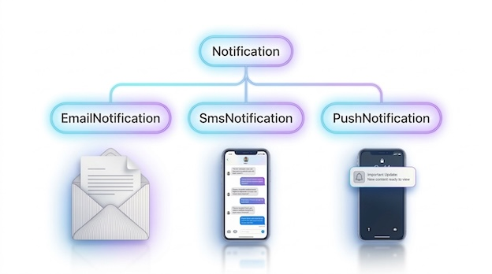
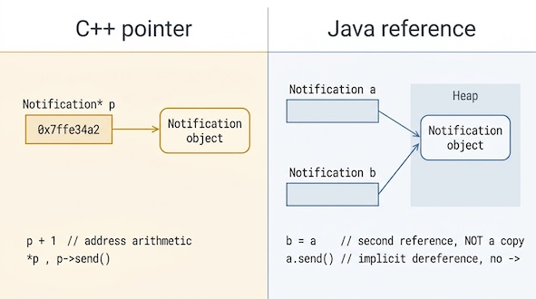
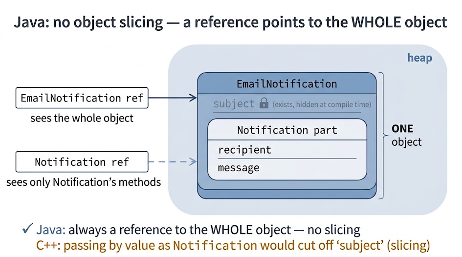
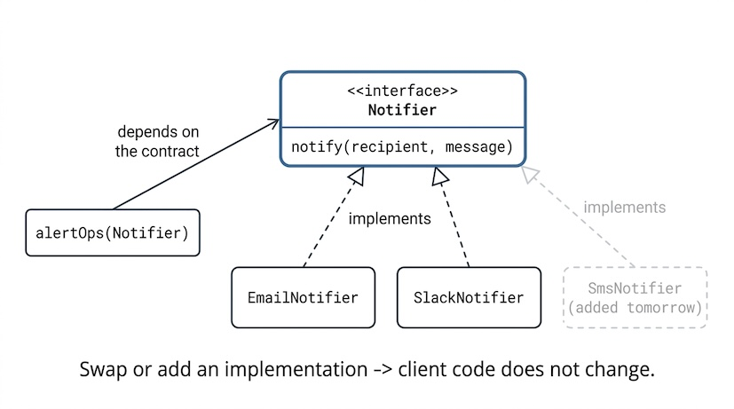

class: center, middle

# Обектно-ориентирано програмиране с Java (част I)



21.10.2026

---

### В предишната лекция разгледахме...

- Java платформата: JVM, bytecode, GC, write once, run anywhere
- Примитивните типове са с фиксиран размер; `boolean` не е число; `char` е 16-битов
- Инстанциите на `String` са immutable обекти, `==` сравнява референции, `.equals()` — съдържание

<br/>

<div style="background:#eef3f7; border-left:5px solid #3b6ea5; padding:10px 16px; margin-top:8px; border-radius:6px;">
🧠 Припомняме си правилото: за обекти <code>==</code> сравнява референции, не съдържание. Днес ще разберем защо и ще му дадем формален договор (<code>equals()</code>/<code>hashCode()</code>).
</div>

---

### Днес ще разгледаме

- Класове и обекти
- Абстрактни класове и интерфейси
- Статични членове, `this` и `super`
- Пакети и видимост
- Фундаменталните ООП принципи
  - Енкапсулация
  - Наследяване
  - Полиморфизъм
  - Абстракция

---

### Обектно-ориентирано програмиране

- **Основен принцип:** Обединяване на данните и операциите, които работят с тях, в една обща структура — обект.
- **Контрол на достъпа:** Скриване на вътрешното състояние на обекта и осигуряване на контролиран достъп до него чрез методи.
- **Моделиране и взаимодействие:** Представяне на системата чрез взаимодействащи си обекти, което улеснява организирането, разбирането и разширяването на кода.

---

### Обект

- Обектът обединява състояние (данни) и поведение (методи).
- Състоянието се определя от стойностите на полетата, а поведението — от методите на обекта.
- Обектът е инстанция на даден клас.
- Обектите се създават по време на изпълнение на програмата и обичайно се разполагат в heap паметта. Променливите от референтен тип съдържат референции към обектите.

---

### Създаване на обекти

```java
String message = new String("Operation completed.");
Integer studentsCount = Integer.valueOf(60);
int[] intArr = new int[100];
String[] stringArr = {"Some", "example"};
stringArr = new String[]{"Changed", "my", "mind"};
```

---

### 🪤 Капан: обектът е в heap-а, променливата е референция

```java
Notification a = new Notification("Добре дошли!");
Notification b = a;          // НЕ копие на обекта — втора референция към СЪЩИЯ
```



<div style="background: #eef3f7; border-left: 5px solid #3b6ea5; padding: 8px 16px; margin-top: 8px; border-radius: 6px;">
    <b>Unlearn C++</b> указатели с <code>*</code> или <code>-&gt;</code> адресна аритметика 
    <br>
    <b>Relearn Java</b> променливата е референция към обект в heap-а, а <code>b = a</code> копира референцията, не обекта.
</div>

---

### Клас

- Клас – дефиниция на (клас от) обекти
  - описва състояние чрез член-данни (член-променливи)
  - описва поведение чрез методи
- Конструктор(и)
- Метод(и)
- Възможно е даден клас да няма състояние или да няма поведение
- Всеки клас има определен *интерфейс* – формално описание на начина, по който други обекти могат да взаимодействат с него

---

### Метод на клас

- Функция за манипулиране на състоянието на класа
  - име и списък от параметри (*сигнатура*)
    - броят на параметрите се нарича *арност*
    - два метода имат еднаква сигнатура, ако имат еднакви имена, еднаква арност и еднаква последователност от типове в списъка от параметри
  - модификатори, тип на връщаната стойност, сигнатура и тяло, оградено с `{` `}`
  - тялото може да съдържа декларации на локални променливи и statements
  - може да има странични ефекти

---

### Методи с променлив брой аргументи

- специален вид параметър на метод: редица от нула или повече аргументи от един и същи тип
- Нарича се *varargs*, от *variable arguments*
- Синтаксис: име на тип, следван от три точки (многоточие)
- Ако метод има varargs параметър, той трябва да е един и да е последен в списъка
- При достигане до varargs параметър, компилаторът създава масив от останалите аргументи и ги подава на метода като масив
- В тялото на метода се достъпва като масив

---

### Методи с променлив брой аргументи

```java
// A method that takes variable number of integer arguments
static void funWithVarargs(int... a) {
    System.out.println("Number of arguments: " + a.length);
    // using for-each loop to display contents of a
    for (int i : a) {
        System.out.print(i + " ");
    }
}

public static void main(String[] args) {
    // standard syntax
}

public static void main(String... args) {
    // varargs syntax - equivalent to the above
}
```

<div style="background:#eef3f7; border-left:5px solid #3b6ea5; padding:6px 14px; margin-top:32px; border-radius:6px;">
🧠 Компилаторът превръща varargs параметъра в <b>масив</b> — varargs е "синтактичнa захар" над масив.
</div>

---

### Статични член-променливи и статични методи

- Те са част от класа, а не от конкретна негова инстанция (обект)
- Могат да се достъпват, без да е създаден обект: само с името на класа, точка, името на статичната член-променлива или метод<br>

```java
System.out.println(Math.PI);        // 3.141592653589793
System.out.println(Math.pow(3, 2)); // 9.0
```

---

### Статични член-променливи

- Статичните член-променливи имат едно-единствено копие, което се споделя от всички инстанции на класа
  - ако са константи, пестим памет (няма смисъл да се мултиплицират във всяка инстанция)
  - ако са променливи, всяка инстанция "вижда" и променя една и съща стойност, което е механизъм за комуникация между всички инстанции на дадения клас

---

### Статични методи

- Статичните методи нямат неявна референция `this` и не могат директно да достъпват нестатични членове на текущия обект.
- Нестатичните методи могат да достъпват както нестатични, така и статични членове, ако правилата за достъп го позволяват.

<div style="background:#eef3f7; border-left:5px solid #3b6ea5; padding:6px 14px; margin-top:32px; border-radius:6px;">
🧠 <b>Unlearn (C++):</b> свободни функции и глобални променливи извън клас.<br/>
<b>Relearn (Java):</b> всичко живее в клас. <code>static</code> метод е най-близкото до „глобална функция", <code>static</code> поле — до „глобална променлива".
</div>

---

### Пример за static: споделен брояч

```java
public class NotificationCenter {

    public static final int MAX_RETRIES = 3;   // константа, споделена
    private static int totalSent = 0;          // брояч, споделен от ВСИЧКИ

    public void send(String msg) {
        totalSent++;                           // всяка инстанция променя СЪЩИЯ брояч
    }

    public static int getTotalSent() {         // статичен → без обект
        return totalSent;
    }

}
```

<br/>


```java
System.out.println(NotificationCenter.getTotalSent());
```

---

### Ключовата дума `this`

- Референция към конкретния обект
- Неявно се подава като параметър на всеки конструктор и нестатичен метод на класа
- Употребява се за:
  - достъпване на член-променливи, "скрити" от едноименни параметри на метод или локални променливи
  - извикване от конструктор на друг overloaded конструктор в същия клас
  - извикване на произволен метод на класа

---

### Ключовата дума `this`

```java
public class Notification {
    private String message;

    public Notification() {
        // Извикване на overloaded конструктора със String параметър
        this("(без текст)");
    }

    public Notification(String message) {
        // Достъпване на член-променлива, скрита от едноименен параметър
        this.message = message;
    }

    public void printMessage() {
        System.out.println("Съобщение: " + message);
    }
}
```

---

### Обект - конкретна инстанция на даден клас

```java
public class MainApp {

    public static void main(String[] args) {
        Notification a = new Notification("Коле, получи ли?");
        a.printMessage();

        Notification b = new Notification("Чао");
        b.printMessage();
    }

}
```

---

### Пакети

- Именувани групи от семантично свързани класове
- Служат за йерархично организиране на кода
- Съответстват на директорно дърво на файловата система
- Конвенция за именуване:
  - само малки букви, точка за разделител
  - компаниите използват обърнат домейн адрес
    - `mail.google.com` → `com.google.mail`

---

### Пакети

- всеки Java клас се намира в някакъв пакет
- пакетът се указва в началото на сорс файла (преди дефиницията на класа) с ключовата дума `package`
- ако липсва `package` декларация, класът е в пакета по подразбиране (който няма име) - което е лоша практика<br>

<br/>

```java
package bg.sofia.uni.fmi.mjt.example;

public class Example {
    // class Example is in package bg.sofia.uni.fmi.mjt.example
}
```

---

### Достъп до клас от друг пакет

- Всеки клас има достъп по подразбиране (имплицитно) до:
  - класовете от собствения си пакет
  - класовете в пакета `java.lang`
- Ако искаме клас да има достъп до клас в някой друг пакет, трябва или експлицитно да го заявим с `import` декларация, която поставяме над декларацията на класа, или да се позоваваме до него с пълното му име, което включва и пакета му (не се препоръчва).
- `import` декларацията може да е за конкретен клас с пълното му име: име на пакет + `.` + име на клас, или на всички класове в даден пакет (т.нар. *wildcard import*: име на пакет + `.*`, което обаче е лоша практика откъм clean code)

---

### Достъп до клас от друг пакет

```java
package bg.sofia.uni.fmi.mjt.example;

import java.util.Arrays;
import java.util.Scanner;

public class StringUtils {
    public static void main(String[] args) {
        Scanner scanner = new Scanner(System.in);
        char[] tokens = scanner.nextLine().toCharArray();
        Arrays.sort(tokens);
        // java.util.Arrays.sort(tokens); // the ugly alternative
        System.out.println(tokens);
    }
}
```

---

### Достъп до клас от друг пакет

- Статичните член-данни и методи се достъпват с префикс: името на класа, който ги съдържа и точка<br/>
`double r = Math.cos(Math.PI * 10.0);`
- `import static` конструкцията позволява статичните членове да се ползват директно по името си<br/>

<br/>

```java
import static java.lang.Math.cos;
import static java.lang.Math.PI;
...
double r = cos(PI * 10.0);
```

---

### Достъп до клас от друг пакет

- Прието е `import`-ите да се подреждат в сортиран лексикографски ред по `<package>.<class>`
- По-чисто е да се изброят конкретните класове от пакета, вместо wildcard import (тип `import java.util.*;`)
  - IDE-тата обаче автоматично "collapse"-ват `import`-ите от един и същи пакет над някаква бройка - изключете тази "екстра"

---

### Модификатори за достъп

за top-level клас, т.е. невложен в друг<br>

| Модификатор      | Видимост                                         |
| :--------------- |:------------------------------------------------ |
| `public`         | Достъпен за всеки клас във всеки пакет           |
| без модификатор* | Достъпен само за класовете в собствения си пакет |

<br><small>\* казваме също "package-private", "default"</small>

---

### Модификатори за достъп

За член-променливи и методи на клас<br>

| Модификатор   | Клас | Пакет | Подклас | Всички други |
| :------------ |:----:|:-----:|:-------:|:------------:|
| `public`      | да   | да    | да      | да           |
| `protected`   | да   | да    | да      | не           |
| no modifier   | да   | да    | не      | не           |
| `private`     | да   | не    | не      | не           |

<div style="background:#eef3f7; border-left:5px solid #3b6ea5; padding:6px 14px; margin-top:32px; border-radius:6px;">
🧠 <b>Unlearn (C++):</b> няма <code>friend</code>. Най-близкото е <b>package-private</b> — класовете от един пакет имат достъп до package-private членовете.
</div>

---

class: center, middle

## Част 2 — принципите (I): енкапсулация, наследяване

.font-lg[Но първо — една история за $125 милиона и една изгубена сонда.]

---

### 💥 Mars Climate Orbiter, 23 септември 1999

- NASA пуска сонда за $125 млн. към Марс. Два екипа пишат софтуера: *NASA (JPL)* и *Lockheed Martin*
- Един софтуерен компонент подавал данни за импулса от малки корекции на курса във фунт-секунди (lbf·s), вместо в изискваните нютон-секунди (N·s). 
- И за двата екипа това е бил просто един `double`.
- Месеци наред грешката в изчисленията на малките корекции на курса постепенно отклонява изчислената траектория от действителната.
- На 23 септември 1999 г. Mars Climate Orbiter преминава на около 57 км над повърхността на Марс, вместо да достигне планираната траектория с височина около 140–150 км. Сондата е загубена.

**Извод**: Когато отделни компоненти се разработват от различни екипи, интерфейсите между тях трябва да определят недвусмислено не само формата на данните, но и техните единици и смисъл.

---

### Решението: да се обвие примитива в клас (енкапсулация)

```java
public enum Unit { NEWTONS, POUNDS }  // ще научим какво е следващата седмица

public final class Force {
    private final double value;
    private final Unit unit;

    public Force(double value, Unit unit) {   // всяка сила знае СВОЯТА единица
        this.value = value;
        this.unit = unit;
    }

    public double toNewtons() {
        return unit == Unit.POUNDS ? value * 4.44822 : value;   // безопасно
    }
}
```

---

### Решението: да се обвие примитива в клас (енкапсулация)

```java
// Сега типът носи смисъла — не можеш да сбъркаш:
Force thrust = new Force(150.0, Unit.POUNDS);
calculateTrajectory(thrust.toNewtons());   // еднозначно, проверено
```

<br/>

💼 Терминът за капана *Разчитай на "голи" примитиви вместо на смислени класове* е *primitive obsession* — класически antipattern, който може да срещнете и на интервю.

---

### Енкапсулация

Енкапсулацията адресира основния проблем, мотивирал създаването на ООП: по-добро управление на достъпа до споделени данни.

> *„Кой промени баланса по тази сметка на −500?"*

Ако състоянието е публично, отговорът е: потенциално всеки ред в codebase-a. Енкапсулацията свива кръга на заподозрените до няколко места — защото  състоянието се променя само през „врати“, които вие контролирате.

---

### Енкапсулация

- Множеството текущи стойности на член-данните на даден обект се наричат негово *състояние*
- Само вътрешните методи на даден обект имат достъп до неговото състояние, като правят невъзможни неочакваните промени на състоянието от външния свят
- В Java се постига чрез модификаторите за достъп

  <div style="background:#eaf5f1; border-left:5px solid #2e7d6b; padding:12px 18px; margin-top:32px; border-radius:6px;">
  📖 <b>Дефиниция — Инвариант (invariant)</b><br/>
  <span style="font-size:0.92em">Условие, което трябва да е <b>винаги</b> вярно за валиден обект (напр. „баланс ≥ 0"). Енкапсулацията съществува, за да се пази
  инвариантът — конструкторът го установява, методите не допускат нарушаването му.</span>
  </div>

---

### Енкапсулация – пример за нарушаване

```java
public class BankAccount {
    public double balance; // нарушена енкапсулация!

    public BankAccount(double balance) {
        this.balance = balance;
    }
}

public class Main {
    public static void main(String[] args) {
        BankAccount acc = new BankAccount(1000);
        acc.balance -= 500; // всеки може да променя баланса директно!
        System.out.println("Баланс: " + acc.balance);
    }
}
```

<br/>

Инвариантът „баланс ≥ 0" може ли да оцелее в така написан код?

---

### Енкапсулация – пример за спазване

```java
public class BankAccount {
    private double balance; // скрито състояние

    public BankAccount(double balance) {
        if (balance >= 0) { this.balance = balance; }
    }
    public void deposit(double amount) {
        if (amount > 0) { balance += amount; }
    }
    public boolean withdraw(double amount) {
        if (amount > 0 && amount <= balance) {   // инвариантът се пази ТУК
            balance -= amount;
            return true;
        }
        return false;
    }
    public double getBalance() {
        return balance;
    }
}
```

---

### Енкапсулация – използване

```java
public class Main {
    public static void main(String[] args) {
        BankAccount acc = new BankAccount(1000);
        acc.withdraw(500); // само чрез метод!
        System.out.println("Баланс: " + acc.getBalance());
    }
}
```

---

### Наследяване

> *„Копирам този код между два класа вече за трети път"*

- Позволява преизползване и разширяване на състояние и поведение на вече съществуващи класове
- Когато клас наследява друг клас, за него казваме, че е *наследник*, или *дете*, или *подклас*, а вторият клас наричаме *родител*, или *базов клас*, или *суперклас*
- В Java се реализира с ключовата дума `extends`
- Класът-наследник получава достъп до всички `public` и `protected` член-променливи и методи на родителския клас
- Java не поддържа множествено наследяване

---

### Пример: йерархия от известия

```java
public class Notification {
    protected final String recipient;
    protected final String message;

    public Notification(String recipient, String message) {
        this.recipient = recipient;
        this.message = message;
    }
    public void send() {
        System.out.println("Изпращам до " + recipient + ": " + message);
    }
}

public class EmailNotification extends Notification {
    private final String subject;

    public EmailNotification(String recipient, String message, String subject) {
        super(recipient, message);        // извиква родителския конструктор
        this.subject = subject;
    }
}
```

---

### Пример: йерархия от известия



---

### Наследяване и method overriding

- Класът-наследник може да предостави собствена дефиниция на (т.е. да предефинира) методи на родителския клас (*method overriding*)

---

### Наследяване и method overriding

- Сигнатурата на метода в класа-родител и класа-наследник трябва да е идентична
- Модификаторът за достъп на метод в класа–наследник трябва да съвпада или да разширява модификатора за достъп на метода в родителския клас (но не може да го свива/ограничава)
- Типът на връщаната стойност трябва да е *съвместим* с този на override-вания метод. Съвместим означава идентичен или наследник (за референтните типове) - *return type covariance*
- Методът в класа-наследник е препоръчително да се анотира с опционалната анотация `@Override`. Така компилаторът ще ни помага да не нарушаваме горните правила

<div style="background:#eef3f7; border-left:5px solid #3b6ea5; padding:6px 14px; margin-top:4px; border-radius:6px;">
🧠 <b>Unlearn (C++):</b> методите са невиртуални по подразбиране, пишеш <code>virtual</code> явно.<br/>
<b>Relearn (Java):</b> <b>всички</b> нестатични методи са виртуални по подразбиране. <code>final</code> ги "заключва" за overriding.
</div>

---

### Method overriding

```java
public class SmsNotification extends Notification {
    public SmsNotification(String recipient, String message) {
        super(recipient, message);
    }

    @Override                             // компилаторът проверява, че наистина override-ваме
    public void send() {
        System.out.println("SMS до " + recipient + ": " + message);
    }
}
```

<br/>

Анотацията `@Override` е опционална, но я ползвайте — грешка в сигнатурата става *грешка при компилация*, не silent бъг.

---

### Ключовата дума `super`

- Употребява се за:
  - достъпване на член-променливи на родителя
  - извикване от конструктор в текущия клас на конструктор в родителския клас
  - извикване на произволен метод на родителския клас
- Не нарушава енкапсулацията - през `super` може да достъпим само `public` и `protected` членове на родителския клас
- За разлика от `this`, не се предава като имплицитен параметър на нестатичните методи и конструкторите. JVM-ът знае йерархията от класове по време на изпълнение и може да достъпи елементите на родителския клас директно, без да му трябва референция

---

### Ключовата дума `super` — пример

```java
public class EmailNotification extends Notification {
    private final String subject;

    public EmailNotification(String recipient, String message, String subject) {
        super(recipient, message); // извикване на родителския конструктор
        this.subject = subject;
    }

    public static void main(String[] args) {
        EmailNotification e =
            new EmailNotification("ivan@fmi.bg", "Здравей", "Тема");
        e.send(); // наследен от родителя метод
    }
}
```

**Vote** ✋: Кой конструктор завършва пръв — на `Notification` или на `EmailNotification`?

---

### Flexible Constructor Bodies (финализирано в Java 25)

- Преди Java 22, ако в конструктор има извикване на друг конструктор с `this(...)` или `super(...)`, това извикване трябваше да е първият statement в тялото
- От Java 22 (preview) това ограничение отпада: финализирано в Java 25
- Възможно е да *инициализираме* полета и да валидираме аргументи преди `super(...)`
- Кодът преди `this(...)`/`super(...)` се нарича *пролог*; след тях — *епилог*
- Прологът може да инициализира полета, но **не** трябва да чете полета на класа и **не** трябва да вика нестатични методи

---

### Йерархията от класове в Java

- Всички класове в Java са (преки или косвени) наследници на класа `java.lang.Object`
- Липсата на множествено наследяване означава, че всеки клас има точно един родител (с изключение на един-единствен клас, `java.lang.Object`, който няма родител).
- Следователно, йерархията от класове е дърво, с `java.lang.Object` в корена

---

### `java.lang.Object`

```java
boolean equals(Object obj)
int hashCode()
String toString()
Object clone()
```

<div style="background:#eef3f7; border-left:5px solid #3b6ea5; padding:6px 14px; margin-top:32px; border-radius:6px;">
🧠 <b>Unlearn (C++):</b> няма универсален базов клас.<br/>
<b>Relearn (Java):</b> всеки клас наследява <code>Object</code> → затова има <code>equals()</code>/<code>hashCode()</code>/<code>toString()</code> навсякъде.
</div>

---

### Връщаме се към нещо от Лекция 1

```java
Student a = new Student("Иван", 61786);
Student b = new Student("Иван", 61786);

a == b           // ?
a.equals(b)      // ?
```

**Vote** ✋: `a.equals(b)` → `true` / `false` / зависи?

---

### `equals()`

- Трябва да го предефинираме, ако сравняваме два обекта за семантично (т.е. смислово) равенство, а не по референциите им (т.е. адреса им в паметта)
- Например, две инстанции на клас `Student` смислово са еднакви (отговарят на един и същи студент), ако факултетните им номера са еднакви – без значение дали референциите са еднакви или не
- Договорът на `equals()` включва рефлексивност, симетричност, транзитивност, консистентност и `false` при сравнение с `null`.

---

### `hashCode()`

- Трябва да го предефинираме, ако сме предефинирали `equals()`
- При предефинирането на `hashCode()`, ако `equals()` връща `true`, `hashCode`-ът на съответните обекти трябва да е равен
- Ако `hashCode`-ът на два обекта е равен, не е задължително `equals()` да връща `true`

---

### `equals` + `hashCode` — как изглежда коректнa реализация

```java
public final class Student {
    private final int facultyNumber;

    @Override
    public boolean equals(Object o) {
        if (this == o) return true;
        if (!(o instanceof Student other)) return false;   // pattern matching (Java 16+)
        return facultyNumber == other.facultyNumber;        // семантична еднаквост
    }

    @Override
    public int hashCode() {
        return Objects.hash(facultyNumber);                 // консистентно с equals
    }
}
```

---

### AI инструмент ви написа този `equals()`

```java
public final class Student {
    private final String email;
    private final int facultyNumber;

    @Override
    public boolean equals(Object o) {
        Student other = (Student) o;                   
        return this.email == other.email
            && this.facultyNumber == other.facultyNumber;
    }
}
```

Vote ✋: коректна ли е тази имплементация?

---

### Операторът `instanceof`

- Използва се за type checking на референтните типове - дали даден обект е инстанция на даден клас

---

### Операторът `instanceof`

```java
Student ivan = new Student("Ivan", 61786);
Human petar = new Human("Petar");

System.out.println(ivan instanceof Student);   // true
System.out.println(ivan instanceof Human);     // true
System.out.println(petar instanceof Student);  // false
System.out.println(petar instanceof Human);    // true

// arrays are reference types
int[] intArr = new int[2];
System.out.println(intArr instanceof int[]);   // true

// null is not an instance of anything: false for any class
System.out.println(null instanceof AnyClass);

// true for any non-null ref, because any class extends java.lang.Object
System.out.println(ref instanceof Object);
```

---

### Pattern matching for `instanceof` (since Java 16)

```java
// before
if (obj instanceof String) {
    int stringLength = ((String) obj).length();
}

// since Java 16 (preview feature in Java 14 & 15)
if (obj instanceof String s) {
    int stringLength = s.length();
}
```

---

### Primitive types in pattern matching

```java
int value = ...
if (value instanceof byte b && b > 0) {
    System.out.println("b = " + b);
}
```

<br/>Семантиката е: "ако стойността на value може да се съхрани в byte променлива и е положителна, то я присвои на b и я изведи"

<div style="background:#fff7e6; border-left:5px solid #d08700; padding:8px 16px; margin-top:32px; border-radius:6px;">
⚠️ Все още <b>preview</b> в Java 27 (JEP 532, 5-ти пореден), не е финализирано.
</div>

---

### Ключовата дума `final`

- в декларация на променлива → прави я константа
- в декларация на метод → методът не може да се override-ва
- в декларация на клас → класът не може да се наследява

<div style="background:#eef3f7; border-left:5px solid #3b6ea5; padding:6px 14px; margin-top:32px; border-radius:6px;">
🧠 <code>final</code> изразява архитектурно <i>намерение</i>: вместо да разчитаме на коментари в кода, превръщаме ограниченията в правила, които компилаторът следи и налага автоматично.
</div>

---

### Наследяване vs. Композиция

- **Наследяване** (Inheritance) и **композиция** (Composition) са два основни подхода за изграждане на сложни обекти и преизползване на код в ООП
- И двата имат своите предимства и недостатъци.

---

### Наследяване (Inheritance)

- Позволява на един клас (наследник) да наследи състояние и поведение от друг клас (родител)
- Използва се, когато има естествена йерархия: връзка тип „е вид“ (*is-a*)
- Пример: `public class EmailNotification extends Notification`
- **Предимства:**
  - Лесно повторно използване на код
  - Позволява полиморфизъм
- **Недостатъци:**
  - Води до силно свързване между класовете
  - Промени в родителския клас могат да повлияят на всички наследници
  - Не е подходящо, ако връзката не е от тип „е вид“.

---

### Композиция (Composition)

- Класът съдържа други обекти като свои членове (*has-a* връзка)
- Използва се, когато искаме да изградим сложни обекти чрез комбиниране на по-прости
- Пример:

```java
public class Car {
    private Engine engine;
    private Wheel[] wheels;
}
```

---

### Композиция (Composition)

- **Предимства:**
  - По-слабо свързване между класовете
  - По-голяма гъвкавост – може да сменяме компоненти
  - Улеснява преизползването на код
- **Недостатъци:**
  - Може да изисква повече код за делегиране на методи.

---

### Зависимост и Dependency Injection (DI)

```java
public class OrderService {
    private final NotificationSender sender;          // КОМПОЗИЦИЯ: has-a, не is-a
    public OrderService(NotificationSender sender) {   // подаваме отвън (DI)
        this.sender = sender;
    }
}
```

<br/>

`OrderService` използва `NotificationSender`, без да зависи от конкретна реализация. Зависимостта се подава отвън чрез конструктора, което улеснява подмяната на реализацията и тестването.

---

### Dependency Injection (DI)

<br/>

<div style="background:#eaf5f1; border-left:5px solid #2e7d6b; padding:12px 18px; margin-top:6px; border-radius:6px; font-family: system-ui, -apple-system, BlinkMacSystemFont, 'Segoe UI', Roboto, sans-serif;">
  📖 <b>Дефиниция</b><br/>
  <span style="font-size:0.8em; line-height: 1.25; display: inline-block; margin-top: 4px;"><i>Dependency Injection (DI)</i> е design pattern, който следва архитектурния принцип <i>Inversion of Control (IoC)</i>. При него даден обект не създава сам своите зависимости (обектите, от които се нуждае, за да работи) чрез оператора <code>new</code>, а ги получава готови отвън — най-често през конструктора си. По този начин процесите по „използване“ се отделят напълно от процесите по „създаване“, което прави класовете по-слабо свързани (loosely coupled), по-гъвкави и много по-лесни за тестване.</span>
</div>

<br/>

💼 Класически въпрос на junior интервю: *кога избираме композиция, кога наследяване?* И ще искат от вас да се аргументирате.

---

### Наследяване vs. Композиция: кога кое да избереш? 💬

- **Използвай наследяване**, когато има ясно изразена „е вид“ (*is-a*) връзка и класът-наследник наистина е специализация на родителя
- **Използвай композиция**, когато искаш да комбинираш функционалности, да избегнеш твърдо фиксирана йерархия или да имаш по-гъвкав и лесен за поддръжка код
- Принципът **„предпочитай композиция пред наследяване“** (*"Favor composition over inheritance"*) е широко препоръчван в съвременното ООП
- Наследяването е мощен инструмент, но може да доведе до твърде сложни йерархии и проблеми при промени
- Композицията дава повече гъвкавост и улеснява поддръжката на кода
- Винаги се питай: *„Това наистина ли е специален случай на ... или просто използва ...?“*.

---

class: center, middle

## Част 3 — принципите (II): полиморфизъм, абстракция, интерфейси

---

### Полиморфизъм

> *Утре в спецификацията се появява нов тип Notification. Колко файла ще трябва да пипна?*

- От гръцки: poly (много) + morphe (форма)
- Дефиниция от биологията - съществуване на морфологично различни индивиди в границите на един вид


<div style="background:#eaf5f1; border-left:5px solid #2e7d6b; padding:12px 18px; margin-top:6px; border-radius:6px;">
  📖 <b>Дефиниция</b> — В контекста на ООП, <i>полиморфизъм (polymorphism)</i> e способността един и същи код да работи с обекти от различни типове, като всеки се държи според <b>реалния</b> си тип. В Java — чрез извикване на предефиниран метод през референция от родителски тип (динамично свързване по време на изпълнение).</span>
</div>

---

### Полиморфизъм

- ООП - наследниците на даден клас споделят поведение от родителския клас, но могат да дефинират и собствено поведение
- Полиморфизмът позволява чрез референция от даден базов тип или интерфейс да работим с обекти от различни конкретни типове. При предефинирани нестатични методи Java избира изпълнението според реалния тип на обекта по време на изпълнение.

---

### Method overriding vs method overloading

- *Overriding* - класът-наследник предефинира поведението на класа-родител
- *Overloading* - класът декларира методи с едно и също име и различен брой и/или тип параметри

---

### Runtime полиморфизъм чрез method overriding

```java
public class Notification {
    protected final String recipient;
    protected final String message;

    public Notification(String recipient, String message) {
        this.recipient = recipient;
        this.message = message;
    }
    public void send() {
        System.out.println("Изпращам до " + recipient + ": " + message);
    }
}
```

---

### Runtime полиморфизъм чрез method overriding

```java
public class EmailNotification extends Notification {
    private final String subject;

    public EmailNotification(String recipient, String message, String subject) {
        super(recipient, message);
        this.subject = subject;
    }

    @Override
    public void send() {
        System.out.println("Email до " + recipient
            + " [" + subject + "]: " + message);
    }
}
```

---

### Compile-time полиморфизъм чрез method overloading

```java
public class Notifier {
    public void send() {
        System.out.println("Изпращам с настройки по подразбиране.");
    }

    public void send(int priority) {
        System.out.println("Изпращам с приоритет " + priority);
    }
}

public class Main {
    public static void main(String[] args) {
        Notifier n = new Notifier();
        n.send();
        n.send(1);
    }
}
```

---

### Method overriding vs method overloading

<br>

|                                       | __Overloading__       | __Overriding__           |
| :------------------------------------ | :-------------------- | :----------------------- |
| Кога                                  | Compile-time          | Runtime                  |
| Къде                                  | В същия клас          | В класовете наследници   |
| Списък от аргументи                   | Различен              | Идентичен                |
| Return type                           | Може да бъде различен | Съвместим                |
| `static`, `private` и `final` методи  | Да                    | Не                       |
| Свързване (binding)                   | Статично              | Динамично                |

---

### Non-polymorphic code

```java
Notification[] all = {email, sms, push};

for (Notification n : all) {
    if (n instanceof EmailNotification) {
        ((EmailNotification) n).send();
    } else if (n instanceof SmsNotification) {
        ((SmsNotification) n).send();
    } else if (n instanceof PushNotification) {
        ((PushNotification) n).send();
    }
}
```

---

### Non-polymorphic code

```java
Notification[] all = {email, sms, push};

for (Notification n : all) {
*   if (n instanceof EmailNotification) {
*       ((EmailNotification) n).send();
*   } else if (n instanceof SmsNotification) {
*       ((SmsNotification) n).send();
*   } else if (n instanceof PushNotification) {
*       ((PushNotification) n).send();
*   }
}
```
<br/>

`instanceof` и explicit cast са "червените лампички". Нов тип утре → нов else if тук. И навсякъде другаде, където има такъв if-else chain.

---

### Polymorphic code

```java
Notification[] all = {email, sms, push};

for (Notification n : all) {
    n.send();                // всеки се държи според реалния си тип
}

```
<br/>

Полиморфният код е не само по-кратък и четим. Помислете как трябва да се променят двата фрагмента, ако се появят нови типове нотификации.

---

### Абстрактни класове

- Дефинират се с модификатора `abstract`
- Могат да имат методи без имплементация, които се декларират с модификатора `abstract`
- Не са напълно дефинирани (оставят на наследниците си да ги конкретизират/допълнят) 
    - не могат да се създават обекти от тях
- Един клас не може да бъде едновременно `abstract` и `final` – защо?

---

### Абстрактни класове - пример

```java
public abstract class Notification {
    protected final String recipient;

    public Notification(String recipient) {
        this.recipient = recipient;
    }

    public final void log() {                  // обща, готова логика
        System.out.println("Известие до " + recipient);
    }

    public abstract void send();               // БЕЗ тяло — наследникът решава как
}
```

<br/>

Реалната полза: абстрактният клас дава *обща рамка* (`log()`) + *задължава* наследника да дефинира специфичното (`send()`).

---

### Интерфейси

> *Нужно е да изпратим съобщение през различни канали (имейл, push известие, SMS), но те нямат общ родителски клас.*

- Съвкупност от декларации на методи без имплементация
- Описват формално поведение, без да го имплементират
- Може да съдържат `static` `final` член-променливи == константи

<div style="background:#eef3f7; border-left:5px solid #3b6ea5; padding:6px 14px; margin-top:32px; border-radius:6px;">
🧠 <b>C++:</b> чисто виртуален клас (<code>virtual void f() = 0;</code>) ≈ Java интерфейс; abstract class ≈ Java <code>abstract class</code>. Java разделя тези две концепции чрез отделни езикови средства.
</div>

---

### Интерфейс = контракт = договор

```java
public interface Notifier {
    void notify(String recipient, String message);
}

public class EmailNotifier implements Notifier {
    public void notify(String recipient, String message) { /* SMTP */ }
}

public class SlackNotifier implements Notifier {
    public void notify(String recipient, String message) { /* Slack API */ }
}
```

<br/>

```java
// Използващият код вижда само ДОГОВОРА — не знае коя имплементация е:
public void alertOps(Notifier notifier) {      // "program to an interface"
    notifier.notify("ops", "Диск на 95%!");
}
```

---

### Интерфейс = контракт = договор



Смяна на имплементацията = нула промени в клиента. Това е разделянето „какво" от „как".

---

### Методи на интерфейсите

- Методите на интерфейсите са `public` и `abstract` по подразбиране
- Модификаторите `public` и `abstract` (заедно или поотделно) могат да бъдат указани и експлицитно
  - дали да бъдат експлицитно указани, е въпрос на стил - но е добре да сме консистентни
- Тъй като методите са абстрактни, не могат да бъдат декларирани като `final`

---

### Интерфейси и наследяване

- Интерфейсите могат да се наследяват
- Един интерфейс може да наследява множество интерфейси

---

### Интерфейсите и имплементациите им

- Интерфейсите не могат да се инстанцират
- Можем да инстанцираме (конкретни) класове, които ги имплементират
- Можем да присвояваме инстанция на клас на променлива от тип интерфейс, който класът имплементира
- Можем да проверяваме с `instanceof` дали клас имплементира даден интерфейс
- Един клас може да имплементира множество интерфейси

---

### Интерфейси и имплементациите им

- Ако даден клас декларира, че имплементира интерфейс, той трябва или
  - да даде дефиниции на *всичките* му методи, или
  - да бъде деклариран като абстрактен
- Като следствие, ако променим сигнатурата на метод(и) на интерфейса, или ако добавим нов(и) метод(и), трябва да променим и всички имплементиращи интерфейса класове
- Това често е проблем, а понякога е и невъзможно (нямаме контрол върху всички имплементации)

---

### Default методи в интерфейсите (от Java 8)

- Default-ен метод в интерфейс е метод, който
  - има имплементация
  - има модификатора `default` в декларацията си
- Имплементиращите класове имплицитно ползват default-ната имплементация на методите, но могат и да я предефинират

---

### Default методи в интерфейсите (от Java 8)

- Клас може да имплементира произволен брой интерфейси
- Ако класът наследява конфликтни `default` реализации от несвързани интерфейси, трябва да предефинира метода и да разреши конфликта.
- В предефинирания метод може експлицитно да се укаже, default-ната имплементация от кой родителски интерфейс да се ползва. В този случай, синтаксисът е `<interfaceName>.super.<defaultMethodName>()`

---

### Default методи и diamond problem

```java
public interface OptimisticLockable {
    default boolean isLocked() {
        return false;
    }
}
public interface PessimisticLockable {
    default boolean isLocked() {
        return true;
    }
}
public class Door implements OptimisticLockable, PessimisticLockable {
    // Compile-time error ако не override-нем:
    // - "Door inherits unrelated defaults for isLocked() from types
    //        OptimisticLockable and PessimisticLockable"
    @Override
    public boolean isLocked() {
        return OptimisticLockable.super.isLocked();
    }
}
```

---

### Default методи и diamond problem

```java
public class Door implements OptimisticLockable, PessimisticLockable {
    // Compile-time error ако не override-нем:
    // - "Door inherits unrelated defaults for isLocked() from types
    //        OptimisticLockable and PessimisticLockable"
    @Override
    public boolean isLocked() {
        return OptimisticLockable.super.isLocked();
    }
}
```

<div style="background:#eef3f7; border-left:5px solid #3b6ea5; padding:6px 14px; margin-top:32px; border-radius:6px;">
🧠 Да — това прилича на диамантения проблем, от който в C++ ви боли главата. Java обаче го решава просто: при конфликт <b>трябва</b> да override-неш и явно да избереш имплементация.
</div>

---

### Статични методи в интерфейсите (от Java 8)

- От Java 8, интерфейсите могат да съдържат и статични методи с имплементация
- Една класическа употреба е за *factory* методи (ще говорим за тях в лекцията за design patterns)

---

### Private методи в интерфейсите (от Java 9)

- От Java 9, интерфейсите могат да съдържат и `private` методи с имплементация
- Използват се, когато в интерфейса има два или повече default-ни или статични метода, чиято имплементация частично се дублира
  - тогава изнасяме повтарящия се код в `private` метод, за да предотвратим code duplication

---

### Интерфейсите - обобщение

- Интерфейсите могат да съдържат
  - Публични, абстрактни методи без имплементация
  - `static` `final` член-променливи == константи
  - `default` и `static` методи с имплементация (от Java 8)
  - `private` методи (от Java 9)

---

### Интересни частни случаи на интерфейси

- Интерфейс, който
  - не съдържа нито един метод, се нарича *маркерен*
  - има точно един публичен абстрактен метод, се нарича *функционален*

---

### Абстракция

> *Викам `"FMI".length()` и `Math.sqrt(144)` всеки ден.<br/>Знам ли как работят вътрешно? Не. И точно затова съм продуктивен.*

- Абстракция означава, моделирайки в обектно-ориентиран език за програмиране обекти от реалния или виртуалния свят, да се ограничим само до съществените им за конкретната задача характеристики и да се абстрахираме (пропуснем) в модела несъществените или нерелевантни за задачата
  - Пример: моделирайки студент, да го характеризираме само с име и факултетен номер, абстрахирайки се от всички други характеристики на студента в реалния свят (напр. цвят на очите)

---

### Абстракция

- Абстракция също означава да работим с нещо, което знаем как да използваме, без да знаем как работи вътрешно. Всяка конкретна имплементация на поведение е скрита в своя обект, за външния свят е видимо само поведението (т.е. интерфейсът)
- Принципът за абстракция се постига в Java чрез интерфейси и абстрактни класове

---

### 🎬 Cliffhanger

```java
public final class Student {
    private final int facultyNumber;

    // конструктор + equals() + hashCode()
    // + toString() + getters()...
    // ... 20+ реда за клас с ЕДНО поле
}
```

<br/>

Следващата седмица ще го напишем на **един ред**, когато разгледаме `record`. Плюс: `sealed` типове („само тези наследници и нито един повече"), `enum`-и и exceptions.

---

## Въпроси?

.font-xl[.ri-github-fill.icon-inline[[fmi/java-course](https://github.com/fmi/java-course)]]

.font-xl[.ri-youtube-fill.icon-inline[[MJT2027](https://www.youtube.com/playlist?list=PLO1UIjXfc0-k)]]
