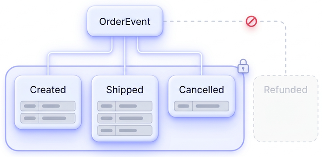
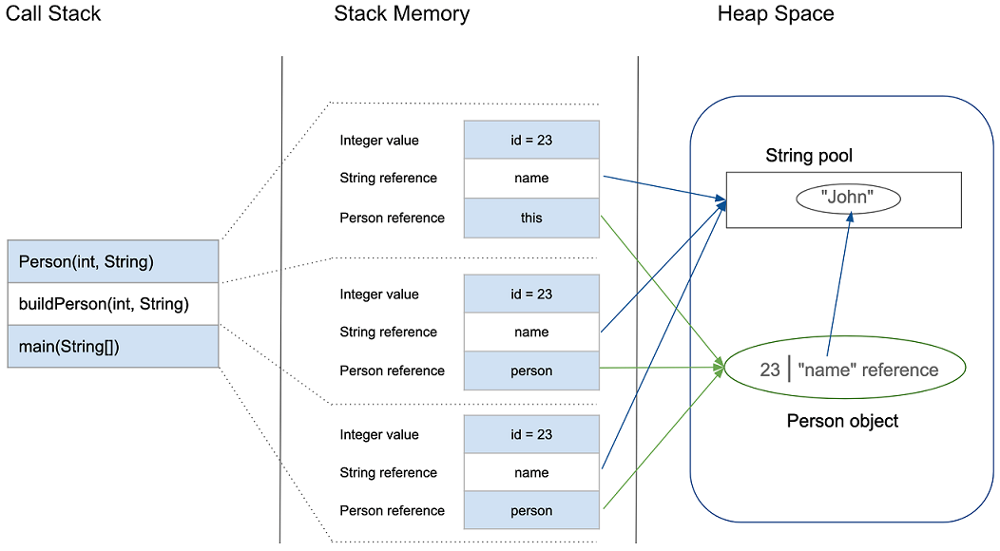
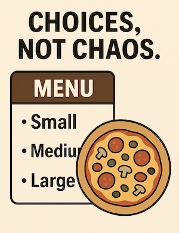
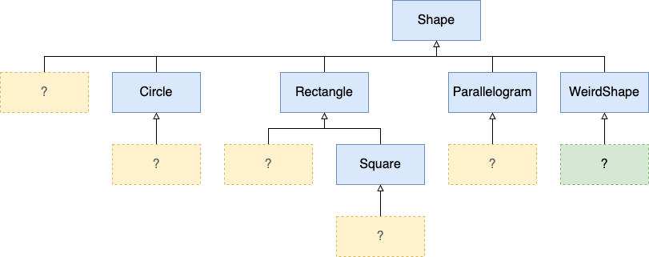
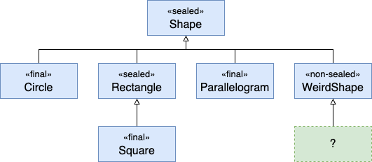
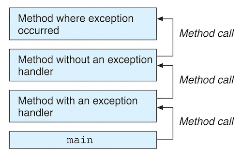
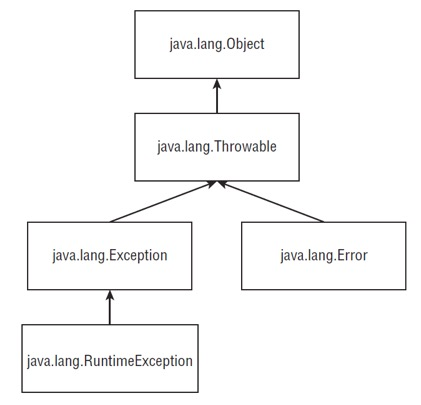
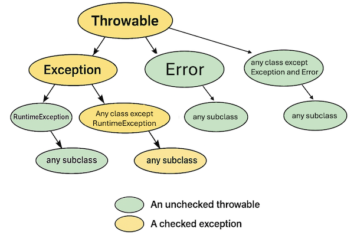
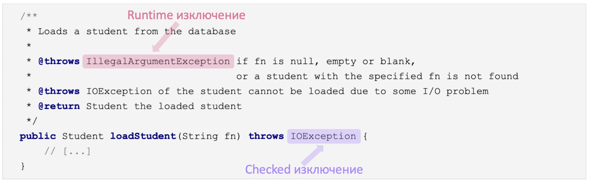

class: center, middle

# Обектно-ориентирано програмиране с Java (част II)



28.10.2026

---

### Миналата лекция завършихме с едно обещание

```java
public final class Student {
    private final int facultyNumber;
    // конструктор + equals() + hashCode() + toString() + getters()
    // ... 20+ реда за клас с ЕДНО поле
}
```

<div style="background:#eef3f7; border-left:5px solid #3b6ea5; padding:10px 16px; margin-top:32px; border-radius:6px;">
🧠 Днес този клас ще стане <b>един ред</b> (<code>record</code>), ще "заключим" йерархии (<code>sealed</code>), ще се запознаем с изброимите типове (<code>enum</code>) и ще се научим да се <i>проваляме безопасно</i> (изключения).
</div>

---

### Предната лекция говорихме за:

- Класове и обекти
- Абстрактни класове и интерфейси
- Фундаменталните ООП принципи
  - Енкапсулация
  - Наследяване
  - Полиморфизъм
  - Абстракция

---

### Днес ще разгледаме:

- Някои важни детайли (аргументи, stack/heap)
- Enums
- Records
- Sealed класове и интерфейси
- Изключения

---

class: center, middle

## Част 1 — моделиране на данни (I)

---

### Преди да продължим

```java
Person p1 = new Person(23, "John");
Person p2 = p1;
p2.name = "Jane";
System.out.println(p1.name);   // ?
```

**Vote** ✋: извежда се `"John"` / `"Jane"` / грешка при компилация?

---

### Предаване на аргументи в Java

- конструкторите и методите имат списък от (нула или повече) *параметри* (или *формални параметри*)
- параметрите са списък (наредена n-торка) от тип и име на параметъра
- при извикване на конструктора или метода, се подава списък от *аргументи* (или *фактически параметри*), които трябва да са съвместими като брой, подредба и тип със списъка параметри

---

### Предаване на примитивни типове като аргументи

Примитивните типове се предават по стойност, т.е. създават се техни копия и промяната на стойностите на параметрите вътре в конструктора или метода не се отразява на стойностите на променливите, подадени като аргументи.

---

### Предаване на примитивни типове като аргументи

```java
public class PassPrimitiveByValue {

    public static void main(String... args) {
        int x = 3;
        // invoke passMethod() with 
        // x as argument
        passMethod(x);
        // print x to see if its 
        // value has changed
        System.out.println("After invoking passMethod(), x = " + x);
    }

    // change parameter in passMethod()
    public static void passMethod(int p) {
        p = 10;
    }

}
```

---

### Предаване на референтни типове като аргументи

Референтните типове (обекти, масиви) също се предават по стойност: референциите, подадени като аргументи, имат същата стойност (т.е. сочат към същото място в паметта), както и преди извикването.
Стойностите на член-данните на реферираните обекти обаче могат да се променят в метода, ако е налице необходимият достъп (в смисъл на енкапсулация) до тях.

---

### Предаване на референтни типове като аргументи

```java
public void moveCircle(Circle circle, int deltaX, int deltaY) {
    // code to move origin of circle to x + deltaX, y + deltaY
    circle.setX(circle.getX() + deltaX);
    circle.setY(circle.getY() + deltaY);
        
    // code to assign a new reference to circle
    circle = new Circle(0, 0);
}

// [...]

moveCircle(myCircle, 23, 56);
// myCircle reference remains unchanged,
// but coordinates of the referred circle are changed after the call
```

<div style="background:#eef3f7; border-left:5px solid #3b6ea5; padding:6px 14px; margin-top:32px; border-radius:6px;">
🧠 <b>Unlearn (C++):</b> истински референции (<code>T&amp;</code>) и указатели (<code>T*</code>).<br/>
<b>Relearn (Java):</b> <b>всичко</b> се предава по стойност. За обект „стойността" е референцията — тя се копира.
</div>

---

### Декларация vs. инициализация, stack vs. heap

```java
public class Person {
    int id;
    String name;

    public Person(int id, String name) {
        this.id = id;
        this.name = name;
    }
}
public class PersonBuilder {
    private static Person buildPerson(int id, String name) {
        return new Person(id, name);
    }

    public static void main(String[] args) {
        int id = 23;
        String name = "John";
        Person person = null;
        person = buildPerson(id, name);
    }
}
```

---

<iframe src="java-memory-visualizer.html" style="border:none; width:100%; height:100%; display:block;">

---

.center[]

---

### Stack vs. Heap — накратко

<br/>

| | **Stack** | **Heap** |
| :-- | :-- | :-- |
| Какво пази | локални променливи, параметри, референции | обекти, вкл. масиви |
| Заделяне | автоматично при извикване на метод | с `new` (явно/неявно) |
| Освобождаване | при изход от метода | от garbage collector-a |
| Скорост | по-бърз | по-бавен |
| Препълване | `StackOverflowError` | `OutOfMemoryError` |

.font-sm[Новосъздаваните обекти стоят в heap-a, а референциите към тях — в stack-а.]

---

### Инициализация на обектите

- Полетата получават стойност по подразбиране, после могат да се инициализират явно или в конструктор.
- За сложна логика при статични полета съществуват *инициализационни блокове* (`static { ... }` и `{ ... }`):

```java
public class InitializeMe {
    private int a;
    private static int b;
    static { b = 100; }   // static initializer — изпълнява се веднъж, при зареждане на класа
    { a = 5; }            // instance initializer — преди конструктора, за всяка инстанция
}
```

<div style="background:#eef3f7; border-left:5px solid #3b6ea5; padding:6px; font-size:0.9em; line-height:1.3; margin-top:32px; border-radius:6px;">
🧠 Има строг <b>ред на инициализация</b> (static полета/блокове → instance полета/блокове → конструктор, базов клас преди наследник). В практиката рядко го пишете в пълен вид — важно е да го разпознавате, не да го наизустявате.
</div>

---

class: center, middle

## Enums

.center[]

---

### Enum

- Специален референтен тип (клас), представящ фиксирано множество от инстанции - константи
- Нарича се *enum(eration)*, защото инстанциите се дефинират чрез изброяване

---

### Enum

```java
public enum Day {
    SUNDAY,
    MONDAY,
    TUESDAY,
    WEDNESDAY,
    THURSDAY,
    FRIDAY,
    SATURDAY
}
```

---

### Enum

- Всеки `enum` неявно наследява абстрактния клас `java.lang.Enum`
  - не може да наследява явно друг клас, защото би било множествено наследяване
  - може да имплементира интерфейси
- Тялото на `enum` класа може да съдържа член-променливи и методи
- Ако има конструктор, той трябва да е package-private или `private`
- Той автоматично създава константите в дефиницията на `enum`-a. Не може да се извиква явно

<div style="background:#eef3f7; border-left:5px solid #3b6ea5; padding:6px 14px; margin-top:32px; border-radius:6px;">
🧠 <b>Unlearn (C++):</b> <code>enum</code>/<code>enum class</code> е предимно именувано цяло число.<br/>
<b>Relearn (Java):</b> <code>enum</code> е <b>пълноценен клас</b> — с конструктор, полета, методи, може да имплементира интерфейси. Всяка константа е обект-singleton.
</div>

---

### Enum

```java
public class EnumExample {
    private Day day;
    
    public EnumExample(Day day) { this.day = day; }

    public void tellItLikeItIs() {
        String message = switch (day) {
            case MONDAY -> "Mondays are bad.";
            case FRIDAY -> "Fridays are better.";
            case SATURDAY, SUNDAY -> "Weekends are best.";
            default -> "Midweek days are so-so.";
        };
        System.out.println(message);
    }

    public static void main(String[] args) {
        EnumExample example = new EnumExample(Day.TUESDAY);
        example.tellItLikeItIs();
    }
}
```

---

### Enum

- Компилаторът добавя автоматично и няколко специални статични методи:
  - `values()` - връща масив, съдържащ всички стойности в `enum`, в реда, в който са изброени в декларацията
  - `valueOf(String name)` - връща `enum` константата по даденото име

---

### Enum

```java
public class EnumExample {
    public enum VehicleType {
        CAR(4),
        BICYCLE(2),
        BOAT(0);

        private final int numberOfWheels;

        VehicleType(int numberOfWheels) {
            this.numberOfWheels = numberOfWheels;
        }

        public int getNumberOfWheels() { return numberOfWheels; }
    }

    public static void main(String[] args) {
        for (VehicleType vt : VehicleType.values()) {
            System.out.printf("A %s has %d wheels \n", vt, vt.getNumberOfWheels());
        }
    }
}
```

---

class: center, middle

## Част 2 — моделиране на данни (II): records & sealed

---

class: center, middle

## Records

.center[]

---

### Records (от Java 16)

- една от най-честите критики към Java е, че се пише доста *boilerplate* код
- например, за почти всеки клас, се налага да дефинираме публичен конструктор, getter методи, `toString()`, `equals()` и `hashCode()`
- за много класове, те имат стандартни, тривиални имплементации и могат да бъдат генерирани автоматично (IDE-тата имат такава функционалност)
- дори като автори на класа да ги генерираме автоматично обаче, проблемът остава за четящите кода

---

### Обещанието от миналата лекция

```java
public record Student(int facultyNumber) {}
```

<div style="background:#eef3f7; border-left:5px solid #3b6ea5; padding:8px 16px; margin-top:32px; border-radius:6px;">
🧠 Един ред. Компилаторът генерира конструктора, getter-а <code>facultyNumber()</code>, и <b>коректни по дефиниция</b> <code>equals()</code>/<code>hashCode()</code>/<code>toString()</code>. 20+ реда от примера от миналата седмица изчезнаха.
</div>

---

### Records

- както enums, records са нов референтен тип и са (ограничен) вид клас
- описват компактно т.нар *value objects* - класове, които имат само състояние: състоят се от "полетата, само полетата и нищо освен полетата"
- може да мислим за тях като за именувана наредена n-торка стойности
- те са (shallowly) immutable агрегации на фиксирано множество от стойности, известни като *компоненти* на record-a

<div style="background:#eaf5f1; border-left:5px solid #2e7d6b; padding:6px 12px; margin-top:32px; border-radius:6px; font-size:0.9em; line-height:1.3;">
  📖 <b>Дефиниция — Value object</b><br/>
  Обект, чиято идентичност се определя от стойността му, а не от референцията. Два value object-а с еднакви стойности са равностойни и взаимозаменяеми — затова <code>record</code> генерира
  <code>equals()</code> и <code>hashCode()</code> на базата на компонентите си.
</div>

---

### Records

```java
public record Point(int x, int y) {}

// [...]

Point p = new Point(-1, 2);
System.out.println(p.x() + ", " + p.y());
```

---

### Records

- компилаторът автоматично генерира boilerplate кода за
  - `private` `final` член-данна за всяко поле, със същото име и тип
  - *каноничен* конструктор: със списък с параметри, отговарящ на декларираното описание на състоянието
  - getter методи за полетата (имената им съвпадат с имената на съответните полета)
  - `equals()`, `hashCode()` и `toString()`
      - ако `r` е record от тип `R` с компоненти `c1, c2, ..., cN`, и създадем копие на инстанцията като `R copy = new R(r.c1(), r.c2(), ..., r.cN())`, то `r.equals(copy) == true`
  - компонентите на `record`-ите могат да имат анотации, например `@NotNull`

---

### Records

- инстанции се създават с оператора `new`
- всички records имплицитно наследяват абстрактния клас `java.lang.Record`, самите те са `final` и не могат да са `abstract`
- `java.lang.Record` не може да бъде явно наследяван
- той дефинира `equals()`, `hashCode()` и `toString()` като абстрактни методи

---

### Пример: без records

```java
public final class FXOrderClassic {

    private final int units;
    private final CurrencyPair pair;
    private final Side side;
    private final double price;
    private final LocalDateTime sentAt;

    public FXOrderClassic(int units, CurrencyPair pair, Side side,
                               double price, LocalDateTime sentAt) {
        this.units = units;
        this.pair = pair; // CurrencyPair is an enum, e.g. CurrencyPair.USD_TO_EUR
        this.side = side; // Side is an enum, e.g. Side.BID or Side.ASK
        this.price = price;
        this.sentAt = sentAt;
    }

    // continues on next screen...
```

---

### Пример: без records

```java
    // ...continues from previous screen
    public int units() {
        return units;
    }

    public CurrencyPair pair() {
        return pair;
    }

    public Side side() {
        return side;
    }

    public double price() {
        return price;
    }

    public LocalDateTime sentAt() {
        return sentAt;
    }
    // continues on next screen...
```

---

### Пример: без records

```java
    // ...continues from previous screen

    @Override
    public boolean equals(Object o) {
        if (this == o) {
            return true;
        }
        if (!(o instanceof FXOrderClassic)) {
            return false;
        }

        FXOrderClassic that = (FXOrderClassic) o;
        return units == that.units &&
                Double.compare(that.price, price) == 0 &&
                pair == that.pair &&
                side == that.side &&
                sentAt.equals(that.sentAt);
    }

    // continues on next screen...
```

---

### Пример: без records

```java
    // ...continues from previous screen

    @Override
    public int hashCode() {
        return Objects.hash(units, pair, side, price, sentAt);
    }

    @Override
    public String toString() {
        return "FXOrderClassic{" +
                "units=" + units +
                ", pair=" + pair +
                ", side=" + side +
                ", price=" + price +
                ", sentAt=" + sentAt +
                '}';
    }

}
```

---

### Същия пример: с records
```java
public record FXOrder(int units,
                      CurrencyPair pair,
                      Side side,
                      double price,
                      LocalDateTime sentAt) {}
```

<br/>

💼 На Junior интервю: *„Какво точно ти генерира компилаторът за този record?"*

Конструктор, getters, `equals`/`hashCode`/`toString`, всичко консистентно.

---

### Records

- опционално, освен едноредова декларация, record-ите могат да съдържат допълнителни конструктори, методи, статични член-данни и статични *factory* методи
- ако обаче се изкушаваме да дефинираме такива, да имплентираме допълнителни интерфейси и т.н., вероятно по-добро дизайн решение би било да създадем обикновен клас

---

### Records

- изключение са т.нар. *компактни конструктори*: в тялото на каноничния конструктор, добавяме само валидация и/или нормализация на параметрите, а останалата част от кода (присвояванията на полетата) се осигурява от компилатора
- компактните конструктори нямат параметри, пропускат се дори празните скоби `()`
- кодът в компактния конструктор се добавя като допълнителен код в началото на дефиницията на каноничния конструктор (а не е отделен конструктор)

---

### Пример: record с компактен конструктор

```java
public record FXOrder(int units, 
                      CurrencyPair pair, 
                      Side side, 
                      double price, 
                      LocalDateTime sentAt, 
                      int ttl) {

    public FXOrder {
        if (units < 1) {
            throw new IllegalArgumentException("FXOrder units must be positive");
        }
        if (price <= 0.0) {
            throw new IllegalArgumentException("FXOrder price must be positive");
        }
    }

}
```

---

### Пример: record със статичен factory метод

```java
public static FXOrder of(CurrencyPair pair, 
                         Side side, 
                         double price) {

    return new FXOrder(1, pair, side, price, LocalDateTime.now());

}
```

---

class: center, middle

## Sealed класове и интерфейси

.center[]

---

### Sealed класове и интерфейси (от Java 17)

 - `sealed` типовете ни позволяват да ограничим класовете или интерфейсите, които могат да ги наследяват или имплементират
 - така могат да се дефинират възможните йерархии в дадена проблемна област по декларативен начин

---

### Проблемът: всеки може да те наследи

На теория, стига да е `public` и да **не е** `final`, всеки клас може да бъде наследен — дори когато искаш точно определен, затворен набор типове:

.center[]

Преди `sealed`: само заобиколни решения (`final`, package-private, private конструктори) — всяко с цена върху достъпа.

---

### Решението: `sealed` разделя *достъпност* от *разширяемост*

Намерението „ето тези наследници и нито един повече" е изразено **експлицитно**:

.center[]

---

### Sealed класове

- наследниците на `sealed` клас могат да бъдат `final`, `sealed` или `non-sealed`
- `sealed` клас може да бъде и абстрактен
- `sealed` класът и неговите permitted класове трябва да са в един пакет
- ако `sealed` класовете са кратки и малък брой, те могат да се дефинират в същия сорс файл като родителския клас
  - в този случай, `permits` клаузата може да се пропусне - компилаторът приема за имплицитно permitted класовете в дадения сорс файл

---

### Sealed класове: дефиниции

```java
// sealed класовете декларират, кои класове могат да ги наследяват
public abstract sealed class Shape
    permits Circle, Rectangle, Parallelogram, WeirdShape {...}

// дефиниране на класове - final наследници на sealed клас
public final class Circle extends Shape {...} // OK
public final class Parallelogram extends Shape {...} // OK

// дефиниране на класове - sealed наследници на sealed клас
public sealed class Rectangle extends Shape permits Square {...} // OK
public final class Square extends Rectangle {...} // OK

// дефиниране на класове - non-sealed наследници на sealed клас
public non-sealed class WeirdShape extends Shape {...} // OK 

// не можем да разширяваме йерархията извън зададените ограничения
public class Triangle extends Shape {...} // Compile error
```

---

### Sealed класове и интерфейси

- При `sealed` класовете и интерфейсите, съществува изчерпателен списък от наследниците, който е известен на компилатора, IDE-то и JVM-a, което позволява по-мощен анализ на кода
    - например, `instanceof` и casts могат да проверяват цялата йерархия статично
    - може да използваме "умен" `switch`, който няма нужда от `default` case, ако всички класове са изброени

---

### Sealed класове и интерфейси

```java
public sealed interface OrderEvent
    permits Created, Shipped, Cancelled {}

public record Created(String id, double amount) implements OrderEvent {}
public record Shipped(String id, String courier) implements OrderEvent {}
public record Cancelled(String id, String reason) implements OrderEvent {}
```

<div style="background:#eaf5f1; border-left:5px solid #2e7d6b; padding:10px 16px; margin-top:32px; border-radius:6px;">
📖 <b>Дефиниция — Алгебричен тип данни (ADT)</b><br/>
<span style="font-size:0.9em">Тип, който е „едно измежду краен списък" варианти, всеки със свои данни. <br/> <code>sealed</code> + <code>record</code> е Java-начинът да го изразиш.</span>
</div>

---

### Sealed интерфейси и record patterns (Java 21)

```java
String describe(OrderEvent e) {
    return switch (e) {
        case Created(String id, double amount) -> id + ": created, " + amount;
        case Shipped(String id, String courier) -> id + ": via " + courier;
        case Cancelled(String id, String reason) -> id + ": " + reason;
    };                       // без default — и въпреки това изчерпателен!
}
```

<div style="background:#eef3f7; border-left:5px solid #3b6ea5; padding:8px 16px; margin-top:32px; border-radius:6px;">
🧠 <b>Record pattern</b> "разглобява" record-а направо в switch-а: <code>case Created(String id, double amount)</code> изважда полетата наготово. Няма cast, няма getter boilerplate.
</div>

---

### Sealed класове и интерфейси: компилаторът ти става code reviewer

```java
public record Refunded(String id, double amount)
        implements OrderEvent {}
```

Добавиш ли `Refunded` към `permits` на `OrderEvent`, компилаторът ще открие всеки `switch`, който вече не покрива всички разрешени типове:

```text
error: the switch expression does not cover all possible input values
```

<div style="background:#eef3f7; border-left:5px solid #3b6ea5; padding:8px 16px; margin-top:32px; border-radius:6px; font-size:0.9em; line-height:1.3;">
🧠 <b>Мисловен модел:</b> направи невалидните състояния непредставими и остави компилатора да проверява изчерпателността.

Същата идея в Rust: <code>enum</code> + <code>match</code>, Haskell: ADT и pattern matching, TypeScript: discriminated unions. Java я прилага чрез <code>sealed</code> типове и pattern matching в <code>switch</code>.
</div>

---

### AI реши да ви „поправи" switch-а. Приемате ли предложението?

```java
String describe(OrderEvent e) {
    return switch (e) {
        case Created c   -> c.id() + ": created";
        case Shipped s   -> s.id() + ": shipped";
        case Cancelled c -> c.id() + ": cancelled";
        default -> "unknown event";   // за всеки случай
    };
}
```

**Vote** ✋: по-безопасен ли е този код с добавения `default`?

---

### Отговор: `default`-ът в случая е капан

<div style="background:#fff7e6; border-left:5px solid #d08700; padding:10px 16px; margin-top:32px; border-radius:6px;">
⚠️ С <code>default</code> switch-ът е винаги изчерпателен → компилаторът спира да те предупреждава. Ако добавиш <code>Refunded</code> утре → тихо попада в <code>"unknown event"</code> в production, вместо грешка при компилация сега.
</div>

<br/>

🧠 „Изглежда по-безопасно" ≠ „по-безопасно". Правдоподобно, но грешно: точно такива неща трябва да забелязвате в AI-генериран код. Контрапримерът в случая е новият клас (`Refunded`).

---

### Sealed интерфейси (референция)

```java
sealed public interface Move permits Athlete, Person, Jump, Kick {}

final class Athlete implements Move {}
record Person(String name, int age) implements Move {}
non-sealed interface Jump extends Move {}
sealed interface Kick extends Move permits Karate {}
final class Karate implements Kick {}
```

.font-sm[Наследник на `sealed` интерфейс може да е `final`, `non-sealed` или `sealed`; `record` също може да го имплементира (и е имплицитно `final`).]

---

class: center, middle

## Част 3 — обработка на грешки (изключения)

.center[]

---

class: center, middle

Но първо — една история за $440 милиона, загубени за 45 минути.

---

### 💥 Knight Capital, 1 август 2012 г.: $440 млн. загуба за 45 минути

- Knight Capital е един от най-големите маркетмейкъри на американските фондови пазари
- При внедряване на нова версия на търговския софтуер инженер пропуска да качи новия код на един от осемте сървъра.
- На него остава стар, неизползван код, който новата версия неволно реактивира.
- В 9:30 ч. системата започва да изпраща погрешни поръчки — за ~45 минути трупа огромни позиции и сделки на загуба.
- **Равносметка: $440 млн.** — ~75% от капитала. Knight Capital не оцелява самостоятелно и е придобита.

<div style="background:#eef3f7; border-left:5px solid #3b6ea5; padding:6px 14px; margin-top:20px; border-radius:6px; font-size:0.9em; line-height:1.3;">
  🧠 <b>Най-опасното?</b> Няма срив. Нищо не спира търговията и не алармира екипа — софтуерът продължава да работи, но прави нещо катастрофално погрешно.
</div>

---

### Поуката: Тихият failure е най-скъпият

- Софтуерът е бил в невалидно състояние и въпреки това е продължил да работи.
- Изключенията са механизмът да кажеш „СТОП, нещо е грешно", вместо да продължиш с грешни данни.
- Днес ще видим как се *хвърля* изключение, къде и как се *лови*, и как да **не** го suppress-ваш.

<br/>

💼 На Junior интервю може да те питат: „Разкажи за скъпоструваща грешка в продуктивна система и как изключение/валидация би я хванало."

---

### Обработка на грешки

```java
long factorial(int n) {
    return n == 0 || n == 1 ? 1 : n * factorial(n - 1);
}

// [...]

factorial(5); // 120
factorial(-5); // ? 
```

---

### Обработка на грешки

```java
long factorial(int n) {
    if (n < 0) {
        return -1;
    }
    return n == 0 || n == 1 ? 1 : n * factorial(n - 1);
}

// [...]

long fact = factorial(x);

if (fact != -1) {
   // all fine 
} else {
   // handle the error
}
```

---

### Обработка на грешки

```java
long factorial(int n) {
    if (n < 0) {
        throw new IllegalArgumentException("Factorial is undefined for negative numbers");
    }
    return n == 0 || n == 1 ? 1 : n * factorial(n - 1);
}

// [...]

try {
    // [...]
    long fact = factorial(x);
    // [...]
} catch (IllegalArgumentException e) {
    // handle the error
}
```

---

class: center, middle

## Изключения

---

### Изключение (Exception)

- Събитие (проблем), което се случва по време на изпълнение на дадена програма и нарушава нормалната последователност на изпълнение на инструкциите ѝ
- Още един начин за комуникация на метод с извикващите го: връщана стойност при нормално изпълнение и изключение при проблем

---

### Например...

- Подали сме невалидни входни данни
- Опитваме се да отворим несъществуващ файл
- Мрежата се е разкачила по време на комуникация
- Свършила е паметта на виртуалната машина
- ...

<div style="background:#eaf5f1; border-left:5px solid #2e7d6b; padding:10px 16px; margin-top:8px; border-radius:6px;">
📖 <b>Дефиниция — Изключение (exception)</b><br/>
<span style="font-size:0.9em">Алтернативен тип резултат от изпълнение на метод: вместо върната стойност при нормално изпълнение, методът сигнализира за проблем, който прекъсва изпълнението и се разпространява нагоре по стека, докато някой не го обработи.</span>
</div>

---

### Какво представляват изключенията?
* Java обекти, описващи възникналия проблем.
* Инстанции са на "специални" класове, които се намират в йерархия на наследяване (ще я разгледаме по-късно).

---

### Как се генерира ("хвърля") изключение?

```java
public Object pop() {

    if (size == 0) {
        throw new EmptyStackException();
    }

    // [...]
}
```

---

### Как се обработва ("лови") изключение?

```java
try {

    // код, който може да хвърли изключение

} catch (Exception e) {

    // обработваме изключението ("exception handler")
    // може да има повече от един catch блок

} finally {

    // при нужда, някакви заключителни операции
    // finally блокът е optional, но ако го има,
    // се изпълнява задължително щом влезем в try-a

}
```

---

### Капанът на празния catch

```java
try {
    processOrders();
} catch (Exception e) {
    // TODO: handle later
}
```

**Vote** ✋: какво ще се случи, когато `processOrders()` хвърли изключение?

---

### Капанът на празния catch

```java
try {
    processOrders();
} catch (Exception e) {
    // TODO: handle later
}
```

<div style="background:#fff7e6; border-left:5px solid #d08700; padding:8px 16px; margin-top:32px; border-radius:6px;">
⚠️ Нищо <i>видимо</i>. Изпълнението продължава в <b>невалидно състояние</b> — точно капанът на Knight Capital, в миниатюра. "Погълнатият" stack trace тук може да резултира в часове дебъгване в критичен бъдещ момент.
</div>

---

### Стек на извикванията (call stack)

.center[]

---

### Видове изключения

- Изключителните събития могат да се дължат на грешка на потребителя, бъг в кода или физически ресурс, който не е достъпен
- Делят се на три вида:
  - Checked (Compile-time) exceptions
  - Unchecked (Runtime) exceptions
  - Errors

---

### Видове изключения

.center[]

---

### Checked vs. unchecked throwables

.center[]

---

### Checked exceptions

- Наричат се още *compile-time* exceptions, защото компилаторът ни задължава да ги обработим
- Едно добре написано приложение, би трябвало да ги очаква и да се възстановява от тях

<div style="background:#eef3f7; border-left:5px solid #3b6ea5; padding:6px 14px; margin-top:32px; border-radius:6px;">
🧠 <b>Unlearn (C++):</b> няма checked/unchecked разделение; сигнатурата не изброява хвърляните типове (<code>noexcept</code> е обратното — обещава, че НЕ хвърля).<br/>
<b>Relearn (Java):</b> checked exceptions са <b>наложени от компилатора</b> — или ги лови, или ги декларирай в <code>throws</code>.
</div>

---

### Примери: checked / unchecked / error

**Checked** (очаквано външно условие):
- `FileNotFoundException`, `IOException` — файлова/входно-изходна операция

**Unchecked / `RuntimeException`** (бъг в кода):
- `ArithmeticException` (деление на нула), `ArrayIndexOutOfBoundsException`, `NullPointerException`, `ClassCastException`

**Error** (извън приложението, обикновено от JVM):
- `OutOfMemoryError`, `StackOverflowError`

---

### 🧭 Checked или unchecked exception?

Задай си въпроса: "Проблем в кода ли е, или външно обстоятелство?

<br/>

- **Unchecked** (`RuntimeException`) — грешка в логиката или невалиден аргумент. Примери: `null`, невалиден индекс.

- **Checked** — очакван проблем, който може да се обработи. Примери: липсващ файл, мрежова грешка..

<br/>

💼 Junior интервю: *Каква е разликата между checked и unchecked exceptions?*

**Важно:** Горното е ориентир, не абсолютно правило.

---

### 🧭 Кога да прихвана (catch) и кога да препратя (rethrow)?

- Не можеш да се справиш с проблема ? → Препрати изключението нагоре по стека.
- Можеш да възстановиш работата? → Прихвани го и реагирай на място.
- Предаваш грешката на друга част от програмата? → Превърни я в по-смислено за нея изключение (wrap & rethrow).
- Трябва да освободиш ресурси? → `finally` (или try-with-resources).

<br/>

💡 Защо преобразуваме изключенията? Различните части на програмата виждат един и същ проблем по различен начин. Ще затвърдим това в лекцията за S.O.L.I.D.

---

### 🛒 Пример: как се разделя една програма на слоеве?

<div style="display:flex; flex-direction:column; align-items:center; gap:3px; margin:6px auto; font-size:0.9em; line-height:1.3;">

  <div style="width:72%; padding:7px 10px; box-sizing:border-box; text-align:center; background:#e5efff; border:1px solid #5485c6; border-radius:6px; color:#222;">
    <strong>🖥️ Presentation layer</strong><br>
    <span style="font-size:0.9em;">Интерфейсът за потребителя</span>
  </div>

  <div style="text-align:center; color:#555; line-height:1.1; padding:1px 0;">
    <span style="font-size:1.3em;">↕</span><br>
    <span style="font-size:0.8em;">Заявка / резултат или грешка</span>
  </div>

  <div style="width:72%; padding:7px 10px; box-sizing:border-box; text-align:center; background:#fff0d9; border:1px solid #d69b42; border-radius:6px; color:#222;">
    <strong>⚙️ Business logic layer</strong><br>
    <span style="font-size:0.9em;">Правилата и обработката на поръчката</span>
  </div>

  <div style="text-align:center; color:#555; line-height:1.1; padding:1px 0;">
    <span style="font-size:1.3em;">↕</span><br>
    <span style="font-size:0.8em;">Заявка / резултат или грешка</span>
  </div>

  <div style="width:72%; padding:7px 10px; box-sizing:border-box; text-align:center; background:#dff3e4; border:1px solid #60a477; border-radius:6px; color:#222;">
    <strong>🗄️ Persistence layer</strong><br>
    <span style="font-size:0.9em;">Записване и четене на данни</span>
  </div>

</div>

<div style="background:#fff5d6; border-left:5px solid #d69b42; padding:5px 12px; margin-top:48px; border-radius:6px; font-size:0.9em; line-height:1.3;">
💡 <b>Защо преобразуваме изключенията между словете?</b>
<ul style="margin:4px 0 0; padding-left:22px;">
  <li>Всеки слой има различен контекст. Изключението трябва да стигне до кода, който може да реагира адекватно.</li>
  <li>Базата данни сигнализира за неуспешен запис, а бизнес логиката може да обясни какво означава това за поръчката.</li>
  <li>Преобразуваме изключението, когато горният слой има нужда от контекста на своята задача, а не от техническите подробности на долния.</li>
</ul>
</div>

---

### Преобразуване на изключение на границата между слоевете

```java
try {
    // [...]
} catch (IOException e) {
    // ниското ниво казва „проблем с диска"
    // бизнес логиката казва „не можах да заредя поръчката"
    throw new OrderLoadException("Could not load order", e);   // e = cause, НЕ се губи
}
```
<br/>

<div style="background:#eef3f7; border-left:5px solid #3b6ea5; padding:6px 14px; margin-top:32px; border-radius:6px;">
🧠 Викащият метода по-горе не трябва да знае за дискове и мрежи. Опаковаш в термините на своя слой, но запазваш оригиналния проблем (<code>e</code>) като cause, за дебъгване. Това е <i>exception chaining</i>.
</div>

---

### Деклариране на хвърляни изключения

Ако метод не прехваща/обработва даден checked exception, който може да се хвърли в тялото му, той трябва да го декларира, за да "предупреди" тези, които го викат:

<br>

```java
public void writeList() throws IOException, FileNotFoundException {
    // [...]
}
```

.font-sm[Липсата на изключение в `throws` клаузата означава сигурно, че то е *runtime* (иначе методът не би се компилирал). Декларирането на runtime изключение в `throws` се компилира, но не е прието.]

---

### Деклариране на хвърляни изключения

```java
/**
 * Loads a student from the database
 *
 * @throws IllegalArgumentException if fn is null, empty or blank,
 *                                  or a student with the specified fn is not found
 * @throws IOException if the student cannot be loaded due to some I/O problem  
 * @return Student the loaded student
 */
public Student loadStudent(String fn) throws IOException {
     // [...]
}
```

<br/>

**Vote** ✋: кое изключение от какъв тип е?

---

### Деклариране на хвърляни изключения

.center[]

---

### Catch chain + multi-catch (накратко)

```java
// 1) Верига: от най-специфично към най-общо
try { /* ... */ }
catch (FileNotFoundException e) { /* ... */ }   // по-специфично ПЪРВО
catch (IOException e)           { /* ... */ }   // по-общо после

// 2) Multi-catch: един блок за няколко несвързани типа
try { /* ... */ }
catch (IOException | SQLException e) { /* ... */ }
```

---

### Finally – не само за обработка на изключения

```java
try { 
    // тук може да се хвърлят изключения
    // или да има return/continue/break
} finally {
    // някакъв важен cleanup code -
    // ще се изпълни винаги*, независимо какво се случи в try блока
}
```

<div style="background:#eef3f7; border-left:5px solid #3b6ea5; padding:6px 14px; margin-top:24px; border-radius:6px; font-size:0.9em; line-height:1.25;">
🧠 <b>Unlearn (C++):</b> Няма <code>finally</code> — ресурсите обикновено се освобождават чрез деструктори и RAII.<br/>
<b>Relearn (Java):</b> Няма детерминистично извиквани деструктори като в C++. <code>finally</code> може да се използва за освобождаване на ресурси. За ресурси, които се затварят, предпочитаме <code>try-with-resources</code>, когато е приложимо.
</div>

---

### Подобрен NullPointerException (от Java 14) — накратко

```java
A a = new A();
a.b.c.number = 100;   // b е null
```

before:
```bash
Exception in thread "main" java.lang.NullPointerException
```

since Java 14:
```bash
NullPointerException: Cannot read field "c" because "a.b" is null
```
<br/>

Диагностично удобство.

---

### 💬 Дискусия: checked или unchecked?

- Има тенденция съвременни библиотеки и фреймуърци (дори самото JDK) да предпочитат unchecked изключения.
- **Лагер А:** checked изключенията налагат обработка на фаза компилация → по-ранно хващане на грешки.
- **Лагер Б:** checked изключенията водят до по-труден за четене и писане код и водят до множество `catch` блокове, които само rethrow-ват.

<br/>

**✋ Въпрос** (няма верен и грешен отговор): *вие* към кой лагер бихте се причислили?

---

### Защо да ползваме изключения?

- Отделяме кода за обработка на грешки от останалия → става по-четим
- "Препредаване" на грешки по стека на извикванията
- Групиране и диференциране на различните типове грешки

---

<iframe src="exception-visualizer.html" style="border:none; width:100%; height:100%; display:block;">

---

### FX trading платформата ни: 10 поръчки или 10 милиона — има ли значение?

```java
var orders = loadOrders();

orders.contains(order); // this is fast, right?
```

<br/>

**Vote** ✋: От какво зависи бързодействието на `contains()` и в какъв порядък може да варира: 10x разлика, 1.000x разлика?

---

### Един и същи ред, но типът на `orders` решава всичко

| N orders   | `ArrayList` ops | `ArrayList` time | `HashSet` ops | `HashSet` time |
| ----------:|----------------:|-----------------:|--------------:|---------------:|
| 10         |             ~10 |       < 0.001 ms |            ~1 |     < 0.001 ms |
| 1.000.000  |      ~1.000.000 |            ~2 ms |            ~1 |     < 0.001 ms |
| 10.000.000 |     ~10.000.000 |           ~20 ms |            ~1 |     < 0.001 ms |

.font-sm[\* *Груба оценка за едно търсене, типичен хардуер от 2026. Умножи по всяко търсене в приложението.*]

<div style="background:#eef3f7; border-left:5px solid #3b6ea5; padding:6px 12px; margin-top:16px; border-radius:6px; font-size:0.82em; line-height:1.3;">
    🧠 При <code>ArrayList.contains()</code> броят операции расте линейно с данните, а при <code>HashSet.contains()</code> е практически константен: O(N) срещу O(1). <code>hashCode()</code>
  води директно до един bucket (без обхождане на цялата колекция), а <code>equals()</code> сверява само елементите в него. Предпоставка за O(1) е добре разпределящ <code>hashCode()</code>.
</div>

<div style="background:#f0f1f3; border-left:5px solid #9aa0a6; padding:8px 14px; margin-top:32px; border-radius:6px; font-size:0.8em; line-height:1.3;">
  🎬 <b>В следващия епизод:</b> къде да съхраниш онзи милион поръчки, така че да намираш нужната за миг, а не след цяла вечност.<br/>
  И още: ще открием, че разликата между код, който просто работи, и код, който е написан добре, е огромна. 😏
</div>

---

## Въпроси?

.font-xl[.ri-github-fill.icon-inline[[fmi/java-course](https://github.com/fmi/java-course)]]

.font-xl[.ri-youtube-fill.icon-inline[[MJT2027](https://www.youtube.com/playlist?list=PLO1UIjXfc0-k)]]
