class: center, middle

# Колекции и чист код

### Collections | Clean Code

04.11.2026

.center[]

---

### Миналата седмица завършихме с обещание

```java
var events = loadEvents();   // как ги съхраняваме, търсим и сортираме ефективно?
```

<div style="background:#eef3f7; border-left:5px solid #3b6ea5; padding:10px 16px; margin-top:32px; border-radius:6px;">
В Част II на ООП лекцията разгледахме <code>record</code>-и, <code>sealed</code> йерархии и се научихме да се проваляме безопасно. Днес ще подреждаме данни в <i>колекции</i>, а също и ще видим, че колекциите са си чист урок по <i>Clean Code</i>.
</div>

---

class: center, middle

# Част 1 — Коя структура и защо

---

## Структури от данни

- Хранилища за данни
- Основни операции
    - добавяне
    - триене
    - търсене
    - обхождане

---

### Масиви - предимства

- пределно прост "интерфейс"
- най-ефективни от гледна точка на използвана памет*
- бърз достъп на елемент по индекс: O(1)

---

### Масиви - недостатъци

- размерът им е фиксиран при инициализацията
- добавянето или изтриването на елемент (с изключение на последна позиция) е скъпа операция
- търсенето на елемент по стойност е бавно:
      - О(N) за произволен масив
      - O(logN) за сортиран масив

---

### Колекции

- Java предоставя т.нар. *collections framework*, съдържащ интерфейси, имплементации и алгоритми върху най-използваните структури от данни
- За разлика от масивите,
      - размерът им е динамичен
      - съдържат само референтни типове
- Всички* интерфейси и класове се намират в пакета `java.util`

---

### Колекции

Основните структури от данни, използвани в имплементациите на колекциите, са

- Масиви
- Свързани списъци
- Хеш таблици
- Дървета

.center[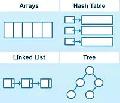]

---

### 🧠 Ментален модел: избирай структура съзнателно, не по навик

<div style="background:#eef3f7; border-left:5px solid #3b6ea5; padding:10px 16px; border-radius:6px;">
  Не „ще ползвам <code>ArrayList</code>" като всеки път, а си задай въпрос за достъпа:
  <ul style="margin:8px 0;">
  <li>По индекс / по ред на срещане? → <code>List</code></li>
  <li>Уникалност / „има ли го?" → <code>Set</code></li>
  <li>Ключ → стойност? → <code>Map</code></li>
  <li>Опашка / добавяне и триене в двата края? → <code>Queue</code> / <code>Deque</code></li>
  </ul>
  Дизайн въпрос е, пренася се във всеки език, и AI не го решава вместо теб.
</div>

💼 Въпрос за интервю: "Защо избра точно тази колекция тук?"

---

### Итератори

- Итераторите предоставят унифициран начин за обхождане на елементите на дадена колекция
- Колекциите (както и масивите) могат да се обхождат с for-each loop

---

### Интерфейси `Iterator` и `Iterable`

```java
public interface Iterator<E> {
    boolean hasNext();
    E next();
    void remove();
}

public interface Iterable<T> {
    Iterator<T> iterator();
}
```

---

### `java.util.Iterator`

- Методът `remove()` премахва от колекцията елемента, последно върнат от `next()`
- Ако колекцията бъде модифицирана докато бъде итерирана, по какъвто и да е начин, различен от извикване на `remove()` на итератора, поведението на итератора е недефинирано
    - В частност, може да се хвърли `ConcurrentModificationException` (дори в еднонишков код)

---

### Премахване по време на итерация

```java
List<OrderEvent> events = new ArrayList<>(loadEvents());

for (OrderEvent e : events) {
    if (e.isCancelled()) {
        events.remove(e);   // ❓
    }
}
```

<br/>

**Vote** ✋: този код (а) работи · (б) хвърля `ConcurrentModificationException` · (в) не се компилира?

---

### Правилният начин: `Iterator.remove()`

```java
for (Iterator<OrderEvent> it = events.iterator(); it.hasNext();) {
    if (it.next().isCancelled()) {
        it.remove();
    }
}
```
---

### Колекции: ООП йерархията

.center[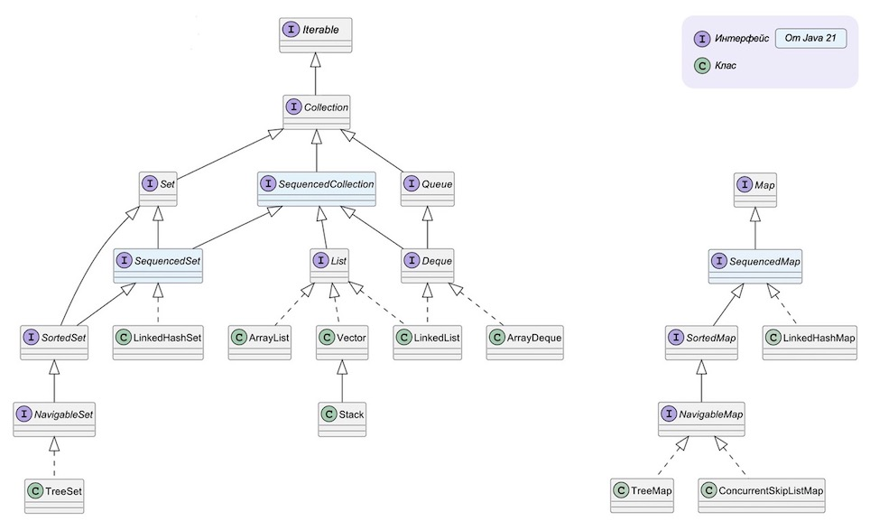]

---

### Обхождане на колекции

```java
List<Float> nums = Arrays.asList(4.999f, 0.271f, 7.1f, -1f);
```

<br>

```java
// чрез for-each loop
for (float current : nums) {
    System.out.printf("%.2f%n", current);
}
```

<br>

```java
// чрез итератор
Iterator<Float> iterator = nums.iterator();
while (iterator.hasNext()) {
    System.out.printf("%.2f%n", iterator.next());
}
```

---

### `java.util.Collection`

```java
int size()
boolean isEmpty()
boolean contains(Object element)
boolean add(E element)
boolean remove(Object element)
Iterator<E> iterator()

boolean containsAll(Collection<?> c)
boolean addAll(Collection<? extends E> c)
boolean removeAll(Collection<?> c)
boolean retainAll(Collection<?> c)
void clear()

Object[] toArray()
<T> T[] toArray(T[] a)
```

---

### `java.util.List`

```java
boolean add(E e)
boolean contains(Object o) // warning: O(N), meaning slow!
E get(int index)
int indexOf(Object o) // warning: O(N), meaning slow!
boolean remove(Object o) // warning: O(N), meaning slow!
E remove(int index)
int size()
boolean isEmpty()
Object[] toArray()
List<E> subList(int fromIndex, int toIndex)
```

---

### Имплементации на `List`

- `ArrayList` - resize-ващ се (динамичен) масив
- `LinkedList` - двойно свързан списък
- `Vector` - resize-ващ се (динамичен) масив. Synchronized. Legacy → замества се от `ArrayList`
- `Stack` - наследява Vector. Legacy → замества се от `Deque`

---

### Алгоритмична сложност на основните операции

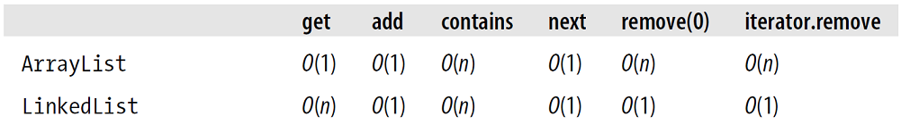

---

### `contains` на 1 000 000 елемента

```java
List<Integer> list = new ArrayList<>(/* 1_000_000 числа */);
Set<Integer>  set  = new HashSet<>(list);

boolean a = list.contains(999_999);   // ~ ? стъпки
boolean b = set.contains(999_999);    // ~ ? стъпки
```
<br/>

**Vote** ✋: `set.contains()` е приблизително (а) еднакво бърз · (б) ~2× · (в) ~1000× · (г) ~1 000 000× по-бърз от `list.contains()`?

---

### `java.util.Queue`


| Операция | хвърля изключение   | връща специална стойност |
|:---------|:--------------------|:-------------------------|
| Insert   | `add(e)`            | `offer(e)`               |
| Remove   | `remove()`          | `poll()`                 |
| Examine  | `element()`         | `peek()`                 |

---

### Имплементации на `Queue`

- `PriorityQueue` - heap (пирамида)
- `LinkedList`
- `ArrayDeque` - resize-ващ се (динамичен) масив

---

### Алгоритмична сложност на основните операции

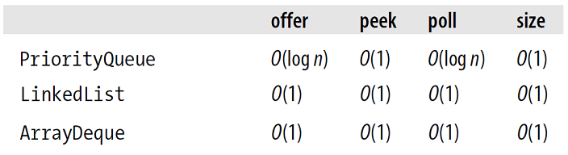

---

### `java.util.Set`

```java
boolean add(E e)
boolean contains(Object o)
boolean remove(Object o)
int size()
boolean isEmpty()
Object[] toArray()
```

---

### Имплементации на `Set`

- `TreeSet` - `TreeMap`. Червено-черно дърво
- `HashSet` - хеш таблица
- `LinkedHashSet` - хеш таблица + двойно свързан списък
- `EnumSet` - битов масив

---

### Конструиране на `HashSet`

```java
HashSet(); // default initial capacity (16) and load factor (0.75).
HashSet(Collection<? extends E> c);
HashSet(int initialCapacity);
HashSet(int initialCapacity, float loadFactor);

// Since Java 19
// Similar factory methods exist also for LinkedHashSet, HashMap and LinkedHashMap
HashSet.newHashSet(int numElements);
```

---

### Договорът `equals()` / `hashCode()`

```java
final class BrokenKey {
    final String v;

    BrokenKey(String v) { this.v = v; }

    @Override
    public boolean equals(Object o) {
        return o instanceof BrokenKey k && k.v.equals(v);
    }
    // ⚠️ няма hashCode()
}

Set<BrokenKey> s = new HashSet<>();
s.add(new BrokenKey("A"));
s.add(new BrokenKey("A"));
System.out.println(s.size());   // ❓
```

<br/>

**Vote** ✋: отпечатва (а) `1` · (б) `2` · (в) грешка при компилация?

---

### Конструктори на `TreeSet`

```java
TreeSet(); // natural ordering
TreeSet(Collection<? extends E> c);
TreeSet(Comparator<? super E> comparator);
TreeSet(SortedSet<E> s);
```

---

### `java.lang.Comparable` vs `java.util.Comparator`


```java
// естествена подредба
public interface Comparable<T> {
    int compareTo(T o);
}

public interface Comparator<T> {
    int compare(T o1, T o2);
}
```

---

### Консистентност на естествената подредба с `equals()`

Естествената подредба на клас С се нарича *консистентна с `equals()`*, ако и само ако
`e1.compareTo(e2) == 0` има същата булева стойност като `e1.equals(e2)`, за всеки два обекта e1 и е2 на С.

<br>
Силно препоръчително е (макар и не задължително) естествената подредба да бъде консистентна с `equals()`.

---

### `LinkedHashSet`

.center[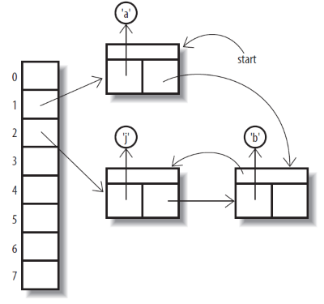]

```java
Set<Character> sc = new LinkedHashSet<>();
Collections.addAll(sc, 'a', 'b', 'j');
```

---

### Алгоритмична сложност на основните операции

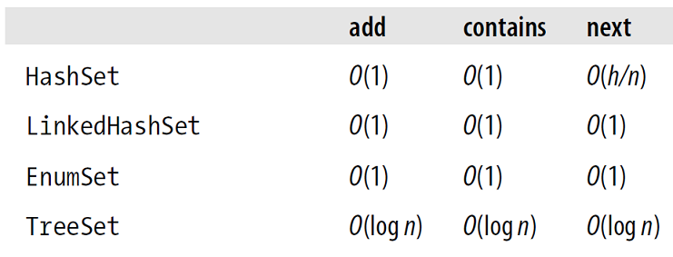

<small>*h* - капацитет на хеш таблицата</small>

---

### Операции над множества със `Set`

```java
Set<String> one = new HashSet<>();
one.add("foo");
one.add("bar");
Set<String> two = new HashSet<>();
two.add("foo");
two.add("baba");

Set<String> union = new HashSet<>(one);
union.addAll(two); // union = [baba, bar, foo]

Set<String> intersection = new HashSet<>(one);
intersection.retainAll(two); // intersection = [foo]

Set<String> difference = new HashSet<>(one);
difference.removeAll(two); // difference = [bar]
```

---

### `java.util.Map`

```java
V put(K key, V value) // Добавя двойка key-value. Ако има вече такъв ключ в Map-а,
                      // променя само value-то, и връща старото value като резултат
V get(Object key)
V remove(Object key)
boolean containsKey(Object key)
int size()
boolean isEmpty()
Set<K> keySet()
Collection<V> values()
```

---

### Обхождане на `Map`

Според това какво ни е нужно, може да вземем от `Map`-a:

- множеството от ключовете
```java
Set<Integer> keys = map.keySet();
```

<br>

- колекция от стойностите
```java
Collection<String> values = map.values();
```

<br>

- множество от двойките ключ-стойност
```java
Set<Entry<Integer, String>> s = map.entrySet();
```

---

### Имплементации на `Map`

- `HashMap` - хеш таблица
- `LinkedHashMap` - хеш таблица + двойно свързан списък
- `TreeMap` - червено-черно дърво
- `EnumMap` - битов масив

---

### Алгоритмична сложност на основните операции

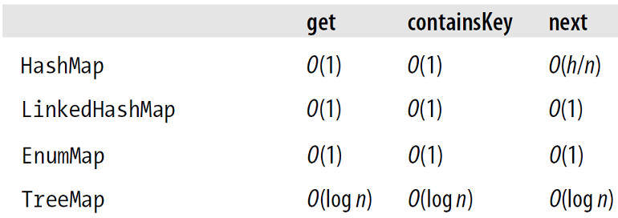

<small>*h* - капацитет на хеш таблицата</small>

---

### Защо разпределението по bucket-и е критично важно?

- `HashMap` е масив от *bucket*-и. `hashCode()` решава в кой bucket отива ключът.
- Добро разпределение → по ~1 ключ на bucket → `get`/`put` ≈ **O(1)**.
- Всички елементи в един bucket → веригата расте → `get`/`put` ≈ **O(N)**.
- Контролира се от *load factor* (по подразбиране 0.75): при запълване над него → resize ×2 + rehash.

<br/>

<div style="background:#eef3f7; border-left:5px solid #3b6ea5; padding:8px 32px; border-radius:6px;">
🧠 Сложността O(1) зависи от това, доколко <code>hashCode()</code> разпределя данните равномерно.
</div>

---

### 💥 Една история: как един HTTP request може да срине сървър

- Декември 2011 г., 28-ото издание на ежегодната хакерска конференция *Chaos Communication Congress* (28C3). Klink и Wälde демонстрират практически приложима атака HashDoS.
- Показват как само един HTTP POST request може да натовари процесора на уязвим сървър до степен да го блокира — проблем, потвърден от редица производители.
---

### 💥 Една история: как един HTTP request може да срине сървър

- Атаката включва нарочно подбрани ключове, които да попадат в един и същи bucket.
- Един HTTP POST с хиляди такива параметри → HashMap-ът, използван при обработката на формата, деградира до O(N²) при парсване → 100% CPU натоварване и блокирал сървър. Засегнати са Java/Tomcat, PHP, Python, Ruby и ASP.NET.
- Проблемът не е в конкретна грешка в нечий код, а в нарушен имплицитен договор: „ключовете са случайно разпределени“. Атакуващият умишлено нарушава това предположение.

---

### 💥 Една история: как един HTTP request може да срине сървър

<div style="background:#fff7e6; border-left:5px solid #d08700; padding:8px 16px; border-radius:6px;">
⚠️ Защитата идва на два етапа: <br/>Java 7u6 — въвежда алтернативно хеширане на низове (<code>jdk.map.althashing.threshold</code>); <br/>Java 8 — дългите вериги в един bucket се преобразуват в червено-черни дървета (<i>treeification</i>), което подобрява най-лошия случай от O(N) до O(log N).
</div>

<br/>

💼 Въпрос на интервю: *„Кога O(1) на `HashMap` не е O(1)?"*

---

<iframe src="hashmap-visualizer.html" style="border:none; width:100%; height:70vh; display:block;"></iframe>

---

### Колекции с наредба vs. Колекции без наредба

- `TreeMap`/`TreeSet` - червено-черни дървета. Запазват естествената наредба. Елементите трябва да имплементират интерфейса `Comparable` (или да се подава имплементация на `Comparator`). Логаритмична сложност за повечето операции
- `HashMap`/`HashSet` - хеш таблици. Нямат наредба. Елементите трябва да имплементират методите `hashCode()` и `equals()`. Константна сложност за повечето операции

<br/>

> 💡 **Общо правило:**
> Винаги предефинирай методите `equals()` и `hashCode()` за класове, чиито обекти ще се добавят в колекции — дори в наредени като `TreeSet` и `TreeMap`. Това гарантира коректно поведение при сравнение, търсене и използване в различни типове колекции.

---

### 💬 Дискусия: наредба срещу скорост

Кога избираш `TreeMap` (наредба, O(log N)) въпреки че `HashMap` (без наредба) е O(1)?

<br/>

✋ Отворен въпрос

---

### Java Map/Collection Cheat Sheet

.center[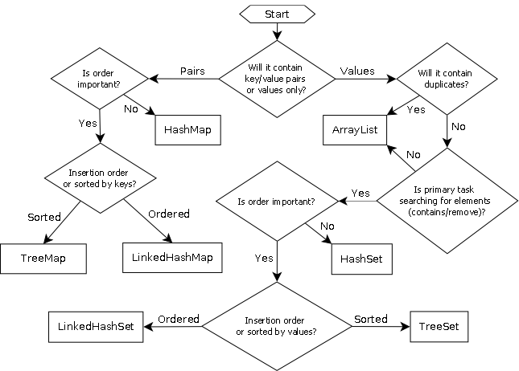]

---

### Big-O Complexity Chart

[.center[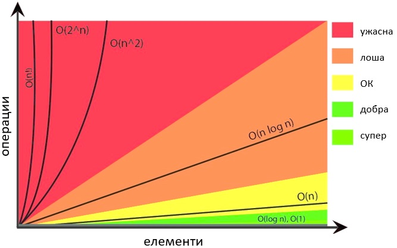]](https://www.bigocheatsheet.com/)

---

[.center[]](https://www.bigocheatsheet.com/)

---

### Колекции - операции

Сортиране

```java
List<Integer> nums = new ArrayList<>();
nums.add(4);
nums.add(9);
nums.add(0);
nums.add(7);
nums.add(-1);

// nums = [4, 9, 0, 7, -1]
Collections.sort(nums);
// nums = [-1, 0, 4, 7, 9]
Collections.sort(nums, Collections.reverseOrder());
// nums = [9, 7, 4, 0, -1]
```

---

### Колекции - операции

Търсене: `indexOf()`, `binarySearch()`

```java
List<Integer> nums = Arrays.asList(4, 9, 0, 7, -1);

// nums = [4, 9, 0, 7, -1]
int index = nums.indexOf(7);
// index = 3

Collections.sort(nums);
index = Collections.binarySearch(nums, -1);
// index = 0
```

---

### Колекции - операции

Разбъркване: `shuffle()`

```java
List<Integer> nums = Arrays.asList(4, 9, 0, 7, -1);

// nums = [4, 9, 0, 7, -1]
Collections.shuffle(nums);
// nums = [?, ?, ?, ?, ?]
```

---

### Колекции - операции

Манипулации: `copy()`, `fill()`, `reverse()`, `swap()`

```java
List<String> from = new ArrayList<>();
from.add("foo");
from.add("bar");
List<String> to = new LinkedList<>();
to.add("a");
to.add("b");

Collections.copy(to, from);
// to = [foo, bar]
```

<br>

```java
List<String> list = new ArrayList<>();
list.add("foo");
list.add("bar");
list.add("baz");

Collections.fill(list, "a");
// list = [a, a, a]
```

---

### Колекции - операции

Манипулация `copy()`, `fill()`, `reverse()`, `swap()`

```java
List<String> list = new ArrayList<>();
list.add("1");
list.add("2");
list.add("3");

Collections.reverse(list);
// list = [3, 2, 1]

Collections.swap(list, 0, 1);
// list = [2, 3, 1]
```

---

### Колекции - операции

Статистики: `min()`, `max()`, `frequency()`

```java
Set<Integer> nums = Set.of(4, 9, 0, 7, -1);

int min = Collections.min(nums); // -1
int max = Collections.max(nums); // 9
int frequency = Collections.frequency(nums, 7); // 1
```

---

### Immutable vs. Unmodifiable колекции

- Колекции, които не поддържат модифициращи операции (като `add`, `remove` и `clear`) се наричат *unmodifiable*. Колекциите, които не са *unmodifiable*, са *modifiable*.

- Колекции, които в допълнение гарантират, че не са възможни никакви промени в съдържанието им, се наричат *immutable*. Колекциите, които не са *immutable*, са *mutable*.

- Една *unmodifiable* колекция не е непременно *immutable*. Ако съдържаните в нея елементи са *mutable*, цялата колекция е очевидно *mutable*, въпреки че е *unmodifiable*
    - Ако обаче една *unmodifiable* колекция съдържа само *immutable* елементи, тя самата може да се счита за *ефективно immutable*.

---

### Unmodifiable колекции

```java
// static factory методи за създаване на unmodifiable колекции (от Java 9)

List<String> list = List.of("Java", "rulez");

Set<Integer> set = Set.of(1, 2, 3, 5, 8);

Map<String, Integer> cities = Map.of(
      "Brussels", 1_139_000,
      "Cardiff", 341_000
);

cities = Map.ofEntries(
      Map.entry("Brussels", 1_139_000),
      Map.entry("Cardiff", 341_000)
);
```

---

### Unmodifiable колекции

```java
Set<String> namesSet = new HashSet<>();
namesSet.add("Paul");
namesSet.add("Anna");

// static factory методи, създаващи unmodifiable колекции като копие на колекции (от Java 10).
// Последващи промени в оригиналната колекция не се отразяват на копията ѝ.

Set<String> moreNamesYet = Set.copyOf(namesSet);
List<String> copiedNames = List.copyOf(namesSet);
Map<String, Integer> map = Map.copyOf(cities);

moreNamesYet.add("Nicky"); // will throw UnsupportedOperationException at runtime
```

---

### Unmodifiable колекции

```java
Set<String> namesSet = new HashSet<>();
namesSet.add("Paul");
namesSet.add("Anna");

// static factory методи за създаване на unmodifiable view на колекция (от Java 9).
// Последващи промени в оригиналната колекция се отразяват на / "виждат" през view-тата ѝ.

Set<String> namesAgain = Collections.unmodifiableSet(namesSet);

namesSet.add("Martin");

System.out.println(namesAgain.contains("Martin")); // true

namesAgain.add("Nicky"); // will throw UnsupportedOperationException at runtime
```

---

### Unmodifiable колекции

- Заемат по-малко памет от modifiable събратята си
- Не могат да съдържат `null` елементи
- При идентично съдържание, factory методите могат да връщат нови инстанции на дадената колекция или референции към вече съществуващи

---

class: center, middle

# Част 3 — Чист код

.center[]

---

### Защо писането на чист код е умение №1 в AI ерата? 

<div style="background:#eef3f7; border-left:5px solid #3b6ea5; padding:10px 16px; border-radius:6px;">
AI пише код за секунди. Твоята работа все повече ще е да <i>четеш и преценяваш</i> код, който не си писал: коректен ли е, ефективен ли е, чист ли е — или просто изглежда <i>правдоподобно</i>?
</div>

<br/>

💼 На интервю в наши дни все по-често ще ти показват готов (често AI-генериран) код и ще те питат „какво не е наред тук?".

---

### Как мерим качеството на кода?

.center[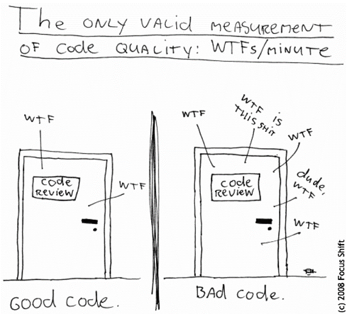]

---

### Принципи на чистия код - именуване, конвенции и добри практики

- Имената на пакети, класове, интерфейси, член-променливи, методи, локални променливи трябва да са говорещи и да спазват установените конвенции
- Предпочитай цели думи. Избягвай съкращения, освен ако не са общоизвестни

---

### Принципи на чистия код - именуване, конвенции и добри практики

- пакети
    - само малки латински букви, със смислена йерархия
    - `bg.sofia.uni.fmi.mjt`
- класове, абстрактни класове, интерфейси, enums, records
    - съществителни, започващи с главна буква (upper camel case / pascal case)
        - `Student`, `GameBoard`
        - имената на интерфейси често са отглаголни съществителни
            - `Cloneable`, `Comparable`, `Runnable`, `Serializable`

---

### Принципи на чистия код - именуване, конвенции и добри практики

- методи
    - глаголи, започващи с малка буква (camel case), без подчертавки
        - `reverseString()`, `calculateSalary()`
- променливи
    - започващи с малка буква (camel case), без подчертавки
        - `itemsCount`
- константи
    - all-caps, с подчертавки между думите
        - `MAX_NAME_LENGTH`

---

### Принципи на чистия код - Спазвай ООП принципите

- Енкапсулация
    - Свеждай публичните части до минимум
- Наследяване
    - Не допускай code duplication

---

### Принципи на чистия код - Спазвай ООП принципите

- Полиморфизъм
    - Ползвай полиморфизъм винаги, когато е възможно
    - Използвай интерфейс за декларация, конкретна имплементация за инициализация
    - Предпочитай интерфейс вместо имплементация в сигнатурите на публичните ти методи

---

### Принципи на чистия код - ползвай интерфейс за декларация и конкретен клас за инициализация

```java
// Bad
ArrayList<String> stringList = new ArrayList<>();
public HashSet<Integer> filterPrimes(HashSet<Integer>);
```

<br>

```java
// Good
List<String> stringList = new ArrayList<>();
public Collection<Integer> filterPrimes(Collection<Integer>);
```

---

### Чист ли е този код?

```java
public static List process(List data) {
    List r = new ArrayList();
    for (int i = 0; i < data.size(); i++) {
        Object x = data.get(i);
        if (((OrderEvent) x).amount() > 0) r.add(x);
    }
    return r;
}
```

<br/>

**Vote** ✋: (а) чист е · (б) има поне 3 проблема · (в) изобщо няма да се компилира?

---

### Стреми се към хубав ОО дизайн

- Използвай само по изключение пакета по подразбиране
- Един клас трябва да прави едно нещо
    - Ако имаш "and" в името на класа, вероятно не е така
- Ако имаш "Helper", "Manager", "Utility" в името, *може би* има по-добър дизайн
- Един метод трябва да прави едно нещо
- Методът трябва да е кратък: < 20 реда код

---

### Стреми се към хубав ОО дизайн

- Ако имаш "and" в името на метод, може би той прави повечко неща: раздели го на няколко
- Ако имаш много параметри на метод:
      - може би не му е мястото в този клас (а там, откъдето се взимат стойностите за тези параметри)
      - или трябва да направиш *data object* / `record`, който да групира семантично свързаните от тях
- Не злоупотребявай със `static`

---

### Принципи на чистия код - форматирай

- Форматирай си кода
- Нямаш никакво оправдание да не го правиш: има IDE shortcuts
      - Ctrl+Alt+L (IntelliJ)
      - Ctrl+Shift+F (Eclipse)

---

### Не използвай "magic numbers"

Вместо "магически числа" в кода, ползвай подходящо именувани константи или enums

<br>

```java
// Bad
for (int i = 0; i < 16; i++) { /* what is 16?! */ }

if (message.startsWith("[ERROR] ")) { /* ?! */ }
```

<br>

```java
// Good
public static final int MAX_PASSWORD_LENGTH = 16;
//  [...]
for (int i = 0; i < MAX_PASSWORD_LENGTH; i++) { /* do something */ }

private static final String ERROR_MESSAGE_PREFIX = "ERROR: ";
//  [...]
if (message.startsWith(ERROR_MESSAGE_PREFIX)) { /* do something */ }
```

---

### Принципи на чистия код

```java
// Bad
if (x % 2 == 0)
    return x / 2;
```

<br>

```java
// Good: Винаги ограждай в блок телата на if-else и цикли,
// дори да са с по един statement
if (x % 2 == 0) {
    return x / 2;
}
```

---

### Принципи на чистия код

```java
// Bad
public int calculateSalary()
{

}

// Good: отварящата фигурна скоба на блок не стои на отделен ред
// Изключение: initializer блоковете
public int calculateSalary() {

}

```

---

### Принципи на чистия код

```java
// Bad
private static long calculateSum (int n){
    long sumOfOddSquares = 0;
    for(int i=0; i< n; i ++){
        if(i%2!=0){
            sumOfOddSquares += Math.pow (i,2);
        }
    }
    return sumOfOddSquares;

}
```

---

### Принципи на чистия код

```java
// Good: 1. Не "залепвай" if, for, do, while, switch с последващата (
//       2. Не "залепвай" списъка с параметри на метод с последващата {
//       3. Не "залепвай" операторите към операндите
//       4. Не оставяй интервал между името на метод и (
//       5. Оставяй интервал след ,
//       6. Оставяй празни редове ("въздух")
//       7. Не оставяй никъде два или повече последователни празни редове
//       8. Красиво обикновено е симетричното
private static long calculateSum(int n) {
    long sumOfOddSquares = 0;

    for (int i = 0; i < n; i++) {
        if (i % 2 != 0) {
            sumOfOddSquares += Math.pow(i, 2);
        }
    }

    return sumOfOddSquares;
}

```

---

### Принципи на чистия код

```java
// Bad
if (x % 2 == 0) {
    return true;
} else {
    return false;
}
```
<br>

```java
// Good: Изразявай се кратко. Малко код == малко бъгове
return x % 2 == 0;
```

---

### Принципи на чистия код

- Слагай коментари, без да прекаляваш
- Коментарите следва да обясняват "защо", а не "какво". Хубавият код е self-explanatory за "какво"-то

---

### Принципи на чистия код

- Разделяй нормалната логика от exception логиката
- Ползвай изключения вместо error codes и печатане на съобщения в конзолата
- Подавай точен и разбираем message, когато конструираш и хвърляш изключение
- Когато създаваш твой (*custom*) клас за изключение, override-вай non-default конструкторите

  ```java
  Exception(String message)
  Exception(String message, Throwable cause)
  ```

- Не suppress-вай / swallow-вай exceptions
      - Никога не оставяй празен `catch`, или `catch` само с `e.printStackTrace()`

---

### Принципи на чистия код

```java
// Bad
try {
    // do something with the file system
} catch (FileNotFoundException e) {
    // I hope someone reads the logs
    e.printStackTrace();
} catch (IOException e) {
    // the admin should see this
    System.err.println("I/O exception accessing the file system.");
}
```

---

### Принципи на чистия код

```java
// Good
try {
    // do something with the file system
} catch (FileNotFoundException e) {
    // catalog file is missing -
    // this is OK, first access should create an empty catalog
    createEmptyShoppingCatalog();
} catch (IOException e) {
    // catalog file is there but cannot be opened or read
    // calling method knows how to handle this
    throw new ShoppingException("Cannot load shopping catalog", e);
}
```

---

### Разделяй I/O логиката от *бизнес* логиката

```java
// Bad
public static void factorial() { // swiss knife: all-in-one
    Scanner sc = new Scanner(System.in);
    int n = -1; long result = 1;
    do {
        System.out.println("Въведи число:");
        try {
            n = Integer.parseInt(sc.nextLine());
        } catch (Exception e) {
            continue;
        }
    } while (n < 0);
    for (int i = 2; i <= n; i++) {
        result *= i;
    }
    System.out.println("n! = " + result);
}
public static void main(String... args) {
    factorial();
}
```

---

### Разделяй I/O логиката от *бизнес* логиката

```java
// Good
private static int readInput(Scanner sc) { // handle input
    int n = -1;
    do {
        System.out.println("Въведи число:");
        try {
            n = Integer.parseInt(sc.nextLine());
        } catch (Exception e) {
            continue;
        }
    } while (n < 0);
    return n;
}

private static void printOutput(long result) { // handle output
    System.out.println("n! = " + result);
}
```

---

### Разделяй I/O логиката от *бизнес* логиката

```java
// Good
public static long factorial(int n) { // business logic
    long result = 1;
    for (int i = 2; i <= n; i++) {
        result *= i;
    }
    return result;
}

public static void main(String... args) {
    int input = readInput(new Scanner(System.in));
    long result = factorial(input);
    printOutput(result);
}
```

---

### Java код конвенции

Запознай се с цялостна Java код конвенция и се придържай към нея.
Две от най-популярните:

<br>

- [Oracle Code Conventions for the Java Programming Language](https://www.oracle.com/technetwork/java/javase/documentation/codeconvtoc-136057.html)

- [Google Java Style Guide](https://google.github.io/styleguide/javaguide.html)

<br><br>

.center[]

---

### Инструменти за статичен код анализ

- Има инструменти за статичен код анализ, които
      - автоматизират придържането към код конвенции
      - намират и бъгове

---

### Най-популярните open-source инструменти

- [checkstyle](http://checkstyle.sourceforge.net/index.html)<br>
- [PMD](https://pmd.github.io/)<br>
- [FindBugs](http://findbugs.sourceforge.net/index.html)

<br>

.center[]

---

### planetgeek.ch | Clean Code Cheat Sheet

.center[[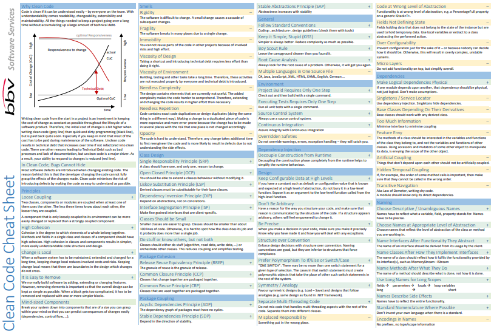](https://www.planetgeek.ch/wp-content/uploads/2014/11/Clean-Code-V2.4.pdf)]

---

### Библията

.center[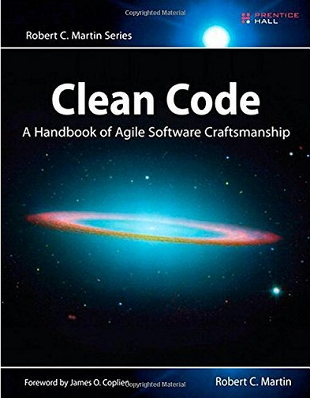]

---

### Clean Code

> "Writing clean code is what you must do in order to call yourself a professional.
> There is no reasonable excuse for doing anything less than your best."
>
> &emsp;&emsp;&emsp;&emsp; ― Robert C. Martin, *Clean Code: A Handbook of Agile Software Craftsmanship*

---

### Следващата седмица

```java
List<OrderEvent> events = new ArrayList<>();
OrderEvent first = events.get(0);     // защо НЕ се налага каст тук?

List raw = new ArrayList();           // а това компилира ли се?
raw.add("не съм OrderEvent");
OrderEvent oops = (OrderEvent) raw.get(0);   // ClassCastException по време на изпълнение
```

---

### Следващата седмица

```java
List<OrderEvent> events = new ArrayList<>();
OrderEvent first = events.get(0);     // защо НЕ се налага каст тук?

List raw = new ArrayList();           // а това компилира ли се?
raw.add("не съм OrderEvent");
OrderEvent oops = (OrderEvent) raw.get(0);   // ClassCastException по време на изпълнение
```

<div style="background:#eef3f7; border-left:5px solid #3b6ea5; padding:8px 16px; margin-top:32px; border-radius:6px;">
🎬 Днес цяла вечер някой тихо ни пазеше от този <code>ClassCastException</code>. <b>Кой?</b> Ще разберем следващата сряда, както и ще се научим да пишем собствени type-safe контейнери с механизмите на Java Generics.
</div>

---

## Въпроси?

.font-xl[.ri-github-fill.icon-inline[[fmi/java-course](https://github.com/fmi/java-course)]]

.font-xl[.ri-youtube-fill.icon-inline[[MJT2027](https://www.youtube.com/playlist?list=PLO1UIjXfc0-k)]]
