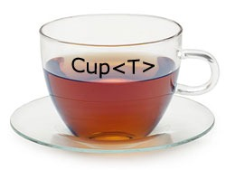
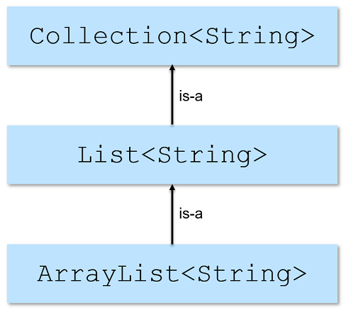
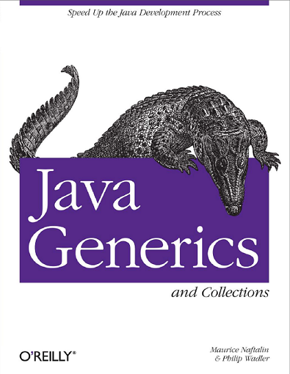

class: center, middle

# Generics

11.11.2026

.center[]

---

### Миналата седмица завършихме с въпрос

```java
List<OrderEvent> events = new ArrayList<>();
OrderEvent first = events.get(0);     // защо НЕ се налага каст тук?

List raw = new ArrayList();           // а това компилира ли се?
raw.add("не съм OrderEvent");
OrderEvent oops = (OrderEvent) raw.get(0);   // ClassCastException по време на изпълнение
```

<div style="background:#eef3f7; border-left:5px solid #3b6ea5; padding:10px 16px; margin-top:28px; border-radius:6px;">
🎬 Цяла вечер някой тихо ни пазеше от този <code>ClassCastException</code>. Кой?
</div>

---

### Отговорът

**Компилаторът.** А инструментът, с който му казваме какъв тип елементи съхраняваме, се нарича *Generics*.

<br>

<div style="background:#eef3f7; border-left:5px solid #3b6ea5; padding:10px 16px; border-radius:6px;">
Днес ще се научим да пишем собствени <b>type-safe</b> контейнери — и да четем критично чужд (вкл. AI-генериран) generic код.
</div>

---

### Нуждата от Generics

- Generic типовете ни позволяват да създадем обща имплементация на клас или метод, която работи с различни типове данни
    - това позволява преизползване на кода

---

### Нуждата от Generics

```java
List list = new LinkedList();
list.add(Integer.valueOf(1));
Integer i = list.iterator().next(); // няма да се компилира
```

---

### Нуждата от Generics

```java
List list = new LinkedList();
list.add(Integer.valueOf(1)); 
Integer i = (Integer) list.iterator().next(); // explicit type cast
```

<br>
- трябва експлицитно да кастваме, което е досадно
- има вероятност да сгрешим в предположението си за типа и cast-ът да "гръмне" с `ClassCastException` по време на изпълнение

---

### Нуждата от Generics

- би било много по-удобно
    - програмистът да може изрази намерението си да ползва определен тип и
    - компилаторът да може да гарантира коректността на програмата за този тип

---

### Нуждата от Generics

```java
List list = new LinkedList();
list.add(Integer.valueOf(1)); 
Integer i = (Integer) list.iterator().next(); // explicit type cast
```

<br>

```java
List<Integer> list = new LinkedList<>();
list.add(1); // autoboxing; compiler checks type compatibility
Integer i = list.iterator().next(); // no explicit cast needed
```

---

class: center, middle

# Част 1 — Пишем generic типове

---

### Generics

```java
List<E>
// Чете се "списък от E"
```

<br>

Клас или интерфейс, в декларацията на който има един или повече параметри за тип, се нарича *generic* клас/интерфейс.

---

### Пример: не-generic кутия

Съдържа какъв да е обект

```java
public class Box {
    private Object value;

    public Object getValue() {
        return value;
    }

    public void setValue(Object value) {
        this.value = value;
    }
}
```

---

### Пример: generic кутия

```java
public class Box<T> {
    private T value;

    public T getValue() {
        return value;
    }

    public void setValue(T value) {
        this.value = value;
    }
}

```

---

### Създаване на инстанции

```java
// The long way
Box<Integer> integerBox = new Box<Integer>();
```

<br>

```java
// "Diamond operator"
Box<Integer> integerBox = new Box<>();
```

---

### Конвенция за именуване на параметрите за тип

- E - Element
- T - Type
- K - Key
- V - Value
- N - Number
- S, U, V etc. - 2-ри, 3-ти, 4-ти тип

---

### Generic методи

- Могат да ползват типовите параметри на класа/метода
- Могат да добавят нови параметри за тип, недекларирани от класа
- Новите параметри за тип са видими единствено за метода, който ги декларира
- Generic методите могат да са статични, нестатични или конструктори

---

### Generic методи – примери

```java
public class Pair<K, V> {

    private K key;
    private V value;

    // Generic constructor
    public Pair(K key, V value) {
        this.key = key;
        this.value = value;
    }

    // Generic methods
    public K getKey() { return key; }
    public void setKey(K key) { this.key = key; }
    public V getValue() { return value; }
    public void setValue(V value) { this.value = value; }

}
```

---

### Generic методи – примери

```java
public class Pairs {

    // Generic static method
    public static <K, V> boolean areEqual(Pair<K, V> p1, Pair<K, V> p2) {
        return p1.getKey().equals(p2.getKey()) &&
                   p1.getValue().equals(p2.getValue());
    }

}
```

---

### Generic методи - извикване

```java
Pair<Integer, String> p1 = new Pair<>(1, "apple");
Pair<Integer, String> p2 = new Pair<>(2, "pear");

// Full syntax
boolean areEqual = Pairs.<Integer, String>areEqual(p1, p2);

// Short syntax
boolean areEqual = Pairs.areEqual(p1, p2);
```

---

class: center, middle

# Част 2 — Вариантност и wildcards

---

### Ковариантност, контравариантност и инвариантност

- *Вариантност* (*Variance*) е понятие, свързано с това, как наследяването между по-сложните типове е свързано с наследяването между техните компоненти
- Лесна за запомняне (и изключително неформална) дефиниция на ковариантност и контравариантност е:
    - *Ковариантност*: приемат се типове-наследници (subtypes)
    - *Контравариантност*: приемат се типове-родители (supertypes)

---

### Масивите в Java са ковариантни

- `T[]` може да съдържа елементи от тип `T` и негови наследници
- `S[]` е наследник на `T[]`, ако `S` е наследник на `T`

<br>

```java
Integer[] intArr = new Integer[5];
Number[] numArr = intArr; // ОК

numArr[0] = 1.23; // Not OK: will compile but will throw an ArrayStoreException at runtime
```

---

### Разгледайте този ред

```java
List<Number> ns = new ArrayList<Integer>();
```

<br>

<div style="background:#fff7e6; border-left:5px solid #d08700; padding:10px 16px; border-radius:6px;">
✋ <b>Vote:</b> Този код компилира ли се?
</div>

---

### Oтговорът e **не**

```java
List<Number> ns = new ArrayList<Integer>(); // НЕ се компилира: incompatible types
```
<br>

- `Integer` is-a `Object`
- `Integer` is-a `Number`...
- ... но `List<Integer>` is-not-а `List<Number>`. Техният общ родител е `Object`

<br>

Казваме, че параметризираният тип е *инвариантен* (*invariant*).

<div style="background:#eef3f7; border-left:5px solid #3b6ea5; padding:10px 16px; margin-top:32px; border-radius:6px;">
🧠 Масивите са ковариантни (и плащаме за това с runtime грешки). Generic типовете в общия си вид са <i>инвариантни</i> нарочно — потенциална грешка би се открила по време на компилация.
</div>

---

### Generic типове и наследяване

- Подтип на generic клас или интерфейс получаваме чрез разширяване или имплементиране
- Ако аргументът за тип е еднакъв, то *is-a* релацията е в сила

---

### Пример от Collections framework-a

.center[]

---

### Ограничени (bounded/restricted) generic типове

Може да се специфицира, че generic тип е съвместим само с даден тип или негови наследници/имплементации (upper bound).

<br>

```java
public <T extends Number> List<T> fromArrayToList(T[] a) {
    // [...]
}
```

Ако типовете са повече от един, те се разделят с &, като в този случай
най-много един може да бъде клас (останалите трябва да са интерфейси)
и ако има клас, той трябва да стои първи в списъка.

<br>

```java
public <T extends Number & Comparable<T>> List<T> anotherMethod(T[] a) {
    // [...]
}
```

---

### 💼 Интервю въпрос: Има ли проблем с тази имплементация?

```java
public static <T extends Comparable> T max(List<T> list) {
    T result = list.get(0);
    for (T e : list) {
        if (e.compareTo(result) > 0) {
            result = e;
        }
    }
    return result;
}
```

---

### 💼 Интервю въпрос: Има ли проблем с тази имплементация?

```java
public static <T extends Comparable> T max(List<T> list) {
    T result = list.get(0);
    for (T e : list) {
        if (e.compareTo(result) > 0) {
            result = e;
        }
    }
    return result;
}
```

Да. Проблемът е raw `Comparable` типът.

```java
max(List.of(3, 1, 2));          // ✅ 3 — с „нормални" данни работи
max(List.of("apple", 42));      // ❌ ClassCastException: String cannot be cast to Integer
```

- raw `Comparable` → `compareTo` приема `Object` → компилаторът допуска списък със смесени, взаимно несравними елементи
- с хомогенни данни работи коректно, но "гърми" в corner cases: най-коварният вид бъг

---

### 💼 Интервю въпрос: Какво точно подобрихме?

```java
public static <T extends Comparable<T>> T max(List<T> list) {
    T result = list.get(0);
    for (T e : list) {
        if (e.compareTo(result) > 0) {
            result = e;
        }
    }
    return result;
}
```

---

### 💼 Интервю въпрос: Какво точно подобрихме?

```java
public static <T extends Comparable<T>> T max(List<T> list) {
    T result = list.get(0);
    for (T e : list) {
        if (e.compareTo(result) > 0) {   // работи, защото T е сравним СЪС СЕБЕ СИ
            result = e;
        }
    }
    return result;
}
```

<br/>

<div style="background:#eef3f7; border-left:5px solid #3b6ea5; padding:10px 16px; border-radius:6px;">
🧠 <code>T extends Comparable&amp;lt;T&amp;gt;</code> == „T се сравнява <b>със себе си</b>". Осъзнаването на това <i>self-referential</i> ограничение отличава тези, които <i>ползват</i> generics, от тези, които ги <i>разбират</i>. 80% пишат raw <code>Comparable</code> и после се чудят защо им се хвърля <code>ClassCastException</code> по време на изпълнение.
</div>

---

### Проблемът с липсата на общ родител

Представете си, че ви трябва метод, който извежда всички елементи на дадена колекция.<br/>
Ето как може да се направи без generics:

<br>

```java
private void printCollection(Collection c) {
    for (Object e : c) {
        System.out.println(e);
    }
}
```

---

### Проблемът с липсата на общ родител

Наивно може да предположим, че с generics може да го реализираме така:

<br>

```java
void printCollection(Collection<Object> c) {
    for (Object e : c) {
        System.out.println(e);
    }
}
```

---

### Проблемът с липсата на общ родител

Наивно може да предположим, че с generics може да го реализираме така:

<br>

```java
void printCollection(Collection<Object> c) {
    for (Object e : c) {
        System.out.println(e);
    }
}
```
<br>

Проблемът е, че тази реализация всъщност е по-малко полезна от предната.<br>
`Collection<Object>` НЕ е родител на `Collection<T>` за никое `T`,
т.е. не може да викнем метода например с `Collection<Integer>`.


---

### Решението: wildcards

- Имат ли всички видове `Collection<T>` общ родител, различен от `java.lang.Object`?
- Отговорът е положителен
  - типът се записва `Collection<?>` и се чете "колекция от неизвестен тип". Такъв тип се нарича *wildcard* тип
- Чрез wildcards става възможно generic типовете да поддържат ковариантност и контравариантност

---

### Решението: wildcards

```java
// този метод може да се извика с аргумент - произволна колекция
void printCollection(Collection<?> c) {
    for (Object e : c) {
        System.out.println(e);
    }
}
```

---

### Wildcards, ограничени отгоре

Искаме да създадем метод, който намира сумата на елементите в списък от `Integer`, `Double`, `Float`, `Number`

<br>

```java
public static double sumOfList(List<? extends Number> list) {
    double sum = 0.0;
    for (Number current : list) {
        sum += current.doubleValue();
    }
    return sum;
}
```

<br>

За разлика от обикновените ограничени generic типове, wildcard, ограничен отгоре, може да има само един ограничителен тип.

---

### Wildcards, ограничени отдолу

Искаме метод, който добавя `Integer` обекти към списък.
Искаме да работи с колекции от `Integer`, `Number`, `Object`

<br>

```java
public static void addNumbers(List<? super Integer> list) {
    for (int i = 1; i <= 10; i++) {
        list.add(i);
    }
}
```

---

### Wildcards

```java
List<? extends Number> xs = new ArrayList<Integer>();
```

<br>

<div style="background:#fff7e6; border-left:5px solid #d08700; padding:10px 16px; border-radius:6px;">
✋ <b>Vote:</b> Кое от следните се компилира? (а) <code>xs.add(1)</code> &nbsp; (б) <code>Number n = xs.get(0)</code> &nbsp; (в) и двете &nbsp; (г) нито едно<br>
</div>

---

### Wildcards

```java
List<? extends Number> xs = new ArrayList<Integer>();

Number n = xs.get(0); // ✅ ЧЕТЕМ Number — винаги безопасно
xs.add(1);            // ❌ не компилира: кой е „?" — може да е List<Double>!
```

<br>

<div style="background:#eef3f7; border-left:5px solid #3b6ea5; padding:10px 16px; border-radius:6px;">
🧠 <code>? extends</code> означава "безопасно е само четенето". Компилаторът не знае точния тип, затова забранява писането. Това води директно до...
</div>

---

### The Get & Put Principle

- Използвай `extends` wildcard, когато само ще get-ваш стойности от структура
- Използвай `super` wildcard, когато само ще put-ваш стойности в структура
- Не използвай wildcard, когато ще правиш и двете

<br>

С други думи, *ковариантните* типове са *read-only*, а *контравариантните* типове са *write-only*.

<div style="background:#eef3f7; border-left:5px solid #3b6ea5; padding:10px 16px; margin-top:32px; border-radius:6px;">
🧠 Принципът е известен и като PECS — <i>„Producer Extends, Consumer Super"</i>.
</div>

---

### 🖐️ Интерактивен пример

<iframe src="variance-explorer.html" style="border:none;width:100%;height:460px"></iframe>

---

### 💬 Дискусия

```java
// от JDK: Collections.sort
public static <T> void sort(List<T> list, Comparator<? super T> c)
```

<br/>

<div style="background:#eef3f7; border-left:5px solid #3b6ea5; padding:10px 16px; border-radius:6px;">
✋ Защо <code>Comparator&lt;? super T&gt;</code>, а не просто <code>Comparator&lt;T&gt;</code>?<br>
Кой реален сценарий става възможен заради <code>super</code>?<br>
</div>

---

### Generic типове — има ли разлика?

Има ли разлика в следните конструкции?

```java
List<Object>

List<T>

List<?>

List<? extends Object>
```

---

### Generic типове

```java
List<Object> // List of Object

List<T> // List of elements of a specific, yet-to-be-determined type T

List<?> // List of elements of a type that can be any

List<? extends Object> // == List<?> (всеки клас е наследник на Object)
```

---

class: center, middle

# Част 3 — Под капака

---

<br><br><br>

.center[Но първо, една история за 500.000 заразени Mac-а, заради Java]

---

### 💥 Една история за 500.000 заразени Mac-а

Март 2012 г. MacOS компютрите традиционно се смятат за по-сигурни от Windows машините.

Но се появява *Flashback* — malware, което заразява над половин милион Mac-а.

**Как става това?**

- Потребителят посещава заразен уебсайт
- Браузърът зарежда злонамерен Java applet
- Използва се уязвимост в Java Runtime Environment
- Злонамереният код заобикаля Java Security Sandbox-а и инсталира malware

<div style="background:#fff7e6; border-left:5px solid #d08700; padding:8px 16px; margin-top:12px; border-radius:6px;">
⚠️ В много случаи <b>не е нужно</b> потребителят да натиска нищо или да въвежда парола.
</div>

---

### 💥 Какво точно се е счупило?

Уязвимостта е известна като CVE-2012-0507.

- Атакуващият "подлъгва" Java да третира един обект като *друг тип*, какъвто той в действителност не е
- Нормално такава грешка завършва с `ClassCastException` и програмата приключва
- Но тук проверката е *заобиколена* и кодът продължава да работи с „грешния" тип
- Така атакуващият излиза извън ограниченията (sandbox-а) и изпълнява какъвто поиска код

<br/>

<div style="background:#eef3f7; border-left:5px solid #3b6ea5; padding:8px 16px; margin-top:8px; border-radius:6px;">
  🧠 Същата "дупка" като с cast-а в началото на лекцията — само че използвана като оръжие: подаваш нещо, което „не е от този тип", а проверката не го хваща.
</div>

---

### Защо ви разказвам тази история?

Java type system не е просто удобство, за да не пишем излишни cast-ове.

- Тя е част от механизмите, с които платформата гарантира безопасността на програмите
- Компилаторът проверява типовете преди изпълнение
- JVM проверява runtime операциите, когато това е необходимо
- Нарушаването на тези гаранции има последствия далеч по-сериозни от един `ClassCastException`

---

### Generics

- Подвеждащо приличат на шаблоните в C++, но се различават от тях:
    - синтактично: при влагане, в Java не е нужно да се разделят съседните `>>` с интервал

    ```c++
    // C++: space between the two >> was mandatory until C++11
    list<list<string> > list;

    // Java: spaces between < and List and between the two >> are optional
    List<List<String>> list;
    ```
    - семантично: в Java се реализират чрез изтриване (*erasure*) на типовата информация, а не чрез създаване на отделна версия на класа за всяка употреба на шаблона с конкретен тип (*expansion*) като в C++

---

### Изтриване на информацията за типовите аргументи (erasure)

- Java компилаторът **изтрива** информацията за типовите аргументи — тя не е налична по време на изпълнение
- Всички типови параметри в generic класове и интерфейси се заместват...

---

### Ако са неограничени или ограничени отдолу – заместват се с `java.lang.Object`:

```java
public class Box<T> {
    private T value;
    public T getValue() { return value; }
    public void setValue(T value) { this.value = value; }
}
```

<br>

```java
// after erasure
public class Box {
    private Object value;
    public Object getValue() { return value; }
    public void setValue(Object value) { this.value = value; }
}
```

---

### Ако са ограничени отгоре – заместват се с техния ограничителен тип

Ако имат няколко ограничителни типа, заместват се с първия (най-левия) от тях в списъка, независимо дали е клас или интерфейс:

```java
public static <T extends Number & Comparable<T>> T maximum(T x, T y, T z) { /* ... */ }
```

<br>

```java
public static Number maximum(Number x, Number y, Number z) { /* ... */ } // after erasure
```

<br>

```java
public static <T extends Cloneable & Serializable> void someFun(T input) { /* ... */ }
```

<br>

```java
public static void someFun(Cloneable input) { /* ... */ } // after erasure
```

---

### 🖐️ Интерактивно: Erasure Visualizer

<iframe src="erasure-visualizer.html" style="border:none;width:100%;height:460px"></iframe>

---

### Сурови типове (Raw types)

```java
Box rawBox = new Box();
```

<br>

Представляват името на generic клас или интерфейс без аргументите за тип.
Raw type на `Box<T>` е `Box`.
Отнемат възможността на компилатора да открива грешки. Оставени са по backward compatibility причини. **Избягвайте ги.**

---

### Сурови типове — предупреждения

```java
Box<String> stringBox = new Box<>();
Box rawBox = stringBox;

// warning: unchecked conversion
Box<Integer> intBox = rawBox;

rawBox.setValue(8); // warning: unchecked invocation to setValue(T)
```

---

### Ограничения: еднаква сигнатура след erasure

```java
public class Example {
    // Compilation error: 'print(Set<String>)' clashes with
    // 'print(Set<Integer>)': both methods have same erasure
    public void print(Set<String> strSet) { }

    public void print(Set<Integer> intSet) { }
}
```

---

### Generics vs C++ шаблони — обобщение

<div style="background:#eef3f7; border-left:5px solid #3b6ea5; padding:12px 16px; border-radius:6px;">
🧠 <b>C++ templates</b>: expansion — отделен клас за всеки тип, пълен runtime тип, code bloat, специализация.<br>
<b>Java generics</b>: erasure — един клас, типовете изтрити до <code>Object</code>/bound, без bloat, но без runtime тип.
</div>

---

### Литература

.center[]

---

### Следващата седмица

<div style="background:#eef3f7; border-left:5px solid #3b6ea5; padding:10px 16px; margin-top:24px; border-radius:6px;">
🎬 Днес написахме <b>type-safe</b> контейнери. Но „компилира се" ≠ „работи". Следващата сряда: <b>Unit Testing, JUnit</b> (същите, с които тестваме решенията ви на Lab задачите и <b>mocking</b> — как да докажем, че кодът наистина <i>работи</i>.
</div>

---

## Въпроси?

.font-xl[.ri-github-fill.icon-inline[[fmi/java-course](https://github.com/fmi/java-course)]]

.font-xl[.ri-youtube-fill.icon-inline[[MJT2027](https://www.youtube.com/playlist?list=PLO1UIjXfc0-k)]]
