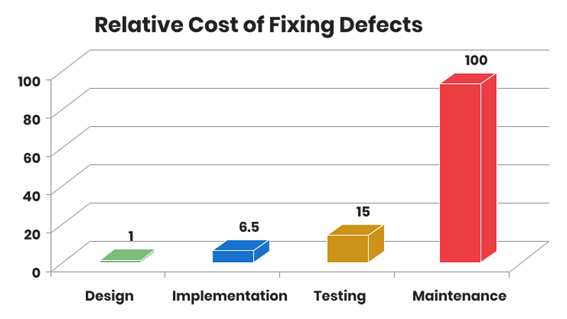
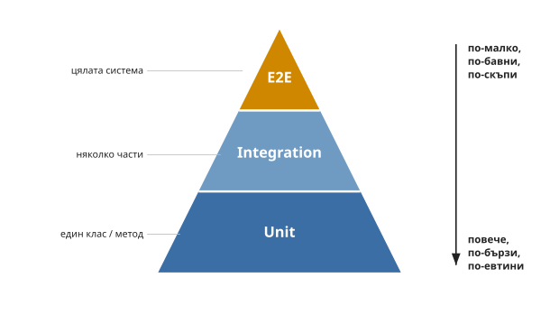

class: center, middle

# Unit Testing & Mocking

18.11.2026

.center[]

---

### Миналата седмица приключихме с едно обещание

```java
List<OrderEvent> events = new ArrayList<>();   // type-safe, компилира се ✅
// ... но прави ли каквото трябва? 🤔
```

<br>

<div style="background:#eef3f7; border-left:5px solid #3b6ea5; padding:10px 16px; border-radius:6px;">
🧠 С Generics накарахме <b>компилатора</b> да лови цял клас грешки. Но „компилира се" ≠ „работи". <br>
Днес ще видим как <b>доказваме</b>, че кодът прави това, което твърдим — по същия начин, по който се проверяват решенията ви на грейдъра.
</div>

---

### „Компилира се" ≠ „работи"

```java
int discount(int price) {
    return price * 10 / 100;   // 10% отстъпка
}
```

---

### „Компилира се" ≠ „работи"

```java
int discount(int price) {
    return price * 10 / 100;   // 10% отстъпка
}
```

<br>

<div style="background:#fff7e6; border-left:5px solid #d08700; padding:8px 16px; border-radius:6px;">
⚠️ Компилацията е успешна. Няма изключения по време на изпълнение. И все пак е грешно за малки суми. Само изпълнение с правилните входове го хваща — т.е. <i>тест</i>.
</div>

---

class: center, middle

# Част 1 — Защо и как тестваме

---

### Защо е нужно да си тестваме кода?

> Chuck Norris doesn't need unit tests because his code always works. ALWAYS.
>
>&emsp;&emsp;&emsp;&emsp;— Wisdom of the Internet ;)

---

### Защо е нужно да си тестваме кода?

- За да сме сигурни, че прави това, което очакваме — и продължава да го прави след промени
- За да ловим грешки рано (евтино), а не в production (скъпо)
- За да можем да променяме кода без притеснение (защита от регресии)

---

### Кога да тестваме?

.center[]

---

### Пирамидата на тестовете

.center[]

- **Unit** (много, бързи) — един клас/метод, в изолация ← **фокусът ни днес**
- **Integration** (по-малко) — няколко части заедно
- **End-to-end** (малко, бавни) — цялата система като потребител

---

### Unit Testing

- Unit test е код, който изпълнява специфична, "атомарна" (т.е. която не може да се разбие по смислен начин на по-малки) функционалност на кода, която да бъде тествана
- Един unit test цели да тества малък фрагмент код - обикновено един метод

---

### Unit Testing

- Unit тестовете гарантират, че кодът работи както очакваме
- Подсигуряват, че кодът ще продължи да работи, както се очаква, в случай че го модифицираме, за да оправим бъг, рефакторираме или разширяваме функционалността

---

### Малко дефиниции

- *Продуктивен код* (a.k.a. *code under test*) – това е кодът, който реализира потребителските изисквания и удовлетворява сценариите на клиентите

- Процентът на продуктивния код, който се тества от автоматични тестове, се нарича *test coverage* или *code coverage*. Високият test coverage на кода ни дава увереност да разработваме функционалности, без да се налага да правим много ръчни тестове

---

### Малко дефиниции

- *Test fixture* е фиксирано състояние на софтуера, който тестваме, което е началното условие (предусловието) за изпълняване на тестовете

---

### Tова тест ли е?

```java
public static void main(String... args) {
    Calc calc = new Calc();
    System.out.println(calc.multiply(10, 0));   // очакваме 0
    System.out.println(calc.multiply(3, 4));    // очакваме 12
}
```

---

class: center, middle

# JUnit

---

### JUnit Framework

- JUnit е най-популярният и *de facto* стандартният testing framework в Java
- Open source проект в [GitHub](https://github.com/junit-team/junit-framework)
- Актуалната версия е [6.1.3](https://github.com/junit-team/junit-framework/releases/tag/r6.1.3) (released 07.08.2026)

<br/>

.center[]

---

### Защо ни трябват testing frameworks?

- Улесняват ни да пишем и изпълняваме тестове
- Стандартизират разработката и поддръжката на тестове

---

### JUnit

- JUnit се базира на анотации
- Всеки JUnit тест е метод, анотиран с `@Test`, съдържащ се в клас, който се използва само за тестване
- Такъв клас се нарича *test case*
---

### Пример за JUnit тест

```java
public class Calc {
    public int multiply(int a, int b) {
        return a * b;
    }
}
```

<br>

```java
import org.junit.jupiter.api.Test;

import static org.junit.jupiter.api.Assertions.assertEquals;

public class CalcTest {
    @Test
    void testMultiplyByZeroShouldReturnZero() {
        Calc calc = new Calc(); // Calc is tested
        assertEquals(0, calc.multiply(10, 0), "10 x 0 must be 0");
        assertEquals(0, calc.multiply(0, 10), "0 x 10 must be 0");
        assertEquals(0, calc.multiply(0, 0), "0 x 0 must be 0");
    }
}
```

---

### Конвенции за именуване

- Прието е името на тестовия клас да се получава от името на класа, който тества, с добавяне на суфикса `Test`
- Популярна конвенция за имената на тестовите методи е, да започват с `test`, следвано от името на метода, който се тества, и кратко описание на тестовия сценарий, например `testLoginWithInvalidUserPassword()`. Към нея се придържаме в нашите тестове за курса
- Името на теста трябва достатъчно ясно да описва сценария

---

### Статични методи на `Assertions` класа

- JUnit предоставя статични методи в класа `org.junit.jupiter.api.Assertions` за тестване на определени условия
- Ще се запознаем с най-използваните от тях, а може да разгледате всички в [документацията](https://docs.junit.org/current/api/org.junit.jupiter.api/org/junit/jupiter/api/Assertions.html) му

---

### Статични методи на `Assertions` класа

- `assertTrue(boolean condition, String message)` – проверява, че булевото условие е истина
- `assertFalse(boolean condition, String message)` – проверява, че булевото условие е лъжа
- `assertNull(Object o, String message)` – проверява, че обектът е null
- `assertNotNull(Object o, String message)` – проверява, че обектът не е null
- `assertSame(expected, actual, String message)` – проверява, че двете референции съвпадат
- `assertNotSame(expected, actual, String message)` – проверява, че двете референции са различни

---

### Статични методи на `Assertions` класа

- `assertEquals(expected, actual, String message)` – проверява за равенство на два обекта
    - масивите се сравняват по референции, не по съдържание
- `assertEquals(expected, actual, delta, String message)` – проверява за равенство на числа с плаваща точка
    - делтата (`delta`) определя точността на сравнението
- `assertArrayEquals(expected, actual, String message)` - проверява за равенство на два масива по дължина и съдържание. Ако и двата са null, се приемат за равни
- `assertIterableEquals(Iterable<?> expected, Iterable<?> actual, String message)` - проверява дали двата `Iterable` връщат едни и същи (по съдържание) елементи, в един и същи ред

---

### Статични методи на `Assertions` класа

- `assertThrows(Class<? extends Throwable> expectedType, Executable code, String message)` – проверява, че кодът хвърля точно това изключение
- `assertAll(Executable... assertions)` – изпълнява няколко assertions и докладва всички failures наведнъж (не спира след първия)
- `fail(String message)` – фейлва теста нарочно
    - Може да се използва за проверка, че определена част от кода не се достига или като временна dummy имплементация

---

### Съобщенията са опционални, но...

- Във всички assert методи, `String` параметърът (message) е опционален
- Добра практика да го подавате винаги и съобщението да е конкретно, подробно и смислено
- Особено важно е в случаите, в които различни инженери пишат продуктивния код и тестовете

---

### JUnit анотации: `@Test`

```java
import static java.time.Duration.ofMillis;
import static org.junit.jupiter.api.Assertions.*;

// a test class may be public, protected or package-private. The latter is recommended
class InvestmentWalletTest {
    @Test
    void testDepositSuccessful() { // a test method may be public, protected or package-private
        assertEquals(5.0, wallet.deposit(5.0), 0.001,
            "If balance is 0, return the amount deposited");
    }
    @Test
    void testDepositNegativeAmount() {
        assertThrows(IllegalArgumentException.class, () -> wallet.deposit(-1.0),
            "Deposit amount cannot be negative");
    }
    @Test
    void testDepositPerformance() {
        assertTimeout(ofMillis(100), () -> wallet.deposit(1250.0), "Deposit too slow");
        // "Deposit too slow ==> execution exceeded timeout of 100 ms by 33 ms"
    }
}
```

---

### JUnit анотации за жизнен цикъл: `@BeforeEach` и `@AfterEach`

```java
class InvestmentWalletTest {

    @BeforeEach
    void setUp() {
        // този метод се изпълнява преди всеки тестов метод
        // използва се за подготовка на тестовата среда
    }

    @AfterEach
    void tearDown() {
        // този метод се изпълнява след всеки тестов метод
        // използва се да зачисти тестовата среда
    }

}
```

---

### JUnit анотации за жизнен цикъл: `@BeforeAll` и `@AfterAll`

```java
class InvestmentWalletTest {

    @BeforeAll
    static void setUpTestCase() {
        // този метод се изпълнява еднократно преди стартиране на всички тестове
        // методите с тази анотация трябва да са статични
    }

    @AfterAll
    static void tearDownTestCase() {
        // този метод се изпълнява еднократно след завършване на изпълнението на всички тестове
        // методите с тази анотация трябва да са статични
    }

}
```

---

### Koй е редът на изпълнение?

```java
@BeforeAll  static void a() { print("A"); }
@BeforeEach void b()        { print("B"); }
@AfterEach  void c()        { print("C"); }
@Test void test1()          { print("1"); }
@Test void test2()          { print("2"); }
```

<br>

**Vote** ✋: (а) `A B 1 C B 2 C` · (б) `B 1 C B 2 C A` · (в) `A 1 2` · (г) не е дефиниран

---

### Ред на изпълнение

- JUnit предполага, че всички тестови методи могат да се изпълняват в произволен ред
- Добре написаните тестове не трябва да разчитат на конкретен ред на изпълнение
    - т.е. тестовете не трябва да зависят от други тестове

<br>

`@TestMethodOrder`/`@Order` съществуват, но изполването им не се препоръчва.

---

### JUnit: advanced възможности

- Тестови класове и методи могат смислово да се обединяват в *test suites*
- Може временно да изключваме/игнорираме даден тест с анотацията `@Disabled`
- Може да изпълняваме дадени тестове, само ако са налице някакви условия (например за тестовата среда), чрез т.нар. *assumptions*
- Може да даваме *human-friendly* имена на тестовите класове и/или методи с анотацията `@DisplayName`
- Поддържа се многократно изпълнение на даден тест с параметризираната анотация `@RepeatedTest`
- Поддържат се *параметризирани* и *динамични* тестове

---

### Къде "живеят" unit тестовете?

- Обикновено unit тестовете се разполагат в отделен проект или в отделна source директория, за да са отделени от продуктивния код
- Няма единен стандарт - зависи с какви други tools (например за build) искате интеграция

---

### Къде "живеят" unit тестовете?

- Един вариант (maven)

  ```bash
  fancy-project
      ├─ src/main/java
      │   └─ (...)
      └─ src/test/java
          └─ (...)
  ```

- Друг вариант

  ```bash
  fancy-project
      ├─ src
      │   └─ (...)
      └─ test
          └─ (...)
  ```

---

### Как се изпълняват?

- През IDE
- През конзола
- През build системи (maven, gradle)
- През Continuous Integration (CI) системи (Jenkins, Travis)
- Засега ще се ограничим да ги изпълняваме през IDE-то

---

### Code coverage plug-ins

- [Code coverage runner](https://www.jetbrains.com/help/idea/code-coverage.html) for IntelliJ — инсталиран by default
- [EclEmma](https://www.eclemma.org/) for Eclipse (базиран на [JaCoCo](https://www.jacoco.org/jacoco/))

---

### 🔴🟢 Test-Driven Development (TDD)

Test-Driven Development (TDD) е софтуерен подход, при който разработчикът пише автоматизиран тест за малка част от функционалността преди продуктивния код. Процесът следва повтарящ се цикъл:

<br>

1. 🔴 **Red** — пишем тест за функционалност, която още я няма → той фейлва.
2. 🟢 **Green** — пишем **минималния** код за неговото удовлетворяване.
3. 🔵 **Refactor** — накрая кодът се подобрява и изчиства.

<br>

<div style="background:#eef3f7; border-left:5px solid #3b6ea5; padding:8px 16px; border-radius:6px;">
🧠 Тестът става <b>спецификация</b> на това, което кодът трябва да прави — написана преди самия код.
</div>

---

class: center, middle

# Част 2 — Код със зависимости

---

### Да си припомним Lab 02 snippet-a `AlertService`

```java
interface Notifier {
    void notify(String recipient, String message);
}

final class AlertService {
    private final Notifier notifier;                 // ← поле от друг тип
    AlertService(Notifier notifier) {                // ← подадено отвън
        this.notifier = notifier;
    }
    void alert(String recipient, String text) {
        notifier.notify(recipient, "ALERT: " + text);  // ← ползва го, без да знае КОЙ е
    }
}
```

<br>

<div style="background:#eef3f7; border-left:5px solid #3b6ea5; padding:8px 16px; border-radius:6px;">
🧠 Повечето от вас се затрудниха с това. Днес го разглеждаме пак — бавно, с прости думи — защото е същината на тестването на реален код.
</div>

---

### Три начина да погледнем към едно и също нещо

- 📦 **Композиция:** Класът има поле от друг тип (`AlertService` съдържа `Notifier`).

- 🔗 **Зависимост (Dependency):** `AlertService` не може да работи без `Notifier` – т.е. *зависи* от него.

- 🔌 **Dependency Injection (DI):** Зависимостта се **подава отвън** (напр. през конструктора), вместо класът сам да я създава (`new SmsNotifier()`). 
  - 👉 Така можем да му подадем точно този `Notifier`, който ни трябва.

---

### Unit тестване на класове със зависимости

- В реалният свят, един клас рядко работи сам – той се обръща към други класове (композиция).
  - `Car` has an `Engine` (стойностен обект, лесно)
  - `InvestmentWallet` has a `QuoteService` (външно API)
  - `UserService` has a `UserRepository` (база данни / състояние)

<br>

❓ Големият въпрос при Unit тестването:
Когато инстанцираме класа, чийто метод ще тестваме, каква имплементация на зависимостта трябва да му подадем? 

---

### Защо DI прави теста възможен

```java
// Ако AlertService сам си правеше new SmsNotifier() вътре...
void alert(...) {
    new SmsNotifier().notify(...);   // 😱 всеки тест праща истински SMS!
}
```

<br>

<div style="background:#fff7e6; border-left:5px solid #d08700; padding:8px 16px; border-radius:6px;">
⚠️ Как да тестваме <code>AlertService</code>, без да пращаме истински SMS (бавно, скъпо, изисква мрежа)?
<br/>
Понеже <code>Notifier</code>-ът е <b>подаден отвън</b>, в теста му подаваме <b>фалшив</b> <code>Notifier</code>, който нищо не праща — само записва какво е бил помолен да прати. После проверяваме записаното.
</div>

---

### Lab 02, TODO 4

```java
// „fake" notifier, който просто записва последното извикване:
final class RecordingNotifier implements Notifier {
    String lastRecipient;
    String lastMessage;
    public void notify(String recipient, String message) {
        this.lastRecipient = recipient;
        this.lastMessage = message;      // нищо не праща — само помни
    }
}

// в теста:
RecordingNotifier fake = new RecordingNotifier();
AlertService service = new AlertService(fake);
service.alert("Мария", "пожар");
// после проверяваме: fake.lastMessage трябва да е "ALERT: пожар"
```

---

### Пример: `UserService`

Нека `UserService` е клас с бизнес логиката на приложението — зависи от `UserRepository`:

```java
public class UserService {

    private final UserRepository repository;

    public UserService(UserRepository repository) {   // ← DI
        this.repository = repository;
    }

    public User register(String email, String password) {
        if (repository.exists(email)) {
            throw new UserAlreadyExistsException();
        }
        User user = new User(email, password);
        repository.save(user);
        return user;
    }
}
```

---

### Зависимостите на `UserService`

`UserRepository` е интерфейс — задачата му е да съхранява `User`-и (in-memory, файл, база, ...):

```java
public interface UserRepository {
    boolean exists(String email);
    void save(User user);
}
```

<br>

```java
public record User(String email, String password) { }

public class UserAlreadyExistsException extends RuntimeException { }
```

---

### Какво да тестваме в `register()`

- `register()` има **2 exit point-a** → **2 сценария**:
  - **[TC1]** хвърля `UserAlreadyExistsException`, когато мейлът вече съществува
  - **[TC2]** записва правилния user в хранилището, когато мейлът НЕ съществува там
- Но за да извикаме `register()` ни трябва `UserRepository`. Коя имплементация да подадем в теста?

---

### Unit тестване на класове със зависимости

- При unit тестване се интересуваме от функционалната коректност само на класа, който се тества (`UserService`)
  - Не се интересуваме от функционалата коректност на неговите зависимости (например конкретната имплементация на `UserRepository`). Това е извън обхвата на unit теста.
- Композираните класове могат да бъдат трудни за инстанциране. Например:
  - `UserRepository` имплементация да изисква връзка към база от данни (`DatabaseUserRepositoryImpl`)

---

### Unit тестване на класове със зависимости

- Трябват ни инструменти, чрез които да контролираме и изолираме композираните класове
- Доброто unit тестване се базира на изолация
- Изолацията се постига чрез т.нар *stub* (*fake*) или *mock* обекти

---

### Stubbing

<div style="background:#eaf5f1; border-left:5px solid #2e7d6b; padding:8px 16px; border-radius:6px;">
📖 <i>Stub</i> наричаме клас, който имплементира интерфейса по минимален начин и връща <b>предварително зададени</b> отговори. Служи да изолираме тествания клас от реалните му зависимости.
Извън unit тестването, могат да бъдат използвани и като заместител на код, който още не е разработен
</div>

<br>

```java
public class PositiveUserRepositoryStub implements UserRepository {
    @Override
    public boolean exists(String email) {
      return true; // отговаря винаги „да, съществува"
    }

    @Override public void save(User user) {
      // не прави нищо
    }
}
```

---

### `InMemoryUserRepositoryStub`

```java
public class InMemoryUserRepositoryStub implements UserRepository {

    private final Map<String, User> users = new HashMap<>();

    @Override
    public boolean exists(String email) {
        return users.containsKey(email);
    }

    @Override
    public void save(User user) {
        users.put(user.email(), user);
    }
}
```

.font-sm[🧠 Този stub има истинска (макар проста) логика — държи се като in-memory база.]

---

### The stub way

```java
@Test
void testRegisterThrowsWhenEmailExists() {
    UserRepository repository = new PositiveUserRepositoryStub();
    UserService service = new UserService(repository);

    assertThrows(UserAlreadyExistsException.class,
        () -> service.register("test@test.com", "weak"),
        "Expected UserAlreadyExistsException but it was not thrown");
}
```

---

### Жизнен цикъл на тестване със stub

1. **Setup** — подготвяме обекта за тестване + stub зависимостите му
2. **Exercise** — извикваме метода, който тестваме
3. **Verify state** — assertions проверяват състоянието/резултата
4. **Teardown** — освобождаваме ресурси (ако има)

---

### Плюсове и минуси на stub-овете

- (−) Броят на stub-овете расте бързо със сложността на логиката
- (−) Трудно се проверява **дали** даден метод е бил извикан и **с какви аргументи**
- (−) За всеки сценарий често трябва нов stub клас
- (+) Може да съдържат нетривиална логика (напр. `InMemoryUserRepositoryStub`)

<br>

<div style="background:#eef3f7; border-left:5px solid #3b6ea5; padding:8px 16px; border-radius:6px;">
🧠 Представете си 20 сценария → 20 stub класа. <br>
Трябва ни нещо, което създава симулирания (fake) обект <b>на място, в самия тест</b>.
</div>

---

class: center, middle

# Част 3 — Mockito: автоматизираме създаването на симулирания (fake) обект

---

<br><br><br><br><br>
.center[Но първо, една история за излишен statement, който доведе до уязвимост на милиони устройства.]

---

### 💥 Един излишен statement, който доведе до уязвимост на милиони устройства.

**Apple „goto fail“ — февруари 2014 г.** Apple имаха код, който проверява дали даден сайт наистина притежава валиден сертификат за сигурност.
В кода обаче имаше малък проблем:

```c
if (signature_is_invalid)
    goto fail;
    goto fail;  // ← този statement се изпълнява ВИНАГИ!

// Проверка на подписа...
```

- Програмата трябва да прескочи към `fail`, само ако подписът е невалиден.
- Но заради липсата на `{ }` вторият `goto fail` се изпълнява винаги.
- Програмата прескачала проверката на цифровия подпис, но връщала код за успех, защото последната успешна операция била оставила err = 0. Така тя приемала сървъра за автентичен, без да е проверила дали подписът му е истински.

**Резултат:** устройството можело да приеме връзка със сървър, чиято самоличност не е била проверена. Засегнати бяха милиони iOS и OS X устройства на Apple.

---

### Как бихме хванали този бъг?

Представете си, че пишем тестове за проверката на сертификата.

**Тест 1: Валиден сертификат**

```java
assertTrue(verify(validCertificate));
```

Очакваме: връзката се приема. 🟢

**Тест 2: Невалиден сертификат**

```java
assertFalse(verify(invalidCertificate));
```

Очакваме: връзката се отхвърля. 🔴

При бъга `goto fail` вторият тест би открил проблема: кодът не достига до правилната проверка на подписа.

---

### Mocking

- *Mock* наричаме обект, който програмно конфигурираме с дадени отговори на дадени извиквания на методи
- Mock-овете ни позволяват лесно да се провери дали даден метод на mock-a е извикан и с какви аргументи е извикан
- Инструмент, чрез който контролираме и изолираме композираните класове

---

### Mocking — идеята

<div style="background:#eaf5f1; border-left:5px solid #2e7d6b; padding:10px 16px; border-radius:6px;">
📖 <b>Mock:</b> фалшив обект, който <b>конфигурираме на място в теста</b> — „ако те питат X, отговори Y" — и после <b>проверяваме</b> дали е бил извикан правилно (кой метод, с какви аргументи, колко пъти).
</div>

<br>

- Stub = готов, hard-coded отговор.
- Mock = динамично "наговорен" отговор + проверка на извикването.
- Без нов клас за всеки сценарий — конфигурираш го с 1-2 реда в самия тест.

---

### Жизнен цикъл на тестване с mock

1. Setup data - подготвяме обекта, който ще се тества, както и mock събратята му
2. Setup expectations - задаваме желаните отговори
3. Exercise - извикваме метода, който искаме да тестваме
4. Verify expectations - уверяваме се, че правилният метод на mock-a се е извикал
5. Verify state - използваме assertions, за да проверим състоянието на обекта
6. Teardown - освобождаваме използваните ресурси

---

### Mocking библиотеки

- [Mockito](https://github.com/mockito/mockito)
  - Ще разглеждаме mockito (5.24.x) като mocking библиотека
  - Една от 10-те най-популярни Java библиотеки изобщо
  - JUnit е стандарт за unit testing framework, mockito е стандарт за mocking библиотека
  - Open-source
- [EasyMock](https://github.com/easymock/easymock)
- [PowerMock](https://github.com/powermock/powermock)<sup>*</sup>

<sub>* Putting it in the hands of junior developers may cause more harm than good.</sub>

---

### Mockito

.center[]

---

### Mockito - Why do we drink it?

- Лесен за ползване - mock, use, verify
- Програматично създаване на mock-ове посредством `mock()`
- Програматично конфигуриране на отговори
  - `when(mock.exists("test@test.com")).thenReturn(true)`
- Програматична верификация на интеракциите с mock-a
  - `verify(mock, never()).save(any())`
- Annotation sugar посредством `@Mock` анотацията

---

### `mock()`, `when()`, `verify()` — трите действия

```java
@Test
void testRegisterThrowsWhenEmailExists() {
    UserRepository mock = mock();                         // 1. създай фалшив обект
    when(mock.exists("test@test.com")).thenReturn(true);  // 2. задай отговор на даден вход

    UserService service = new UserService(mock);

    assertThrows(UserAlreadyExistsException.class,        // 3a. провери поведението
        () -> service.register("test@test.com", "weak"));

    verify(mock, never()).save(any());                    // 3b. провери извикването:
}                                                         //     save() НЕ трябва да е викан
```

---

### `when()` — задаване на отговори

```java
when(mock.exists("ann@fmi.bg")).thenReturn(false);  // връща стойност
when(mock.exists("bad")).thenThrow(new RuntimeException());  // хвърля изключение
```

<br>

- Може да задаваш различни отговори за различни аргументи.
- Ако не си задал отговор, mock връща „празна" стойност по подразбиране (`false`, `0`, `null`).

---

### Argument matchers

```java
when(mock.exists(anyString())).thenReturn(true);   // за произволен низ
verify(mock).save(any());                          // save() с какъвто и да е аргумент
verify(mock, times(1)).save(any(User.class));      // точно веднъж, с User
```

<br>

Има много видове matchers (`eq`, `anyInt`, `argThat`...). Идеята е, „не ме интересува точната стойност, интересува ме, че беше извикан".

---

### Spy — обект с частично подменено поведение

<div style="background:#eaf5f1; border-left:5px solid #2e7d6b; padding:10px 16px; border-radius:6px;">
📖 <b>Spy:</b> обвива истински обект. По подразбиране извиква истинските му методи, но позволява да подмениш поведението (stub-неш) само някои от тях. <br>
Може да ползваш и <code>verify()</code>. <br>
Mock = изцяло симулиран обект <br> Spy = истински обект, при който можеш да подмениш поведението на отделни методи.

</div>

<br>

```java
List<String> realList = new ArrayList<>();
List<String> spy = spy(realList);

spy.add("a");                   // истинският add() се изпълнява
System.out.println(spy.size()); // 1 — истинско поведение
verify(spy).add("a");           // и пак можем да проверяваме извиквания
```

---

### Spy — единственият капан за запомняне

```java
List<String> spy = spy(new ArrayList<>());

// ❌ ОПАСНО: when(spy.get(0)) ИЗПЪЛНЯВА истинския get(0) → IndexOutOfBounds!
// when(spy.get(0)).thenReturn("x");

// ✅ правилно за spy: doReturn(...).when(spy) — НЕ вика истинския метод
doReturn("x").when(spy).get(0);
System.out.println(spy.get(0));   // x
```

<br>

<div style="background:#fff7e6; border-left:5px solid #d08700; padding:8px 16px; border-radius:6px;">
⚠️ При spy използвай <code>doReturn(...).when(spy).method()</code>, а НЕ <code>when(spy.method()).thenReturn(...)</code> — второто първо <b>изпълнява истинския метод</b>, който може да хвърли изключение.
</div>

---

### Добри практики

- Не тествай тривиален код като getters/setters
- Тествай `private` методи само косвено (през публичните)
- Стреми се към 70-80% line code coverage (~90% за нов или критичен код)
- Пиши кратки, ясни и **бързи** unit тестове
- Един тест → един сценарий; говорещо име
- Тествай **поведение**, не имплементация

---

### Добри практики

- Mock-вайте само толкова колкото ви трябва за конкретния тест
- Не mock-вайте value обекти
- Keep it short and simple (KISS)
- Redesign when you cannot test it

---

### Полезни четива

- [JUnit User Guide](https://docs.junit.org/current/user-guide/index.html)
- [JUnit Tutorial: A Beginner to Expert Guide with Enhanced Features](https://www.lambdatest.com/learning-hub/junit-tutorial)
- [Mockito Reference Documentation](https://javadoc.io/doc/org.mockito/mockito-core/latest/org.mockito/org/mockito/Mockito.html)
- [Mocks aren't stubs](https://martinfowler.com/articles/mocksArentStubs.html) by Martin Fowler
- [Writing good tests](https://github.com/mockito/mockito/wiki/How-to-write-good-tests) by Mockito team

---

### Полезни четива

.center[]

---

### Следващата седмица

```java
UserRepository mock = mock();          // днес: фалшифицираме зависимостта

// но какво, ако зависимостта е истински ФАЙЛ на диска?
String data = Files.readString(Path.of("users.txt"));
```

<br>

<div style="background:#eef3f7; border-left:5px solid #3b6ea5; padding:8px 16px; margin-top:8px; border-radius:6px;">
🎬 Днес симулирахме (fake-вахме) зависимости, за да тестваме в изолация. Но следващата седмица зависимостта
ще е <b>истински файл и поток от данни</b> — <b>I/O Streams & Files</b>. Как се чете, пише и тества код, който работи с файловата система?
</div>

---

## Въпроси?

.font-xl[.ri-github-fill.icon-inline[[fmi/java-course](https://github.com/fmi/java-course)]]

.font-xl[.ri-youtube-fill.icon-inline[[MJT2027](https://www.youtube.com/playlist?list=PLO1UIjXfc0-k)]]
