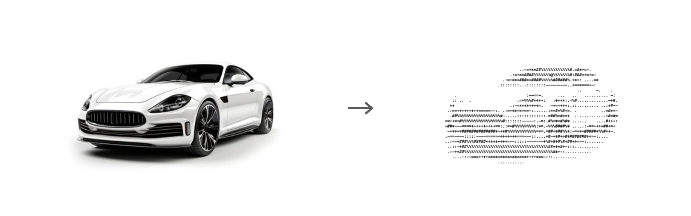

# Image to ASCII Art 🖼️➡️🔤

Преди емоджитата и PNG изображенията хората вече рисували с клавиатурата. [ASCII art](https://en.wikipedia.org/wiki/ASCII_art) се появява в BBS системите (bulletin board systems) в края на 70-те и началото на 80-те. Тогава много компютри можели да показват само текст, затова потребителите създавали цели картини от символи. По-късно се появили групи за ASCII art и дори ASCII комикси. През 90-те графичните браузъри и шрифтовете с различна ширина на символите намалили популярността му, но то останало част от MUD игрите, IRC, имейлите и форумите, където се използват шрифтове с еднаква ширина на символите (fixed-width). ASCII art се използва и днес: например, когато пуснете `neofetch` в терминала, логото на операционната ви система се показва като картина от символи. Сред известните автори на ASCII art е [Joan Stark](https://en.wikipedia.org/wiki/Joan_Stark) от `alt.ascii.art`.

Тази седмица задачата ни е да разработим библиотека, която превръща изображение в ASCII art, тоест картина, нарисувана само със символи. Библиотеката зарежда изображение в някой от популярните графични формати (JPEG, PNG, BMP), разделя го на правоъгълна мрежа от клетки и заменя всяка клетка със символ според яркостта ѝ. По-плътните символи представят тъмните части, а по-редките символи представят светлите. Ако погледнете получения текст отдалече, ще разпознаете оригиналното изображение, но с по-малко детайли.



В цветен режим всеки символ се оцветява в средния цвят на своята клетка. Така резултатът запазва не само формата, но и цветовете на оригинала:


Библиотеката има два основни компонента:

- Алгоритми за преобразуване на изображение в ASCII art
- Компонент за зареждане на изображения и записване на резултата във файлове

Генерирането на ASCII art е разделено на две отговорности, които ще имплементирате поотделно: **кой символ** представя всяка клетка (според яркостта ѝ) и **как този символ се изписва** в крайния текст (просто като символ, или оцветен с ANSI код). Втората отговорност е изнесена в отделен тип, за да може да се добавят нови формати на изхода, без да се променя самият алгоритъм.

## Идеята

ASCII art заменя части от изображението със символи според тяхната **яркост (brightness)**. Плътните символи (`@`, `%`, `#`) се използват за тъмните области, а тези, които заемат по-малко място (` `, `.`), се използват за светлите.

Наборът от символи, подредени от най-светъл към най-тъмен, се нарича **рампа (ramp)**:

```
" .:-=+*#%@"
```

На индекс `0` е интервалът (най-светлият символ), а на последния индекс е `@` (най-тъмният). Рампата има 10 нива, така че всяка стойност на яркостта се представя с едно от тях. Това се нарича [квантизация (quantization)](https://en.wikipedia.org/wiki/Quantization_(image_processing)).

## Алгоритъмът, стъпка по стъпка

Преди да стигнем до интерфейсите, нека разгледаме стъпките на алгоритъма. Те ще ви помогнат да прецените кой клас за коя част от задачата отговаря.

### 1. Избор на размер на клетка (с корекция на пропорциите)

При шрифтовете с еднаква ширина на символите (monospace), символите са около **два пъти по-високи, отколкото широки**. Ако заменим всеки пиксел с един символ, картината ще изглежда разтегната по височина. За да избегнем това, използваме клетки, които са приблизително два пъти по-високи, отколкото широки:

```
cellWidth  = imageWidth / outputWidth
cellHeight = cellWidth * 2            // ASPECT_CORRECTION = 2
cols       = imageWidth  / cellWidth
rows       = imageHeight / cellHeight
```

Използваме само цели клетки, така че няколко пиксела по десния и долния ръб на изображението може да останат извън резултата.

### 2. Изчисляване на средния цвят на всяка клетка

За всяка клетка събираме поотделно стойностите на `R`, `G` и `B` на всички нейни пиксели и делим всяка сума на броя пиксели. Така получаваме средния цвят на клетката.

### 3. От цвят към яркост (luminance)

От стойностите на `R`, `G` и `B` изчисляваме едно число за яркостта по следната формула. Зеленото има най-голяма тежест, защото човешкото око е най-чувствително към него:

```
L = 0.299·R + 0.587·G + 0.114·B
```

Закръглете резултата с `Math.round()` и го ограничете в диапазона [0, 255].

### 4. Подобряване на контраста (contrast stretch)

Яркостите в една снимка рядко покриват целия диапазон от 0 до 255. Например, ако всички стойности са между 40 и 210, разликата между светлите и тъмните части в резултата ще е по-малка. За да подобрим контраста, преизчисляваме яркостите на клетките така, че най-тъмната да получи стойност 0, а най-светлата да получи стойност 255:

```
stretched = (L − min) × 255 / (max − min)
```

`min` и `max` са най-ниската и най-високата яркост **на клетките**. Изчисляваме ги след намирането на средния цвят, за да не се определят от един отделен тъмен или светъл пиксел. Ако всички клетки имат еднаква яркост (`max == min`), пропускаме тази стъпка, за да не делим на нула.

### 5. Съпоставяне на яркост със символ

След корекцията на контраста превръщаме яркостта (от 0 до 255) в индекс в рампата:

```
index = (255.0 − L) / 255.0 × (ramp.length − 1)
```

Обърнете внимание на `255 − L`: **светлата** клетка получава **нисък** индекс (интервал), а **тъмната** клетка получава **висок** индекс (`@`). Идеята е същата като при рисуване с тъмно мастило върху светла хартия.

### 6. Сглобяване на мрежата

Съединяваме символите на клетките ред по ред и добавяме нов ред (`\n`) между редовете.

### 7. Добавяне на цвят (по избор)

Как точно се изписва всеки символ в крайния текст зависи от избрания **начин на изписване (renderer)**:

- При обикновено изписване добавяме просто самия символ.
- При цветно изписване пред символа добавяме [ANSI escape последователност](https://en.wikipedia.org/wiki/ANSI_escape_code#24-bit) за 24-битов цвят (truecolor). Цветът се определя от **средния цвят на клетката** от стъпка 2, преди преобразуването в яркост:

```
\u001B[38;2;R;G;Bm   <символ>   ...   \u001B[0m   (reset в края на всеки ред)
```

Тоест пред всеки символ добавяме `\u001B[38;2;R;G;Bm` със съответните стойности на `R`, `G` и `B`, а всеки ред завършва с `\u001B[0m`, което връща стандартните настройки за цвят. При обикновеното изписване не добавяме escape последователности и резултатът е обикновен ASCII текст.

Забележете, че алгоритъмът (стъпки 1–6) е един и същ и за двата начина на изписване — различава се единствено как се изписва всяка клетка. Затова изнасяме тази отговорност в отделен тип.

## Основни интерфейси и класове

Имплементирайте описаните по-долу интерфейси и класове. Някои са частично дефинирани, за да ви насочат. Разгледайте документацията на класа [BufferedImage](https://docs.oracle.com/en/java/javase/25/docs/api/java.desktop/java/awt/image/BufferedImage.html). Ще използвате методите му, за да четете пикселите на изображението.

### BrightnessConverter

Интерфейсът `BrightnessConverter` преобразува един `RGB` пиксел в стойност за яркост.

```java
package bg.sofia.uni.fmi.mjt.asciiart.brightness;

/**
 * Converts a packed RGB pixel into a single brightness value in the range [0, 255].
 */
public interface BrightnessConverter {

    /**
     * Computes the brightness of a single pixel.
     *
     * @param rgb a pixel packing red, green, and blue in its low 24 bits
     *            (as returned by BufferedImage.getRGB)
     * @return the brightness of the pixel, in the range [0, 255]
     */
    int brightness(int rgb);
}
```

### LuminanceBrightness

Класът `LuminanceBrightness` има публичен конструктор по подразбиране, имплементира `BrightnessConverter` и изчислява яркостта по формулата от стъпка 3: `0.299 R + 0.587 G + 0.114 B`. Закръглете резултата с `Math.round()` и го ограничете в диапазона [0, 255].

### CharacterRamp

Интерфейсът `CharacterRamp` съпоставя стойност за яркост със символ от рампата.

```java
package bg.sofia.uni.fmi.mjt.asciiart.ramp;

/**
 * Maps a brightness value to a character from a fixed ramp of symbols,
 * ordered from the lightest to the darkest.
 */
public interface CharacterRamp {

    /**
     * Maps a brightness value to a ramp character.
     *
     * @param brightness a brightness value in the range [0, 255]
     * @return the ramp character for the given brightness
     * @throws IllegalArgumentException if brightness is outside [0, 255]
     */
    char charFor(int brightness);
}
```

### DensityRamp

Класът `DensityRamp` имплементира `CharacterRamp`, използва рампата `" .:-=+*#%@"` и има два публични конструктора:

```java
package bg.sofia.uni.fmi.mjt.asciiart.ramp;

public class DensityRamp implements CharacterRamp {

    /**
     * Creates a ramp with the default mapping: a bright pixel maps to a light
     * character (a space), a dark pixel maps to a dense character ('@').
     */
    public DensityRamp();

    /**
     * Creates a ramp whose mapping may be inverted.
     *
     * @param inverted if true, the mapping is flipped: a bright pixel maps to a
     *                 dense character and a dark pixel maps to a light one.
     */
    public DensityRamp(boolean inverted);

    // ...
}
```

Използвайте формулата от стъпка 5, за да изберете символа според яркостта. При `inverted == true` обърнете посоката, като пропуснете изваждането `255 −`. Тогава светлите клетки получават плътни символи, а тъмните получават по-редки символи.

:point_right: Обръщането на посоката има значение. Стандартното съпоставяне е подходящо за **тъмен обект на светъл фон**, например тъмна кола на бял фон. При **светъл обект на тъмен фон** фонът се запълва с `@` и обектът може да се изгуби. В такъв случай обърнатата посока може да го направи по-ясен. Кой вариант изглежда по-добре зависи от изображението.

### CellRenderer

Интерфейсът `CellRenderer` определя как една клетка се изписва в крайния текст. Той получава вече избрания символ и средния цвят на клетката и дописва резултата в подадения `StringBuilder`. Така алгоритъмът за избор на символ остава независим от формата на изхода.

```java
package bg.sofia.uni.fmi.mjt.asciiart.render;

/**
 * Appends a single ASCII-art cell to the output being built.
 * Implementations decide how a cell's symbol is written (plain, colored, ...).
 */
public interface CellRenderer {

    /**
     * Appends one cell to the output.
     *
     * @param output the builder that accumulates the ASCII art
     * @param symbol the character chosen for the cell
     * @param rgb    the cell's average color, packed in the low 24 bits
     * @throws IllegalArgumentException if output is null
     */
    void appendCell(StringBuilder output, char symbol, int rgb);

    /**
     * Appends anything that must close a row (e.g. a reset escape).
     * The default implementation appends nothing.
     *
     * @param output the builder that accumulates the ASCII art
     * @throws IllegalArgumentException if output is null
     */
    default void endRow(StringBuilder output) {
    }
}
```

### PlainCellRenderer

Класът `PlainCellRenderer` има публичен конструктор по подразбиране, имплементира `CellRenderer` и дописва само самия символ, без цвят. `endRow` не прави нищо.

### AnsiColorCellRenderer

Класът `AnsiColorCellRenderer` има публичен конструктор по подразбиране, имплементира `CellRenderer` и изписва всеки символ в цвят. Пред символа добавя `\u001B[38;2;R;G;Bm` със стойностите на `R`, `G` и `B` от подадения цвят (стъпка 7), а `endRow` добавя reset-а `\u001B[0m`.

### AsciiArtConverter

Интерфейсът `AsciiArtConverter` преобразува цяло изображение в ASCII art.

```java
package bg.sofia.uni.fmi.mjt.asciiart;

import java.awt.image.BufferedImage;

/**
 * Converts an image into ASCII art: a String with one text row per cell row,
 * rows separated by '\n', and no trailing newline.
 */
public interface AsciiArtConverter {

    /**
     * Converts the given image into ASCII art.
     *
     * @param image       the image to convert
     * @param outputWidth the desired output width, in characters
     * @return the ASCII art representation of the image
     * @throws IllegalArgumentException if image is null, or if outputWidth is not
     *                                  positive, or is greater than the image width
     */
    String convert(BufferedImage image, int outputWidth);
}
```

### DefaultAsciiArtConverter

Класът `DefaultAsciiArtConverter` имплементира `AsciiArtConverter` и изпълнява целия алгоритъм (стъпки от 1 до 7). Той има публичен конструктор, който приема обектите за изчисляване на яркостта, избор на символ и изписване на клетките:

```java
package bg.sofia.uni.fmi.mjt.asciiart;

import bg.sofia.uni.fmi.mjt.asciiart.brightness.BrightnessConverter;
import bg.sofia.uni.fmi.mjt.asciiart.ramp.CharacterRamp;
import bg.sofia.uni.fmi.mjt.asciiart.render.CellRenderer;

public class DefaultAsciiArtConverter implements AsciiArtConverter {

    /**
     * @throws IllegalArgumentException if brightnessConverter, ramp, or renderer is null
     */
    public DefaultAsciiArtConverter(BrightnessConverter brightnessConverter,
                                    CharacterRamp ramp,
                                    CellRenderer renderer);

    // ...
}
```

В метода `convert()`:

1. Изчислете размера на клетката и броя редове и колони (стъпка 1).
2. За всяка клетка изчислете средния `RGB` цвят и го преобразувайте в яркост чрез подадения `brightnessConverter` (стъпки 2 и 3). Запазете средния цвят, защото ще ви трябва при изписването.
3. Подобрете контраста, като преизчислите **яркостите на клетките** (стъпка 4).
4. За всяка клетка изберете символ според новата ѝ яркост чрез подадената `ramp` (стъпка 5), след което го изпишете чрез подадения `renderer`, като му подадете символа и средния цвят на клетката.
5. В края на всеки ред извикайте `renderer.endRow(...)` и добавете нов ред (`\n`) между редовете (стъпка 6). Дали изходът ще е обикновен, или цветен, зависи единствено от подадения `renderer` — алгоритъмът остава същият.

### FileSystemImageManager

Интерфейсът `FileSystemImageManager` предоставя методи за зареждане на изображения от файловата система и записване на получения ASCII art в текстов файл.

```java
package bg.sofia.uni.fmi.mjt.asciiart.filesystem;

import java.awt.image.BufferedImage;
import java.io.File;
import java.io.IOException;
import java.util.List;

/**
 * An interface for loading and saving images on the file system.
 * The supported image formats are JPEG, PNG, and BMP.
 */
public interface FileSystemImageManager {

    /**
     * Loads a single image from the given file.
     *
     * @param imageFile the file containing the image.
     * @return the loaded BufferedImage.
     * @throws IllegalArgumentException if the file is null
     * @throws IOException              if the file does not exist, is not a regular file,
     *                                  or is not in one of the supported formats.
     */
    BufferedImage loadImage(File imageFile) throws IOException;

    /**
     * Loads all images from the specified directory.
     *
     * @param imagesDirectory the directory containing the images.
     * @return A list of BufferedImages representing the loaded images.
     * @throws IllegalArgumentException if the directory is null.
     * @throws IOException              if the directory does not exist, is not a directory,
     *                                  or contains files that are not in one of the supported formats.
     */
    List<BufferedImage> loadImagesFromDirectory(File imagesDirectory) throws IOException;

    /**
     * Saves the given ASCII art to the specified text file.
     *
     * @param asciiArt the ASCII art to save.
     * @param textFile the file to save the ASCII art to.
     * @throws IllegalArgumentException if the ASCII art or file is null.
     * @throws IOException              if the file already exists or the parent directory does not exist.
     */
    void saveAsciiArt(String asciiArt, File textFile) throws IOException;
}
```

### LocalFileSystemImageManager

Класът `LocalFileSystemImageManager` има публичен конструктор по подразбиране, имплементира `FileSystemImageManager` и предоставя методите за зареждане на изображения и записване на ASCII art.

:point_right: Подсказка: за зареждането на изображения използвайте класа [javax.imageio.ImageIO](https://docs.oracle.com/en/java/javase/25/docs/api/java.desktop/javax/imageio/ImageIO.html). За записването на текста ще ви помогнат [класовете за писане, които разгледахме тази седмица](https://docs.oracle.com/en/java/javase/25/docs/api/java.base/java/io/package-summary.html). Обърнете внимание на кодировката (encoding).

### Пример за използване

Ето кратък пример за използване на библиотеката:

```java
FileSystemImageManager fsImageManager = new LocalFileSystemImageManager();

BufferedImage image = fsImageManager.loadImage(new File("car.png"));

BrightnessConverter brightness = new LuminanceBrightness();
CharacterRamp ramp = new DensityRamp();

AsciiArtConverter plain = new DefaultAsciiArtConverter(brightness, ramp, new PlainCellRenderer());
String asciiArt = plain.convert(image, 100);
System.out.println(asciiArt);
fsImageManager.saveAsciiArt(asciiArt, new File("car.txt"));

AsciiArtConverter color = new DefaultAsciiArtConverter(brightness, ramp, new AnsiColorCellRenderer());
String colored = color.convert(image, 100);
fsImageManager.saveAsciiArt(colored, new File("car-color.txt"));
```

### Разглеждане на резултата

ASCII art без цвят е обикновен текст. Можете да отворите `car.txt` в текстов редактор или да го отпечатате в терминала.

Цветният резултат съдържа и **ANSI escape последователности**, които терминалът разпознава като команди за промяна на цвета. В обикновен текстов редактор или документ може да видите самите кодове вместо цветни символи. За да видите резултата в цвят, покажете съдържанието на файла директно в терминала:

```bash
# macOS / Linux
cat car-color.txt
```

```powershell
# Windows PowerShell
Get-Content car-color.txt
```

```bat
:: Windows cmd.exe
type car-color.txt
```

:point_right: Съвременните терминали (iTerm2, новите версии на macOS Terminal, терминалът във VS Code, Windows Terminal) поддържат 24-битов цвят (truecolor). По-старите терминали с поддръжка само на 256 цвята може да не покажат правилните цветове. При Windows `cmd.exe` поддръжката зависи от версията. Ако цветовете не се показват, използвайте Windows Terminal или PowerShell.

### Тестване

Първо изпробвайте библиотеката си локално с някое от [нашите изображения](resources/) или с ваша картинка. Отпечатайте резултата в терминала и го погледнете отдалече. След това помислете как да проверите работата ѝ автоматично и създайте подходящи unit тестове.

:point_right: Как се тества алгоритъм, който „рисува“? Вместо да сравнявате цели картини пиксел по пиксел, проверете отделните части:

- За даден `RGB` цвят `LuminanceBrightness` трябва да връща очакваната яркост.
- За дадена яркост `DensityRamp` трябва да връща очаквания символ. Проверете стандартната и обърнатата посока, както и граничните стойности 0 и 255.
- `PlainCellRenderer` и `AnsiColorCellRenderer` се тестват самостоятелно: за даден символ и цвят проверете какво дописват в `StringBuilder`. При цветния очаквайте точно escape последователността `\u001B[38;2;R;G;Bm`, а `endRow` да добавя `\u001B[0m`.
- За малко изображение, което сами сте създали (например изцяло черно, изцяло бяло или с еднаква яркост във всички клетки), `DefaultAsciiArtConverter` трябва да връща очакван низ с правилните размери.

Не се съсредоточавайте само върху покритието на кода (code coverage). По-важно е тестовете да проверяват основната функционалност.

## Пакети

Спазвайте имената на пакетите и класовете, както и публичните сигнатури на всички описани по-горе типове. В противен случай грейдърът няма да може да тества решението ви.

```
src
└── bg.sofia.uni.fmi.mjt.asciiart
    ├── AsciiArtConverter.java
    ├── DefaultAsciiArtConverter.java
    ├── brightness
    │   ├── BrightnessConverter.java
    │   └── LuminanceBrightness.java
    ├── ramp
    │   ├── CharacterRamp.java
    │   └── DensityRamp.java
    ├── render
    │   ├── CellRenderer.java
    │   ├── PlainCellRenderer.java
    │   └── AnsiColorCellRenderer.java
    ├── filesystem
    │   ├── FileSystemImageManager.java
    │   └── LocalFileSystemImageManager.java
    └── (...)

test
└── bg.sofia.uni.fmi.mjt.asciiart
     └── (...)
```

## Забележки

- В грейдъра качете директориите `src` и `test`, като изберете и двете. Можете също да ги сложите в общ `.zip` архив и да качите него.
- Тестовите класове трябва да завършват на `Test`.
- Не качвайте JAR файловете на JUnit и Mockito. Те вече са налични в грейдъра.
- Не качвайте изображенията, с които тествате библиотеката си локално.

Приятно програмиране! 🚀
