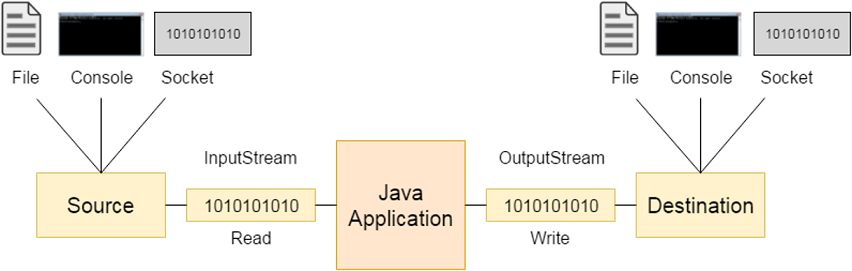
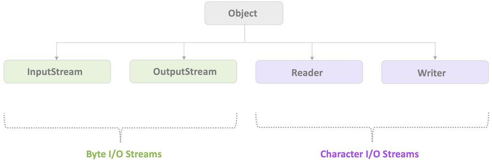
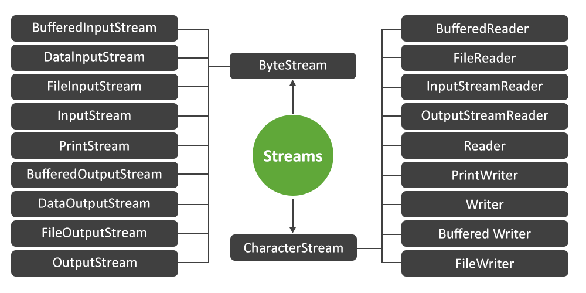
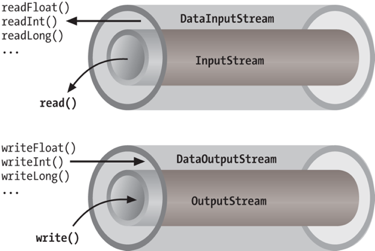
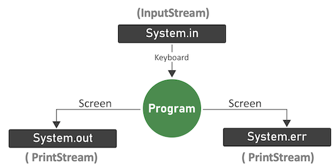
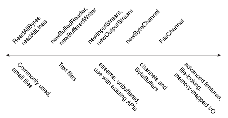
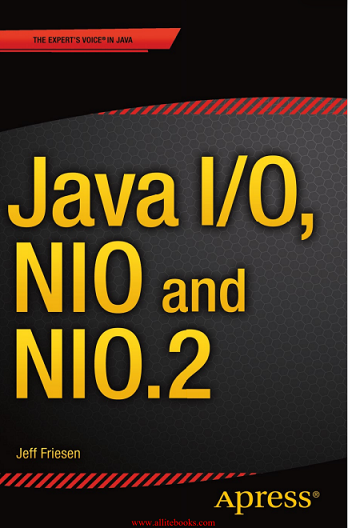

class: center, middle

# Входно-изходни потоци и файлове

26.11.2026

.center[]

---

### Миналата седмица приключихме с обещание

```java
UserRepository mock = mock();            // fake-нахме зависимостта

// но какво, ако зависимостта е истински файл на диска?
String data = Files.readString(Path.of("users.txt"));
```

<br>

<div style="background:#eef3f7; border-left:5px solid #3b6ea5; padding:10px 16px; border-radius:6px;">
🧠 В Unit Testing мокнахме зависимостите, за да тестваме <b>в изолация</b>.<br> Днес тази зависимост става
<b>реална</b> — файл, поток от байтове, файлова система. Как програмата чете и пише от външния свят, и
как го тестваме?
</div>

---

### Днес ще разгледаме:

- Входно-изходните потоци в Java — и какво стои под тях (ОС, байтове, буфери)
- Защо сравнително малко класове дават комбинаторно много възможности
- Работа с файловата система (`Path`, `Files`)
- Най-често допусканите грешки

---

### Първата лекция, която ни доближава до ОС и машината

Досега програмите ни работеха предимно с данни в паметта на Java процеса. Днес за първи път ще погледнем отвъд нея – към файлове, устройства, мрежови връзки и други външни ресурси.

<br>

<div style="background:#eef3f7; border-left:5px solid #3b6ea5; padding:10px 16px; border-radius:6px;">
🧠 <b>Какво стои зад I/O абстракциите в Java?</b><br/>
Java ни предоставя удобни абстракции за вход и изход. В крайна сметка, когато трябва да се получат или изпратят данни към външен ресурс, JVM-ът използва услугите на операционната система.<br/>
На ниско ниво това обикновено включва <i>системни извиквания</i> (<i>syscalls</i>), чрез които ОС предоставя достъп до ресурси като файлове и мрежови връзки.
</div>

---

class: center, middle

# Част 1 — Потоци: моделът и какво има "под капака"

---

### Какво е поточна линия?

.center[]

---

### Входно-изходни потоци

- Концепцията за вход-изход в Java се основава на *потоци* (*streams*)
- *Потокът* е абстракция за **последователност от данни**, която се обработва постепенно във времето
- От входен поток четем данни, a към изходен поток записваме данни.
- В Java потоците може да се основават на байтове или на символи

<br>

<div style="background:#eef3f7; border-left:5px solid #3b6ea5; padding:8px 16px; border-radius:6px;">
🧠 <b>Unlearn/Relearn (C/C++):</b><br>
Java <code>InputStream</code>/<code>OutputStream</code> ≈ C <code>fread()</code> / <code>fwrite()</code> в binary mode.<br>
Java <code>Reader</code> / <code>Writer</code> ≈ C++ <code>std::istream</code> / <code>std::ostream</code> в текстов контекст.
</div>

---

### Източник на данни и дестинация за данни

<br>

.center[]

---

### Две основни йерархии

- **Byte Streams** - работят с байтове. Подходящи са за:
    - Binary данни: снимки, видео, аудио
    - ZIP/JAR файлове. Мрежова комуникация
    - Всякакви данни, при които искаме директен контрол върху байтовете
- **Character Streams** — работят с текст (символи). Подходящи са за:
    - Текстови файлове (CSV, JSON, XML)
    - Конфигурационни файлове
    - Лог файлове

---

### Две основни йерархии

На диска няма „текст"— има само байтове!

- За да интерпретираме тези байтове като текст, трябва да приложим определено кодиране (charset), например UTF-8.
- Защо са две йерархии? Защото понякога искаме да работим с байтове, а друг път — с текст, без сами да се занимаваме с преобразуването между двете.

---

### Абстрактните класове в корена на I/O йерархията

<br>

.center[]

<br>

Намират се в пакета `java.io`.

---

### Видове потоци според нуждата

Абстрактните класове имат множество наследници, които се различават по две основни направления:

- **източника или дестинацията на данните**: файлове, мрежи, буфери в паметта
- **допълнителната обработка**, която предоставят: буфериране, работа с примитивни типове, сериализация на обекти, компресиране, криптиране

<br>

<div style="background:#eef3f7; border-left:5px solid #3b6ea5; padding:8px 16px; border-radius:6px;">
🧠 Два въпроса определят избора на конкретен клас: <b>откъде или накъде</b> текат данните и <b>какво допълнително искаме да правим с тях</b>.
Комбинираме необходимите функционалности чрез <i>wrapping</i> (<i>обвиване</i>) – един поток се обвива в друг, който добавя ново поведение.
Не търсим един клас, който прави всичко. Изграждаме необходимата комбинация от потоци.
</div>

---

### Видове потоци според нуждата

.center[]

---

### „Обвиване" (wrapping) на потоци

По-специализираните потоци се създават като **wrapper около по-базов поток** и добавят по едно качество:

<br>

```java
FileInputStream fileInput = new FileInputStream("data.bin");        // база: байтове от файл
BufferedInputStream buffered = new BufferedInputStream(fileInput);  // + буфериране за скорост
DataInputStream data = new DataInputStream(buffered);               // + четене на примитиви

int number = data.readInt();
double value = data.readDouble();
```

<br>

Повечето потоци имат конструктор, който приема *друг поток*, което позволява *wrapping*.

---

### „Обвиване" (wrapping) на потоци

.center[]

<br>


⚠️ Важно: Извикването на `.close()` върху външния wrapper затваря и обвитите потоци, като затварянето се разпространява навътре по веригата.

---

### „Обвиване" (wrapping) на потоци

Това е една от основните идеи на Java I/O:

- Имаме няколко базови потока, които осигуряват достъп до различни източници и дестинации, и други потоци, които добавят функционалност.
- ~5 базови потока × ~5 допълнителни качества не означава 25 отделни класа, които трябва да помним.<br>
- Вместо това обвиваме потоците един в друг (като матрьошка) и комбинираме необходимите функционалности.<br>
- Това е приложение на *Decorator Pattern* (ще се върнем към него в темата за Design Patterns).

---

### Входно-изходни потоци: жизнен цикъл

Работата с един поток обикновено преминава през три етапа:

- **Създаване (отваряне)** – свързваме потока с източник или дестинация на данни (файл, сокет и др.)
- **Използване** – четем данни от потока или записваме данни в него
- **Затваряне** – извикваме `close()`, за да освободим свързаните с потока ресурси

<br>

<div style="background:#fff7e6; border-left:5px solid #d08700; padding:8px 16px; border-radius:6px;">
⚠️ <b>Затварянето не е козметика!</b> Потоците, които използват ресурси на ОС, трябва да бъдат затваряни своевременно.
Отворен файлов поток например може да задържа файлов дескриптор (file descriptor) – ограничен ресурс на ОС. Незатворените потоци могат да доведат до resource leak и грешки като <code>Too many open files</code>.
Всеки поток, който отваряме, трябва да бъде затворен, когато приключим работа с него.
</div>

---

### Try-with-resources — затваряй гарантирано

- `try`, който **декларира ресурси** и ги **затваря автоматично** в края на блока
- Работи за всеки клас, който имплементира `AutoCloseable` (вкл. всички `Closeable` → всички потоци)

<br>

```java
static String readFirstLine(String path) throws IOException {
    try (BufferedReader br = new BufferedReader(new FileReader(path))) {
        return br.readLine();
    }   // br.close() се вика АВТОМАТИЧНО — дори при exception
}
```

---

### Под капака: защо изобщо има буфер?

**Проблемът:** Достъпът до външни ресурси е скъп в сравнение с достъпа до оперативната памет. При директно четене на малки порции данни от файл може да се стигне до множество системни извиквания (*syscalls*). Всяко от тях има цена – преход между user space и kernel space.

<br>

**Решението: `BufferedInputStream`**. Вместо да иска от ОС по един байт, `BufferedInputStream` прочита наведнъж по-голям блок (например 8192 байта) и го съхранява в паметта. След това обслужва множество малки `read()` calls директно от този буфер.

<br>

**Резултат:** Много извиквания на `read()` в Java могат да бъдат обслужени само с едно по-голямо четене от underlying stream-а, вместо всяко да предизвиква отделно системно извикване.

---

### Пример с `InputStream`

```java
InputStream inputStream = new FileInputStream("data/input-text.txt");

int data;
while ((data = inputStream.read()) != -1) {
    // doSomethingWithData(data);
}

inputStream.close();
```

<br>

`read()` чете **един байт** и го връща като `int` в интервала `[0, 255]`.
Връща `-1` като маркер за **край на потока** (`EOF`).

---

### Защо `int`, а не `byte`?

```java
int data;
while ((data = inputStream.read()) != -1) { ... }
```

<br>

**Vote** ✋: Защо `read()` връща `int`, при положение че чете само един байт?
- (а) За да се избегне проблемът със знаковото разширяване (sign extension) при преобразуване от `byte` към `int`.
- (б) Защото `byte` в Java е знаков тип [-128, 127], а трябва да се представят стойности [0, 255].
- (в) За да има стойност (-1) извън валидния диапазон на байт → еднозначен `EOF` маркер.

---

### `java.io.InputStream`

```java
abstract int read();                 // единственият абстрактен: прочети 1 байт
int read(byte[] b);                  // този ползваш най-често (блок наведнъж)
int read(byte[] b, int off, int len);
byte[] readAllBytes();                // удобно за МАЛКИ файлове
long transferTo(OutputStream out);    // копирай целия поток в друг
void close();
int available();
long skip(long n);
void mark(int readlimit);
boolean markSupported();
void reset();
```

---

### `java.io.OutputStream`

```java
abstract void write(int b);            // единственият абстрактен: запиши 1 байт
void write(byte[] b);                  // този ползваш най-често (блок наведнъж)
void write(byte[] b, int off, int len);
void flush();                          // изпразни буфера към ОС сега
void close();
```

---

### Пример с `OutputStream`

```java
OutputStream os = new FileOutputStream("test.txt");

os.write("Hello FMI!".getBytes());
os.flush();
os.close();
```

<br>

При конструиране на `FileOutputStream`, ако файлът не съществува — прави се опит да се създаде.

---

### `FileOutputStream`: append vs. overwrite

```java
// добавя в края на файла
OutputStream output = new FileOutputStream("data/output.txt", true);

// презаписва файла
OutputStream output = new FileOutputStream("data/output.txt", false);
```

Без булев аргумент поведението по подразбиране е **overwrite** (презаписване).

---

### Пример с `DataInputStream`

```java
DataInputStream input = new DataInputStream(new FileInputStream("binary.data"));

int    aByte   = input.read();
int    anInt   = input.readInt();
float  aFloat  = input.readFloat();
double aDouble = input.readDouble();

input.close();
```

`DataInputStream` = wrapper, който добавя четене на **примитивни типове** над байтовете.

---

### Пример с `ObjectOutputStream` (сериализация)

```java
var out = new ObjectOutputStream(new FileOutputStream("persons.dat"));

Person person = new Person("Иван", 25);
out.writeObject(person);     // сериализира обекта
out.close();
```

<br>

- *Сериализация* (*Serialization*) = преобразуване на състоянието на обект в последователност от байтове, която може да бъде съхранена във файл или изпратена по мрежата.

- *Десериализация* (*Deserialization*) = възстановяване на обект от тази последователност от байтове.

---

### `java.io.Serializable`

`Serializable` е **маркерен интерфейс** — указва, че обекти на класа може да се *сериализират* и
*десериализират*. Класове, чиито обекти записваме/четем във файл или пращаме по мрежата, трябва да са
`Serializable`.

```java
import java.io.Serializable;

public class Person implements Serializable {
    // the particular version of the class definition is denoted by
    // the serial version unique identifier: IDEs can generate these
    private static final long serialVersionUID = 1234L;

    private String name;
    private int age;

    public Person(String name, int age) {
        this.name = name;
        this.age = age;
    }
}
```

---

### „Работи на моята машина"

Колега ти предлага този фрагмент код за „прочети и покажи съдържанието на текстов файл":

```java
String content = new String(Files.readAllBytes(Path.of("имена.txt")));
System.out.println(content);   // „Иван Петров"
```

Компилира се. Работи на машината на автора.
Има ли проблем обаче?

---

### „Работи на моята машина"

Колега ти предлага този фрагмент код за „прочети и покажи съдържанието на текстов файл":

```java
String content = new String(Files.readAllBytes(Path.of("имена.txt")));
System.out.println(content);   // „Иван Петров"
```

Компилира се. Работи на машината на автора.

<br>

<div style="background:#fff7e6; border-left:5px solid #d08700; padding:8px 16px; border-radius:6px;">
🪤 Къде фейлва? <br> Няма зададен <b>charset</b> → ползва platform default. Записано на Windows-1252, прочетено на Linux (UTF-8) → <code>Иван Петров</code> (маймуница).<br>Fix: <code>Files.readString(path)</code> (UTF-8 по
подразбиране) или с изрично подаване на конкретен charset.
</div>

---

### `java.io.Reader` / `java.io.Writer`

```java
// Reader (символи, вход)              // Writer (символи, изход)
int  read();                           void  write(int c);
int  read(char[] cbuf);                void  write(char[] cbuf);
int  read(CharBuffer target);          void  write(String str);
void close();                          Writer append(CharSequence csq);
                                       void  flush();
                                       void  close();
```

---

### Пример с `BufferedReader` — чети ред по ред

```java
Reader reader = new FileReader("data/data.txt");
BufferedReader bufferedReader = new BufferedReader(reader);

String line;
while ((line = bufferedReader.readLine()) != null) {
    // process(line);
}
```

`readLine()` връща `null` на край на файла (аналог на `-1` при байтовете).

<!-- Базов слайд, запазен. ➕ 1 ред: null = EOF аналог. -->

---

### Разделител на редовете — не го пиши на ръка

Различните ОС използват различен символ за край на ред:

- Windows: `\r\n`
- UNIX, Linux, macOS: `\n`

За да работи кодът на всяка ОС, **не** пиши `"\n"` директно — ползвай:

- `System.lineSeparator()`, или
- `PrintWriter.println()`, или
- `BufferedWriter.newLine()`

---

### Трите стандартни потока

<br>

.center[]

---

### `java.util.Scanner` и `java.util.Formatter`

```java
Scanner scanner = new Scanner(System.in);   // парсва вход
int i = scanner.nextInt();
String str = scanner.nextLine();
```

<br>


```java
System.out.format("Local time: %tT", Calendar.getInstance());   // форматира изход
System.err.printf("Cannot open '%s': %s", fileName, msg);
```

<br>

<div style="background:#eef3f7; border-left:5px solid #3b6ea5; padding:8px 16px; border-radius:6px;">
🧠 <b>C връзка:</b> <code>printf</code>/<code>format</code> са буквално наследникът на
<code>printf</code> от C - същите <code>%d %s %f</code> шаблони.
</div>

---

class: center, middle

# Част 2 — Файловата система

### `Path` и `Files`

---

### Файловата система

- Йерархична структура: **директории** и **файлове**
- Главна директория (**корен**) · текуща (работна) директория
- **Пътища**: относителни и абсолютни
- Symbolic links

<!-- Базов слайд, запазен. -->

---

### Java API-то за файловата система: NIO.2

**NIO.2** (NIO == Non-blocking I/O), пакет [`java.nio.file`](https://docs.oracle.com/en/java/javase/27/docs/api/java.base/java/nio/file/package-summary.html):

- [`java.nio.file.Path`](https://docs.oracle.com/en/java/javase/27/docs/api/java.base/java/nio/file/Path.html) — представя **път** (файл/директория, който може и да не съществува)
- [`java.nio.file.Files`](https://docs.oracle.com/en/java/javase/27/docs/api/java.base/java/nio/file/Files.html) — **статични операции** върху пътища (чети, пиши, копирай, трий, обхождай)

<br>

<div style="background:#eef3f7; border-left:5px solid #3b6ea5; padding:8px 16px; border-radius:6px;">
🧠 Две неща: <code>Path</code> = „адресът", <code>Files</code> = „действията". Запомниш ли това
разделение, намираш всичко останало.
</div>

---

### `java.nio.file.Path`

```java
// Path представя път; файлът/директорията може да съществува или не.
// Инстанции: статични методи Path.of(...) (Java 11+) или Paths.get(...)

Path userHome   = Path.of("/home/joe");                 // /home/joe
Path aFile      = Path.of("/home/joe", "orders.txt");   // /home/joe/orders.txt
Path relPath    = Path.of("documents", "FileIO.odp");   // documents/FileIO.odp

Path winPath    = Path.of("C:\\Users\\joe\\orders.txt"); // Windows: C:\Users\joe\orders.txt
```

---

### `Path` — разделители и методи

Разделителят е OS-зависим (`\` на Windows, `/` на UNIX); вземи го с `FileSystem.getSeparator()`.

| Метод          | UNIX/Linux       | Windows           |
|:---------------|:-----------------|:------------------|
| `toString()`   | /home/joe/foo    | C:\home\joe\foo   |
| `getFileName()`| foo              | foo               |
| `getName(0)`   | home             | home              |
| `getNameCount()`| 3               | 3                 |
| `subpath(0, 2)`| home/joe         | home\joe          |
| `getParent()`  | /home/joe        | \home\joe         |
| `getRoot()`    | /                | C:\               |

---

### `Path` — преобразувания и сравняване

```java
Path toAbsolutePath()   // прави пътя абсолютен (от корена)
Path toRealPath()       // абсолютен + без symlink-и + без . и ..

Path p1 = Path.of("/home/joe/foo");
Path p2 = p1.resolve("bar");          // /home/joe/foo/bar  ← добавяне на под-път

boolean equals(Path other)
boolean startsWith(Path other)
boolean endsWith(Path other)
```

<br>

<div style="background:#fff7e6; border-left:5px solid #d08700; padding:8px 16px; border-radius:6px;">
⚠️ Съединявай пътища с <code>resolve(...)</code>, НЕ с <code>+ "/" +</code> <br>
Иначе губиш платформената независимост на кода ти.
</div>

---

### Legacy: `java.io.File`

Дескриптор за файлове отпреди Java 7 — аналог на `Path`. Още се среща в много API-та.

```java
File file = new File("data/file.txt");

// конверсия към/от NIO.2
Path path = file.toPath();
File back = path.toFile();
```

<br>

<div style="background:#eef3f7; border-left:5px solid #3b6ea5; padding:8px 16px; border-radius:6px;">
🧠 <b>За нов код: винаги <code>Path</code>/<code>Files</code>.</b> <code>File</code> го ползваш само
когато старо API го изисква. (AI понякога ти "пробутва" <code>File</code> по навик)
</div>

---

### `java.nio.file.Files` — обзор

Един клас, статични методи, 5 групи:

- **Метаданни:** `size`, `isDirectory`, `isRegularFile`, `getLastModifiedTime`, `getOwner`…
- **Проверки:** `exists`, `isReadable`, `isWritable`, `isSameFile`…
- **Операции:** `copy`, `move`, `delete`, `deleteIfExists`, `createDirectory`, `createDirectories`
- **Четене/писане на цял файл:** `readString`, `writeString`, `readAllLines`, `write`, `readAllBytes`
- **Обхождане:** `newDirectoryStream`, `lines`

---

### `Files`: чети/пиши цял файл (най-често)

```java
// Удобни — за МАЛКИ файлове:
String text  = Files.readString(Path.of("config.json"));          // UTF-8
List<String> lines = Files.readAllLines(Path.of("data.csv"));
byte[] bytes = Files.readAllBytes(Path.of("image.png"));

Files.writeString(Path.of("out.txt"), "Иван Петров");             // UTF-8
Files.write(Path.of("out.bin"), bytes);
```

<br>

<div style="background:#fff7e6; border-left:5px solid #d08700; padding:8px 16px; border-radius:6px;">
⚠️  Работата с „цял файл в паметта" е удобна, но за <b>големи</b> файлове би резултирала в <code>OutOfMemoryError</code>.
За тях ползваме буфериран поток или <code>Files.lines(...)</code> (ред по ред).
</div>

---

### `Files`: триене, копиране, местене

```java
Files.delete(path);
// path не съществува → NoSuchFileException; непразна директория → DirectoryNotEmptyException
Files.deleteIfExists(path);                                 // връща boolean

Files.copy(source, target, StandardCopyOption.REPLACE_EXISTING);
Files.move(source, target, StandardCopyOption.ATOMIC_MOVE); // ако ОС поддържа
```

---

### `Files`: създаване и обхождане на директории

```java
Files.createDirectory(dir);     // родителят трябва да съществува
Files.createDirectories(dir);   // създава и всички родители

Path dir = Path.of("some-dir");
try (DirectoryStream<Path> stream = Files.newDirectoryStream(dir)) {
    for (Path entry : stream) {
        // работа с entry (файл или поддиректория)
    }
}
```

`DirectoryStream` е `Iterable` (подобен на колекция), **не** I/O поток — но пак се затваря.

---

### Обхождане с шаблони (globs)

```java
try (DirectoryStream<Path> stream = Files.newDirectoryStream(dir, "*.java")) {
    // само .java файловете
}
```

| Шаблон      | Семантика                                                |
|:------------|:---------------------------------------------------------|
| `*`         | произволен брой символи **в едно име** от пътя           |
| `**`        | като `*`, но **пресича** `/` (цели поддиректории)        |
| `?`         | точно един символ                                        |
| `{a,b}`     | някой от под-шаблоните                                   |
| `[a-z]`     | някой символ от диапазона                                |

---

class: center, middle

# 💥 Една история за филм, който едвам оцелява

---

### 💥 Toy Story 2 едва не изчезва (Pixar, 1998)

- Докато работят по филма, някой пуска на Unix сървъра приблизително:

  ```bash
  /bin/rm -r -f *          # рекурсивно, forced, без питане — върху root директорията
  ```

- За секунди започват да изчезват папки — модели на герои се изпаряват пред очите на аниматорите.

---

### 💥 Toy Story 2 (развръзката)

- ~90% от файловете на филма — изтрити. А backup-ите не са работели от около месец.
- Спасение: тех. директорка, в майчинство, имала домашно копие на сървъра (работела от вкъщи).
  Карат компютъра ѝ през града, увит в одеяло. Възстановяват почти всичко.

---

### ⚡ Бенчмарк: Методи за четене на файлове

| Метод | Малък файл (1MB) | Среден (100MB) | Голям (1GB) | Кога да използваме |
|---------|--------------|---------------|-------------|----------------------|
| `Files.readString()` | ⚡ 4ms | ⚡ 15ms | ❌ OutOfMemory | Малки текстови файлове |
| `Files.readAllLines()` | ⚡ 4ms | ⚡ 120ms | ⚠️ 3.5s | Средни файлове, нужни са всички редове |
| `Files.lines()` + Stream | ⚡ 5ms | ⚡ 112ms | ⚡ 3.5s | Големи файлове, обработка ред по ред |
| `BufferedReader` | ⚡ 24ms | ⚡ 122ms | ⚡ 1.1s | Максимален контрол |
| `FileChannel` (NIO.2) | ⚡ 3ms | ⚡ 102ms | ⚡ 969ms | Екстремна производителност |

---

class: center, middle

# Чести грешки, тестване, clean code

---

### 🏆 Топ 5 грешки от 10 000+ Stack Overflow въпроса

1. Пропуснат `close()` → **file descriptor leak**
2. **Грешен encoding** → маймуница
3. Четене **байт по байт** без буфер → 1000× по-бавно
4. **Погълнат `IOException`** → silent грешки, които нямат дебъгване
5. **Абсолютни пътища** → „работи само на моята машина"

---

### 🐞 #1 Пропуснат `close()`

```java
// ❌ грешно - file handle leak!
FileInputStream input = new FileInputStream("data.bin");
int data = input.read();
// Забравихме да затворим потока!

// ⚠️ По-добре - но все още рисковано
FileInputStream input = null;
try {
    input = new FileInputStream("data.bin");
    int data = input.read();
} finally {
    if (input != null) {
        input.close(); // Ами ако close() хвърли изключение?
    }
}

// ✅ правилно - try-with-resources
try (FileInputStream input = new FileInputStream("data.bin")) {
    int data = input.read();
}   // автоматично се извиква close(), дори при exception
```

---

### 🐞 #2 Грешен encoding

```java
// ❌ грешно - използва platform default encoding
FileWriter writer = new FileWriter("users.txt");
writer.write("Иван Петров");

// Записано на Windows-1252, прочетено на Linux (UTF-8):
// Иван Петров        ← „маймуница"
```

<br>

```java
// ✅ Правилно - изрично указан UTF-8
try (BufferedWriter writer = Files.newBufferedWriter(Path.of("users.txt"), UTF_8)) {
    writer.write("Иван Петров");
}
```

<br/>

```java
// ✅ Най-просто
Files.writeString(Path.of("users.txt"), "Иван Петров"); // UTF_8 by default
```

---

### 🐞 #3 Четене байт по байт без буфер

```java
// ❌ грешно - потенциално syscall за ВСЕКИ байт → ~1000× по-бавно
try (FileInputStream in = new FileInputStream("large.dat")) {
    int b;
    while ((b = in.read()) != -1) { process(b); }
}
```

<br>


```java
// ✅ правилно - с буфериране
try (var in = new BufferedInputStream(new FileInputStream("large.dat"))) {
    int b;
    while ((b = in.read()) != -1) { process(b); } // блокове от 8192 B
        
}
```

```java
// ✅ отлично - с буфериране и четене на масив
try (FileInputStream input = new FileInputStream("large.dat")) {
    byte[] buffer = new byte[8192];
    int bytesRead;
    while ((bytesRead = input.read(buffer)) != -1) { processBuffer(buffer, bytesRead); }
}
```

---

### 🐞 #4 Погълнат `IOException`

```java
// ❌ грешно - поглъщане на грешки
try {
    var cfg = Files.readString(Path.of("config.json"));
} catch (IOException e) { /* Нищо... файлът липсва? Нямаме права? Кой знае... */ }
```

<br>

```java
// ✅ правилно - смислена обработка
try {
    String content = Files.readString(Path.of("config.json"), UTF_8);
    return parseConfig(content);
} catch (NoSuchFileException e) {
    logger.error("Configuration file not found: " + e.getMessage());
    return getDefaultConfig();
} catch (AccessDeniedException e) {
    logger.error("No permission to read config file");
    throw new SecurityException("Cannot access configuration", e);
} catch (IOException e) {
    logger.error("Failed to read configuration", e);
    throw new RuntimeException("Configuration error", e);
}
```

---

### 🐞 #5 Абсолютни пътища

```java
// ❌ грешно - работи само на вашата машина
Path file = Path.of("C:\\Users\\Ivan\\Documents\\data.txt");
```

<br>

```java
// ✅ правилно - относителни пътища
Path file = Path.of("data", "input.txt"); // data/input.txt на всички платформи
```

<br>

```java
// ✅ добро - home directory
Path home = Path.of(System.getProperty("user.home"));
Path file = home.resolve("myapp").resolve("data.txt");
// → /home/ivan/myapp/data.txt на Linux
// → C:\Users\Ivan\myapp\data.txt на Windows
```

---

### Как се unit-тества код, работещ с файлове?

- **Статични** тестови файлове, пакетирани в проекта на тестовете (`src/test/resources`)
- **Динамични** временни файлове: създай преди теста, изтрий след (`@TempDir` в JUnit!)
- **Най-добре: без файлове изобщо** — замени `FileInputStream` с `ByteArrayInputStream`,
  `FileReader` със `StringReader`

<br>

<div style="background:#eef3f7; border-left:5px solid #3b6ea5; padding:8px 16px; border-radius:6px;">
🧠 Ако методът ти приема <code>Reader</code> (а не <code>String</code> път), в теста
му подаваш <code>new StringReader("test content")</code> — никакви дискови операции. Пак е принципът "inject dependency, test in isolation".<br>
Проектирай кода си за тестваемост.
</div>

---

### Clean Code за потоци и файлове

- **Винаги** затваряй ресурсите — try-with-resources, когато е възможно
- Бъди изричен за **charset** (UTF-8), **не** разчитай на platform default
- За големи файлове — **поточно**, не „цял файл в паметта"
- Пътища: относителни + `resolve`, не string конкатенация
- ползвай `var` (с удоволствие и мярка)

  ```java
  var input = new ByteArrayInputStream("Shorter is better".getBytes());
  ```

---

### Обобщение

Java предоставя богата библиотека от готови компоненти за работа с файлове и потоци:

- **ZIP/компресия** (`java.util.zip`): `ZipInputStream` → `InflaterInputStream` → `FilterInputStream` → `InputStream`
- **Криптиране** (`javax.crypto`): `CipherInputStream`/`CipherOutputStream`
- **Свободно място** (`FileStore`), **временни файлове** (`Files.createTempFile`), и още

---

### Обобщение

В Java има голямо разнообразие от API-та за работа с файловата система.<br>
Те се различават по сценариите, за които са подходящи, имат различни предимства и недостатъци и правят различен компромис между гъвкавост, бързодействие и сложност за употреба.

.center[]

.center[<small>API-тата, подредени от по-прости към по-сложни</small>]

---

### Полезни четива

.center[]

---

## Въпроси?

.font-xl[.ri-github-fill.icon-inline[[fmi/java-course](https://github.com/fmi/java-course)]]

.font-xl[.ri-youtube-fill.icon-inline[[MJT2027](https://www.youtube.com/playlist?list=PLO1UIjXfc0-k)]]
