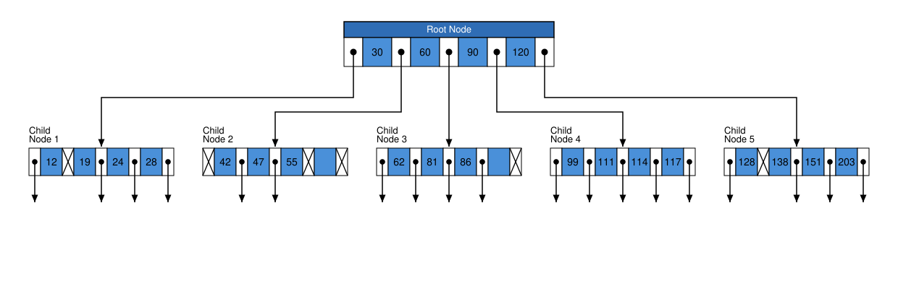
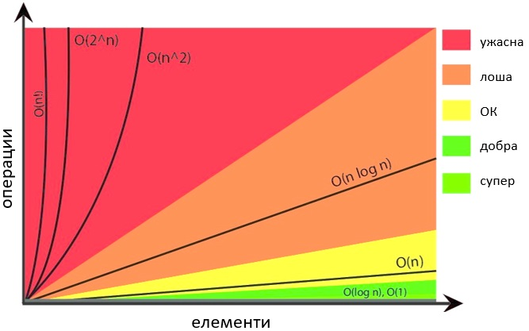

class: center, middle

# Структури от данни & алгоритми

### crash course

---

### Защо правим този crash course?

```java
Map<String, Integer> m = new HashMap<>();   // O(1)... защо?
Set<Order> s = new TreeSet<>();             // сортирано... как?
Queue<Task> q = new PriorityQueue<>();      // кой елемент изваждаме пръв... и защо?
```

<br/>

<div style="background:#eef3f7; border-left:5px solid #3b6ea5; padding:10px 16px; border-radius:6px;">
🧠 Днес поглеждаме под капака: кои структури от данни правят тези операции бързи — и кога престават да бъдат ефективни.
<br/>
Целта не е да изкараме курс по СДА за час и половина. Целта е да изградим <i>мисловен модел</i>, достатъчен, за да четем и пишем уверено код с Java collections и да отговаряме на въпроси на Junior интервю.
</div>

---

### Структури от данни - пътна карта

1. **Линейни** — масиви, свързани списъци, стекове, опашки, декове.
2. **Дървовидни** — дървета за търсене (BST, AVL, red-black, B/B+); heap (двоична пирамида).
3. **Хеш-базирани** — хеш таблици, хеширане, колизии, коефициент на запълване (load factor).
4. **Вероятностни** - Skip Lists
5. **Графови** - представяния на графи, обхождане, основни алгоритми.
6. **Java Collections** - практически реализации и връзка с изучените структури.

---

class: center, middle

# 1. Линейни структури

---

### Масив (array)

Непрекъснат блок памет; достъп по индекс чрез аритметика: `base + i * size`

| Операция | Сложност |
|:--|:--|
| достъп по индекс `a[i]` | O(1) |
| търсене по стойност | O(N) (O(log N) ако е сортиран → binary search) |
| вмъкване/триене в средата | O(N) (разместване) |
| вмъкване в края | O(1) ако има място |

<br/>

<div style="background:#eef3f7; border-left:5px solid #3b6ea5; padding:8px 16px; border-radius:6px;">
🧠 Фиксиран размер. „Динамичният масив" (<code>ArrayList</code>) преодолява това ограничение, като заделя по-голям масив и копира при препълване — amortized O(1) добавяне в края.
</div>

---

### Свързан списък (singly linked list)

- Възли, всеки пази **стойност + референция към следващия**. Не е непрекъснат в паметта.

```
[a|•]──▶[b|•]──▶[c|•]──▶ null
 head
```
<br>

| Операция | Сложност |
|:--|:--|
| достъп по индекс | O(N) (няма аритметика — тръгваш от head) |
| вмъкване/триене в началото | O(1) |
| вмъкване/триене след даден възел | O(1) |
| търсене по стойност | O(N) |

<br>

<div style="background:#fff7e6; border-left:5px solid #d08700; padding:8px 16px; border-radius:6px;">
⚠️ Няма възможност за „скок" до средата на списъка. Затова <code>LinkedList.get(i)</code> е O(N) — класически trap.
</div>

---

### Двусвързан списък (doubly linked list)

- Всеки възел пази **стойност + prev + next** → движение в двете посоки, O(1) триене на познат възел.

<br>


```
null ◀──[•|a|•]◀──▶[•|b|•]◀──▶[•|c|•]──▶ null
         head                   tail
```

<br>

- Цена: +1 референция на възел (повече памет).
- Това е **`java.util.LinkedList`**. `LinkedHashMap` и `LinkedHashSet` също поддържат ред чрез свързани записи.

<br>

🧠 Динамичен масив vs свързан списък == класическият trade-off: бързо индексиране срещу бързо вмъкване/триене в краищата.

---

### Опашка (Queue) и Стек (Stack)

.col-6[
**Стек — LIFO**
(Last In, First Out)
```
push ▶  ┌───┐
        │ c │ ◀ top (pop/peek)
        │ b │
        │ a │
        └───┘
```
]
.col-6[
**Опашка — FIFO**
(First In, First Out)
```
 enqueue ▶ [a][b][c] ▶ dequeue
           tail    head
```
]

<br/>

- И двете са O(1) за своите операции.
- В Java: стек и опашка → **`ArrayDeque`** (НЕ `Stack`/`Vector` <-- legacy).

---

### Дек (Deque — Double-Ended Queue)

- Добавяне, премахване и преглед на елементи в двата края.
- Операциите в двата края са O(1) амортизирано за добавяне и O(1) за премахване и преглед.

<br>

```
 addFirst ◀─ [a][b][c][d] ─▶ addLast
 removeFirst               removeLast
```

<br>

- Обобщава поведението на стек и опашка.
- В Java: `ArrayDeque` (кръгов масив) или `LinkedList` (двусвързан списък).

<div style="background:#eef3f7; border-left:5px solid #3b6ea5; padding:8px 16px; border-radius:6px;">
🧠 Rule of thumb: Трябва ти стек или опашка? → <code>ArrayDeque</code>. Обикновено е предпочитаният избор: ефективен, с малко допълнителни разходи и без синхронизация.
</div>

---

### Линейни структури — обобщение

| Структура | индекс | начало | край | среда/търсене | JDK |
|:--|:--|:--|:--|:--|:--|
| Масив | O(1) | O(N) | O(1)* | O(N) | `T[]` |
| ArrayList | O(1) | O(N) | O(1)* | O(N) | `ArrayList` |
| Linked list | O(N) | O(1) | O(1)** | O(N) | `LinkedList` |
| Deque | - | O(1) | O(1) | O(N) | `ArrayDeque` |

<br>

.font-sm[
\* amortized <br>
\*\* при двусвързан с указател към tail
]

---

class: center, middle

# 2. Дървовидни структури

---

### Дърво — основни понятия

```
          (root) 8
                / \
               3   10
              / \    \
             1   6    14
```

<br>

- **корен (root)**, **листа (leaves)**, **родител/дете**, **поддърво**
- **височина (height)** = най-дълъг път корен→лист
- **двоично дърво** = всеки възел има ≤ 2 деца (ляво, дясно)

<br>

<div style="background:#eef3f7; border-left:5px solid #3b6ea5; padding:8px 16px; border-radius:6px;">
🧠 Защо дървета? Защото при <b>балансирана</b> височина log N, търсенето е O(log N) — между O(1) на хеш-базираните структури и O(N) на списъка, но <b>с наредба / сортиране</b>.
</div>

---

### Двоично наредено дърво (BST)

**Инвариант:** за всеки възел — всичко **ляво < възела < дясно**.

Добавяме 8, 3, 10, 1, 6, 14:

```
 8           8            8              8
            /            / \            / \
   →       3     →      3   10   →     3   10
                                      / \    \
                                     1   6    14
```

<br>

- При добавяне, всяко число тръгва от корена и „пада" надясно/наляво, докато намери празно място.
- **Търсене:** тръгваш от корена; по-малко → ляво, по-голямо → дясно. Път ≈ височината.

---

### BST: красивата идея и грозният ѝ corner case

Добавяме **в сортиран ред** 1, 3, 6, 8, 10:

```
 1
  \
   3
    \
     6          ⚠️ изроди се в СПИСЪК
      \
       8
        \
         10
```

<br>

<div style="background:#fff7e6; border-left:5px solid #d08700; padding:8px 16px; border-radius:6px;">
⚠️ Височината стана N вместо log N → търсенето е <b>O(N)</b>. BST е бързо само когато е <b>балансирано</b>. Затова, когато ни е нужна гарантирана ефективност, използваме <i>самобалансиращи се</i> дървета.
</div>

---

### Определения за баланс

<div style="background:#eaf5f1; border-left:5px solid #2e7d6b; padding:8px 16px; border-radius:6px;">
📖 <b>Балансирано дърво:</b> за всеки възел, разликата във <i>височините</i> на двете му поддървета е ≤ константа (при строго балансирано: ≤ 1). Височината му е log N.
</div>

<br>

<div style="background:#eaf5f1; border-left:5px solid #2e7d6b; padding:8px 16px; border-radius:6px; margin-top:8px;">
📖 <b>Идеално (перфектно) балансирано:</b> за всеки възел, разликата в <i>броя възли</i> в двете му поддървета е ≤ 1. Всички листа са на едно и също или съседни нива.
</div>

<br/>

- **AVL** — строго балансирано (разлика във височините ≤ 1).
- **Red-black** — по-слабо балансирано (височината ≤ 2·log N), но по-евтино поддържане.

---

### AVL дърво — идея

- Изобретено от двама математици и пионери на КН, Аделсон-Велский и Ландис, през 1962
- BST + **balance factor** на всеки възел = `height(left) − height(right)` ∈ {−1, 0, +1}.
- След всяко вмъкване/триене, ако факторът стане ±2 → **ротация**, която връща баланса.
- Гаранция: височина ≤ ~1.44·log N → всички операции **O(log N)** в най-лошия случай.

<br>

<div style="background:#eef3f7; border-left:5px solid #3b6ea5; padding:8px 16px; border-radius:6px;">
🧠 Ротацията е локално пренареждане на 2–3 възела, което <b>запазва BST инварианта</b>, но намалява височината. <br>
„~1.44·log N" значи, че в най-лошия случай AVL е най-много ~44% по-високо от идеално балансирано дърво. За любопитните: константата идва от числата на Фибоначи / Златното сечение.
</div>

---

### Четирите ротации — кога коя

Дисбалансът има 4 форми, според КЪДЕ се появява „тежкото" поддърво:

<br>

| Случай | Дисбаланс | Поправка |
|:--|:--|:--|
| **LL** | ляво-ляво | 1× дясна ротация |
| **RR** | дясно-дясно | 1× лява ротация |
| **LR** | ляво-дясно | лява (на детето) + дясна |
| **RL** | дясно-ляво | дясна (на детето) + лява |

<br>

Правило: LL/RR = единична ротация; LR/RL = двойна (първо изправяме „чупката", после ротираме).

---

### LL — единична дясна ротация

Вмъкваме 3, 2, 1 (ляво-ляво тежко):

```
    3  (bf=+2)              2
   /                       / \
  2            →          1   3
 /
1
```

- `2` става корен; `3` слиза надясно.
- BST наредбата е запазена: 1 < 2 < 3. Височината падна от 3 на 2.

---

### RR — единична лява ротация

Вмъкваме 1, 2, 3 (дясно-дясно тежко — огледало на LL):

```
 1 (bf=−2)                  2
  \                        / \
   2          →           1   3
    \
     3
```

- Симетрично на LL. `2` става корен.

---

### LR — двойна ротация (лява, после дясна)

Вмъкваме 3, 1, 2 (ляво-дясно):

```
    3            3              2
   /            /              / \
  1     →      2     →        1   3
   \          /
    2        1
```

- Стъпка 1: **лява** ротация на детето (1) → изправяме в LL форма.
- Стъпка 2: **дясна** ротация на корена (3) → балансирано.

---

### RL — двойна ротация (дясна, после лява)

Вмъкваме 1, 3, 2 (дясно-ляво — огледало на LR):

```
 1            1                2
  \            \              / \
   3    →       2    →       1   3
  /              \
 2                3
```

- Стъпка 1: **дясна** ротация на детето (3).
- Стъпка 2: **лява** ротация на корена (1).

---

### Red-black tree

- Изобретено от Leonard Guibas и Robert Sedgewick през 1978
- BST, в който всеки възел е **червен** или **черен**, при 5 правила (накратко):
  - коренът е черен; листата (null) са черни;
  - червен възел няма червени деца;
  - всеки път корен→лист има **еднакъв брой черни** възли.
- Следствие: най-дългият път ≤ 2× най-късия → височина O(log N).

<div style="background:#eef3f7; border-left:5px solid #3b6ea5; padding:8px 16px; border-radius:6px;">
🧠 По-слабо балансирано от AVL → по-малко ротации при вмъкване → по-бързи модифициращи операции. Затова се използва масово.
<br/>
Това е дървото зад <b><code>TreeMap</code></b> и <b><code>TreeSet</code></b> в Java.
</div>

---

### AVL vs Red-black — кога кое

| | AVL | Red-black |
|:--|:--|:--|
| Баланс | строг (≤1) | loose (≤2×) |
| Търсене | малко по-бързо | малко по-бавно |
| Вмъкване/триене | повече ротации | по-малко ротации |
| Употреба | много четене | смесено |

<br>

💼 Интервю: „кое дърво стои зад `TreeMap`?" → red-black. „Защо не AVL?" → по-малко ротации.

---

### B-дърво — какво е?

- Изобретено от Rudolf Bayer и Ed McCreight (Boeing Labs), 1970–72.
- **Балансирано наредено n-арно дърво:** всеки възел съдържа множество **сортирани ключове** и може да има много деца - десетки или дори стотици.
- Ключовете разделят стойностите на интервали и насочват търсенето към правилното дете.
- Всички листа са на едно и също ниво

---

### B-дърво



<div style="background:#eef3f7; border-left:5px solid #3b6ea5; padding:8px 16px; border-radius:6px;">
  📖 <b>Структура на възела:</b> Всеки възел от ред <code>m</code> съдържа до <code>m-1</code> ключа и указатели до <code>m</code> деца. Ключовете в един възел са сортирани и разделят поддърветата.
</div>

---

### B-дърво и B+ дърво

B+ дървото е вариант на B-дървото с различно разположение на данните:

.font-sm[

| | B-дърво | B+ дърво |
|:--|:--|:--|
| **Данни** | във всички възли | само в листата |
| **Вътрешни възли** | ключове + данни | само разделителни ключове |
| **Листа** | не са свързани | свързани в списък |

]

<br/>

<div style="background:#eef3f7; border-left:5px solid #3b6ea5; padding:8px 16px; border-radius:6px;">
  🧠 Ключовата разлика: в B+ дърво <b>листата са свързани в списък</b>, а всички данни са долу. Това има голямо практическо значение — ще видим защо на следващия слайд.
</div>

---

### Защо B-дървета и B+ дървета се използват в бази данни?

- При големи обеми данни не всичко се побира в **RAM** → част стои на диск/SSD.
- Четенето от диск/SSD е на **блокове (страници)**, не на отделни ключове.
- Затова възлите побират много ключове → **голям брой деца, малка височина** → по-малко достъпи до диска при търсене.

📖 **В реални бази данни:**
.font-sm[
- В реалните бази данни B-tree индексите използват варианти на балансирани многоразклонени дървета. **InnoDB** използва B+ tree-подобна структура, а **PostgreSQL** има собствена B-tree реализация. Общата идея е минимизиране на дисковите достъпи чрез висока разклоненост и ефективно търсене.
]

<br>

<div style="background:#eef3f7; border-left:5px solid #3b6ea5; padding:8px 16px; border-radius:6px;">
  🧠 <b>Точкова</b> заявка (<code>WHERE id = ?</code>) → слизаш до един лист. <b>Интервална (Range)</b> заявка (<code>WHERE age BETWEEN 18 AND 30</code>) → намираш началото и вървиш по <b>свързаните листа</b>. Затова индексите са B+, не B.
</div>

---

### Heap (пирамида)

<div style="background:#eaf5f1; border-left:5px solid #2e7d6b; padding:8px 16px; border-radius:6px;">
📖 <b>Heap:</b> пълно двоично дърво с инвариант за реда: при <b>min-heap</b> всеки родител ≤ децата си (на върха е най-малкото); при <b>max-heap</b> — обратно.
</div>

<br>

```
     min-heap            max-heap
        1                   9
       / \                 / \
      3   2               7   8
     / \                 / \
    7   5               3   5
```

- **НЕ е сортирано** — само коренът е гарантирано екстремумът.
- Операции: `peek` O(1); `insert` и `extract-min/max` O(log N) (sift up / sift down).

---

### Heap в масив — без указатели

Пълното дърво се пакетира компактно в масив по нива:

```
 index:  0   1   2   3   4
 value:  1   3   2   7   5
```

<br>

<div style="background:#eef3f7; border-left:5px solid #3b6ea5; padding:8px 16px; border-radius:6px;">
🧠 Формули (0-базиран индекс): за възел <code>i</code> →
<br/>• ляво дете = <code>2i + 1</code> &nbsp;•&nbsp; дясно дете = <code>2i + 2</code> &nbsp;•&nbsp; родител = <code>(i − 1) / 2</code>
<br/>
Никакви референции — цялата структура е аритметика върху индекси.
</div>

---

### Къде се ползва heap

- **Приоритетна опашка** — винаги вадиш най-приоритетното първо → `java.util.PriorityQueue`.
- **Heapsort** — build-heap, после N пъти extract-max → сортиран масив. O(N log N), in-place.

```java
Queue<Integer> pq = new PriorityQueue<>(List.of(5, 1, 4, 2, 3));
while (!pq.isEmpty()) System.out.print(pq.poll() + " ");   // 1 2 3 4 5
```

<br>

<div style="background:#eef3f7; border-left:5px solid #3b6ea5; padding:8px 16px; border-radius:6px; font-size:0.8em;">
  💼 <b>Интервю задачка:</b> „намери k-тия най-голям елемент" → ефективно се решава с <b>min-heap с размер k</b>:
  <br/>
  1. Запълваш heap-а с първите <code>k</code> елемента.
  <br/>
  2. За всеки следващ: ако е по-голям от корена (най-малкия в heap-а) → заместваш корена и го оставяш „да потъне".
  <br/>
  3. Накрая в корена стои <b>k-тият най-голям</b> елемент.
  <br/>
  Сложност: <b>O(N log k)</b> — по-добре от сортиране O(N log N), когато k ≪ N.
</div>

---

class: center, middle

# Обхождане (traversal)

---

### BFS и DFS

.col-6[
**BFS — ширина**
ниво по ниво; опашка (FIFO)
```
    1
   / \
  2   3      → 1 2 3 4 5
 / \
4   5
```
]
.col-6[
**DFS — дълбочина**
колкото може надолу; стек / рекурсия
```
    1
   / \
  2   3      → 1 2 4 5 3
 / \
4   5
```
]


| | структура | употреба |
|:--|:--|:--|
| **BFS** | опашка | най-къс път (без тегла), нива на достижимост, свързани компоненти |
| **DFS** | стек/рекурсия | откриване на свързани компоненти и цикли, топологично сортиране |

---

class: center, middle

# 3. Хеш-базирани структури

---

### Аналогия: шкаф с номерирани чекмеджета

- Имаш 1000 документа и 16 чекмеджета. Как намираш документ за секунди, без да преглеждаш всичко?
- **Правило (хешираща функция):** „сборът на буквите в името на автора по модул 16" → номер на чекмедже.
- Слагаш документа в това чекмедже. Търсиш? Прилагаш същото правило → отиваш да търсиш директно в това чекмедже.

<br>

<div style="background:#eef3f7; border-left:5px solid #3b6ea5; padding:8px 16px; border-radius:6px;">
🧠 Не търсиш — <b>изчисляваш</b> къде е. <br/>Това е цялата идея на хеша: превръщаш „търсене" в „аритметика" → O(1).
</div>

<br>

📖 **История:** Идеята за хеширане (key addressing) възниква в началото на 50-те години в IBM (Hans Peter Luhn). Първоначално използва chaining за разрешаване на колизиите. Open addressing с linear probing се появява малко по-късно през десетилетието.

---

### Как Java хешира низовете?

Java използва **полиномиално хеширане** с основа 31.

<div style="background:#eaf5f1; border-left:5px solid #2e7d6b; padding:8px 16px; border-radius:6px;">
  📖 <b>Обща формула:</b> <code>h(s) = s₀·31ⁿ⁻¹ + s₁·31ⁿ⁻² + … + sₙ₋₁</code>
  <br/>
  <code>sᵢ</code> = числовата стойност на символа (Unicode UTF-16 code unit) &nbsp;·&nbsp; <code>n</code> = дължината на низа.
</div>

<br/>

**Пример:** `"java"` → `j=106, a=97, v=118, a=97`

<div style="background:#eef3f7; border-left:5px solid #3b6ea5; padding:8px 16px; border-radius:6px;">
  <code>h = 106·31³ + 97·31² + 118·31 + 97 = <b>3 254 818</b></code>
</div>

---

### Как се изчислява хеш кодът?

**Схема на Хорнер** — същото, но без степенуване: последователно умножаваме по 31 и добавяме следващия символ.

```java
int h = 0;
for (char c : s.toCharArray()) {
   h = 31 * h + c;      // точно принципът в String.hashCode()
}
```

<br>

<div style="background:#fff7e6; border-left:5px solid #d08700; padding:8px 16px; border-radius:6px;">
  ⚠️ <b>Защо точно 31?</b> Малко, просто, нечетно → добро разпределение за типични низове. Евтино за CPU: <code>31·h = 32·h − h = (h &lt;&lt; 5) − h</code>.
</div>

---

### Хеширане

```
  key ──▶ hashCode() (голямо число) ──▶ % capacity ──▶ индекс на bucket
 "java"    3254818                          % 16              2
```

.font-sm[Опростена схема — реалната реализация обработва хеш стойността допълнително.]

<br>

<div style="background:#eaf5f1; border-left:5px solid #2e7d6b; padding:8px 16px; border-radius:6px;">
📖 <b>Хешираща функция:</b> изображение от ключ към индекс. Добрата функция разпределя <b>равномерно</b> и е <b>бърза</b>. Еднакви ключове → еднакъв хеш (детерминизъм). Обратното НЕ важи.
</div>

---

### Колизии — неизбежни

<div style="background:#eaf5f1; border-left:5px solid #2e7d6b; padding:8px 16px; border-radius:6px;">
📖 <b>Колизия:</b> два различни ключа попадат в един и същ bucket. При краен брой buckets и неограничен брой различни ключове — <b>неизбежно</b> (принцип на чекмеджетата / Дирихле).
</div>

<br>

Два класически подхода за справяне:

- **Separate chaining (затворено адресиране):** всеки bucket пази **списък** (или дърво) от елементи.
- **Open addressing (отворено адресиране):** при зает bucket, търсиш друг свободен по правило (probing).

---

### Справяне с колизии: separate chaining

```
 [0] → null
 [1] → ("java",1) → ("x",9)        ← верига при колизия
 [2] → ("ann",7)
 [3] → null
```

<br>

  - Търсене в bucket: обхождаш веригата и сравняваш с `equals`. Къса верига → почти O(1).
  - Java `HashMap` използва separate chaining. При верига ≥8 и капацитет ≥64, bucket-ът се преобразува в **червено-черно дърво** (Java 8+)
  - Дървото подрежда елементите първо по хеш код, а при равни хеш кодове — по `compareTo()` (ако ключът е `Comparable`), иначе по вътрешен резервен механизъм.
  - Подобрява поведението при много колизии, но не отменя нуждата от добри `hashCode()` и `equals()`.

.font-sm[🔗 Точно този механизъм разиграхме с визуализатора в Лекция 04 (и историята с HashDoS атаката).]

---

### Справяне с колизии: open addressing

Всичко живее в самия масив; при зает bucket пробваш следващ по правило:

- **Linear probing:** `f(x), f(x)+1, f(x)+2, ...` → прости, но „струпвания" (clustering).
- **Quadratic probing:** `f(x), f(x)+1², f(x)+2², ...` → по-малко струпване.
- **Double hashing:** стъпката се дава от втора хешираща функция → намалява струпванията.

<div style="background:#fff7e6; border-left:5px solid #d08700; padding:8px 16px; border-radius:6px;">
⚠️ Open addressing е чувствителен към запълването: при високо запълване търсенето на свободна позиция става значително по-бавно. Изтриването също е по-сложно — често се използват специални маркери (<i>tombstones</i>).
</div>

<br>

Ако искаш да задълбаеш в най-новите подходи за open addressing, виж също [Robin Hood hashing](https://www.studyplan.dev/dsa/robin-hood-hashing) и [Swiss Tables](https://www.studyplan.dev/dsa/swiss-table-layout).

---

### Размер, load factor, рехеширане

<div style="background:#eaf5f1; border-left:5px solid #2e7d6b; padding:8px 16px; border-radius:6px;">
📖 <b>Load factor (коефициент на запълване):</b> <code>size / capacity</code>. Показва колко е запълнена таблицата спрямо капацитета ѝ.
</div>

<br>

- Java `HashMap`: default capacity **16**, load factor **0.75**.
- При достигане на threshold` = `capacity × load factor таблицата се увеличава при следващо добавяне и всички ключове се **преразпределят** по новото capacity.
- Рехеширането е O(N) наведнъж, но рядко → amortized O(1) добавяне се запазва.

.font-sm[🧠 Компромис: нисък load factor → по-малко колизии, но повече заета памет. Висок load factor → по-малко празно пространство, но повече колизии.]

---

### Хеш таблица — сложност

| Операция | Среден случай | Най-лош случай |
|:--|:--|:--|
| `put` / `get` / `contains` | O(1) | O(N), с подобрение чрез treeify |
| обхождане на всички | O(N + capacity) | |

<br>

<div style="background:#eef3f7; border-left:5px solid #3b6ea5; padding:8px 16px; border-radius:6px;">
🧠 O(1) е очакваната сложност при добро разпределение на хешовете и разумен load factor. При много колизии операциите могат да деградират до O(N).
</div>

---

class: center, middle

# 4. Вероятностни структури

---

### Skip list — идея

Изобретена от William Pugh (1989) като вероятностна алтернатива на балансираните дървета.

Сортиран свързан списък + „експресни линии" отгоре, които "прескачат/fast-forward-ват" напред в списъка:

```
 L2:  1 ────────────────▶ 9
 L1:  1 ──────▶ 5 ──────▶ 9
 L0:  1  ▶  3 ▶ 5  ▶  7 ▶ 9      ← всички елементи, сортирани
```

- Търсиш отгоре надолу: по високото ниво прескачаш надалеч, слизаш едно ниво надолу когато „прехвърлиш" търсения елемент.
- Височината на нов възел се избира на случаен принцип → очаквана максимална височина log N.

<br>

<div style="background:#eef3f7; border-left:5px solid #3b6ea5; padding:8px 16px; border-radius:6px;">
🧠 Очаквана сложност O(log N) търсене/вмъкване/триене, в най-лошия случай: O(N). За разлика от балансирано дърво, <b>без ротации</b>, само с указатели и coin flip. По-лесно за concurrent имплементации.
</div>

---

### Skip list — операции и употреба

| Операция | Сложност (очаквана) |
|:--|:--|
| search | O(log N) |
| insert / delete | O(log N) |
| обхождане по ред | O(N) |

<br>

- В Java: **`ConcurrentSkipListMap`** и **`ConcurrentSkipListSet`** — сортирани и поддържат concurrent достъп без глобално заключване.

<br>

💼 Интервю въпрос: „сортиран, concurrent map без глобален lock?" → skip list (`ConcurrentSkipListMap`).

---

class: center, middle

# 5. Графови структури

---

### Граф — какво е

- *Върхове (vertices)* и *ребра (edges)*, които свързват върховете. Графът може да бъде ориентиран или неориентиран, с тегла или без тегла.
- Дървото е специален вид граф — свързан граф без цикли.

<br>

```
   A───B
   │ ╲ │
   C───D
```

<br>

- Приложения: социални мрежи, карти, зависимости, компютърни мрежи.

---

### Представяния на граф

| Представяне | Памет | „Има ли ребро между u и v?" | „Кои са съседите на u?" |
|:--|:--|:--|:--|
| **Матрица на съседство** | O(V²) | O(1) | O(V) |
| **Списък на съседство** | O(V + E) | O(степен на u) | O(степен на u) |
| **Списък на ребрата** | O(E) | O(E) | O(E) |

<br>

<div style="background:#eef3f7; border-left:5px solid #3b6ea5; padding:8px 16px; border-radius:6px;">
🧠 Кога кое:<br><b>Mатрица на съседство</b> - при гъсти графи и честа проверка за наличие на ребро. <br><b>Списък на съседство</b> - при разредени графи и когато често обхождаме съседите на даден връх.<br><b>Списък на ребрата</b> – когато работим основно със самите ребра (например при сортиране по тегло или алгоритми като Kruskal).
</div>

---

### Класически алгоритми върху графи (само като идея)

- **Най-кратък път**: BFS (при нетегловни графи), Dijkstra (при неотрицателни тегла), Bellman–Ford, Floyd–Warshall.
- **Минимално покриващо дърво (MST)**: намираме подмножество от ребрата, което свързва всички върхове в едно дърво и с минимална сума от теглата. Приложение: Свързване на градове с оптични кабели, електропреносна мрежа или пътища с минимална цена. Prim, Kruskal.
- **Задачата за търговския пътник (TSP)**: намираме маршрут с минимална обща цена, който посещава всеки връх точно веднъж и се връща в началния.

<div style="background:#fff7e6; border-left:5px solid #d08700; padding:8px 16px; border-radius:6px;">
⚠️ <b>Сложност:</b> За задачите за най-кратък път и минимално покриващо дърво съществуват ефективни (полиномиални) алгоритми. За TSP не е известен ефективен (полиномиален) алгоритъм.
</div>

---

class: center, middle

# 6. Java Collections

---

### Коя структура стои зад коя колекция

| JDK клас | Структура от данни | Сложност | Наредба |
|:--|:--|:--|:--|
| `ArrayList` | динамичен масив | get O(1), add* O(1) | вмъкване |
| `LinkedList` | двусвързан списък | ends O(1), get O(N) | вмъкване |
| `ArrayDeque` | кръгов масив | ends O(1) | — |
| `PriorityQueue` | binary heap | peek O(1), poll O(log N) | по приоритет |
| `HashMap`/`HashSet` | хеш таблица (+ дърво при колизии) | O(1) | няма |
| `LinkedHashMap`/`Set` | хеш таблица + свързан списък | O(1) | вмъкване |
| `TreeMap`/`TreeSet` | red-black дърво | O(log N) | сортирано |
| `ConcurrentSkipListMap`/`Set` | skip list | O(log N) | сортирано, конкурентно |

.font-sm[\* amortized. Това е слайдът "за снимка". 💼 Всеки ред е потенциален интервю въпрос.]

---

### Мисловният модел

<div style="background:#eef3f7; border-left:5px solid #3b6ea5; padding:10px 16px; border-radius:6px;">
🧠 Има няколко често използвани подхода за съхранение и търсене в колекции:
<br/><br/>
• <b>Масив / ArrayList</b> → поддържа ред и достъп по индекс, но търсенето е O(N)<br/>
• <b>Свързан списък</b> → поддържа ред; ефективни операции при известен възел или в краищата.<br/>
• <b>Хеш</b> → осигурява достъп за O(1), но без определен ред<br/>
• <b>Балансирано дърво</b> → осигурява операции за O(log N) и поддържа сортиран ред
<br/><br/>
Избираш колекция == избираш кои компромиси си готов да приемеш. Този принцип важи за всеки език.
</div>

---

class: center, middle

# За финал...

---

### Границите на изчислимото

[.center[]](https://www.bigocheatsheet.com/)

.font-sm[

Дотук разглеждахме как избираме ефективни структури и алгоритми. <br>
Има обаче задачи, за които дори най-добрата структура не може да ни осигури бързо точно решение.

]

---

### Границите на изчислимото

Класове на изчислителна сложност: P, NP, NP-complete, NP-hard

- **P** — задачи, които могат да бъдат решени за полиномиално време.
- **NP** — задачи, за които верността на решение може да бъде проверена за полиномиално време.
- **NP-complete** — най-трудните задачи в NP. Ако намерим полиномиален алгоритъм за една от тях, ще можем да решаваме полиномиално всички задачи в NP. Пример — TSP (вариант с отговор „да“ или „не“): *Съществува ли маршрут, който посещава всеки град точно веднъж и има обща дължина ≤ K?*
- **NP-hard** — задачи, поне толкова трудни, колкото NP-complete задачите. Не е задължително да принадлежат към NP. Пример — TSP (оптимизационен вариант): *Намери маршрута с минимална обща дължина, който посещава всеки град точно веднъж.*

---

### Границите на изчислимото

Класове на изчислителна сложност: P, NP, NP-complete, NP-hard

<br>

🧠 **„P = NP?“** е една от седемте задачи, известни като *Millennium Prize Problems*. Clay Mathematics Institute предлага награда от 1 милион щатски долара за решението на всяка от тях.

<br>

💼 **За интервю:** TSP е NP-hard в оптимизационната си версия. За големи входове често използваме евристики или приближени алгоритми, вместо да търсим точно оптимално решение.

---

## Въпроси?

.font-xl[.ri-github-fill.icon-inline[[fmi/java-course](https://github.com/fmi/java-course)]]

.font-xl[.ri-youtube-fill.icon-inline[[MJT2027](https://www.youtube.com/playlist?list=PLO1UIjXfc0-k)]]
